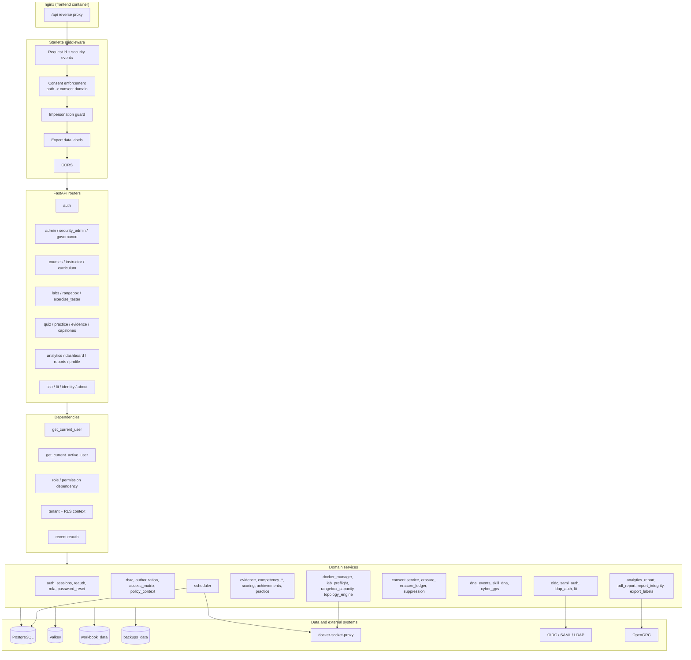

# Backend technical architecture

## Layering rules

| Layer | May depend on | Must not |
|---|---|---|
| Router | schemas, dependencies, services | contain domain rules or raw SQL |
| Dependency | auth, permissions, tenant | make business decisions |
| Service | models, other services, data files | depend on HTTP request objects |
| Model | SQLAlchemy only | call services or routers |
| Data file | nothing | be edited at runtime |

## Cross-cutting order

1. **Authentication** — decode the JWT, check `sec`, bind the session, load the
   user.
2. **Authorization** — role and permission dependencies, tenant scope, policy
   attributes.
3. **Consent** — middleware block for gated paths before the service runs.
4. **Validation** — Pydantic schemas and input-safety normalisation.
5. **Domain** — service method, transaction, ledger trigger.
6. **Serialisation** — response schema and export labels.

## Related

- [Backend overview](subsystem-overview.md)
- [Feature index](features/README.md)
- [Database](../database/subsystem-overview.md)
- [Cache](../cache/subsystem-overview.md)
- [Docker control](../docker-proxy/subsystem-overview.md)
