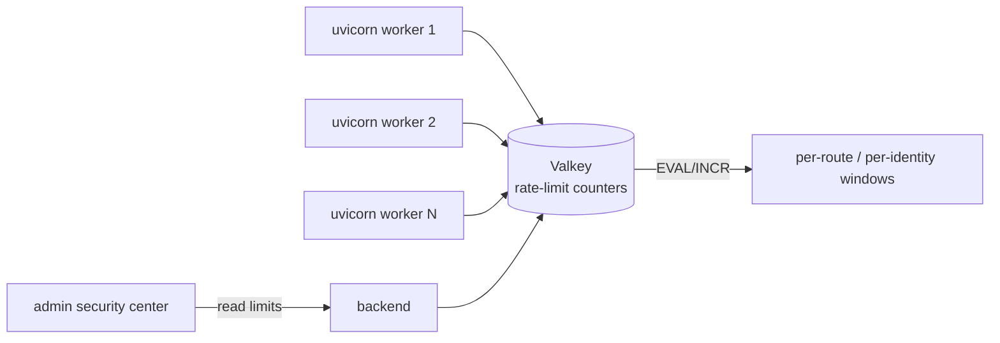

# Cache subsystem (Valkey)

## Purpose

Valkey is the shared store for slowapi rate-limit counters. It is not a cache of
learner records, not a session store, and not a queue. Its only job is to make
rate limits consistent across backend workers.

## Service

| Item | Value |
|---|---|
| Container | `ocr-valkey` |
| Compose service | `redis` (RESP-compatible name) |
| Image | `valkey/valkey:9.1.3-alpine` |
| Port | 6379, internal only |
| Persistence | none: `--save "" --appendonly no` |
| Auth | `VALKEY_PASSWORD` in production |
| Client URI | `redis://redis:6379/0` |

The `redis://` URI is unchanged because Valkey is RESP-compatible with the
Redis client. The service name remains `redis` for compatibility with existing
configuration.

## Configuration

```text
RATELIMIT_STORAGE_URI=redis://redis:6379/0
```

Development may use `memory://` for a single worker. Do not use `memory://` with
multiple workers; each process would enforce its own limit and the effective
limit would multiply.

## Failure behaviour

- A Valkey outage degrades rate limiting to in-process counters; it does not
  take authentication down.
- A restart resets the current windows. That is acceptable for counters.
- Rate-limit counters are ephemeral by design. Do not add persistence for them.

## Diagram



## Run and check

```bash
cd platform
docker compose --env-file .env -f docker-compose.dev.yml up -d redis
docker exec -it ocr-valkey valkey-cli ping
```

With auth:

```bash
docker exec -it ocr-valkey valkey-cli --no-auth-warning -a "$VALKEY_PASSWORD" ping
```

## Tests

```bash
cd platform/backend
python -m pytest tests/test_ratelimit.py tests/test_login_throttle.py \
  tests/test_event_burst.py -q
```

## Rules

- Never store learner data, tokens, or evidence in Valkey.
- Never expose 6379.
- Keep it internal and password-protected in production.
- Use a separate logical database if another client is added.
- Document any new key family and its TTL.

## Related

- [Rate limiting in the backend](../backend/features/login/README.md)
- [Deployment network](../deployment/network-and-ports.md)
- [Compose profiles](../deployment/compose-profiles.md)
