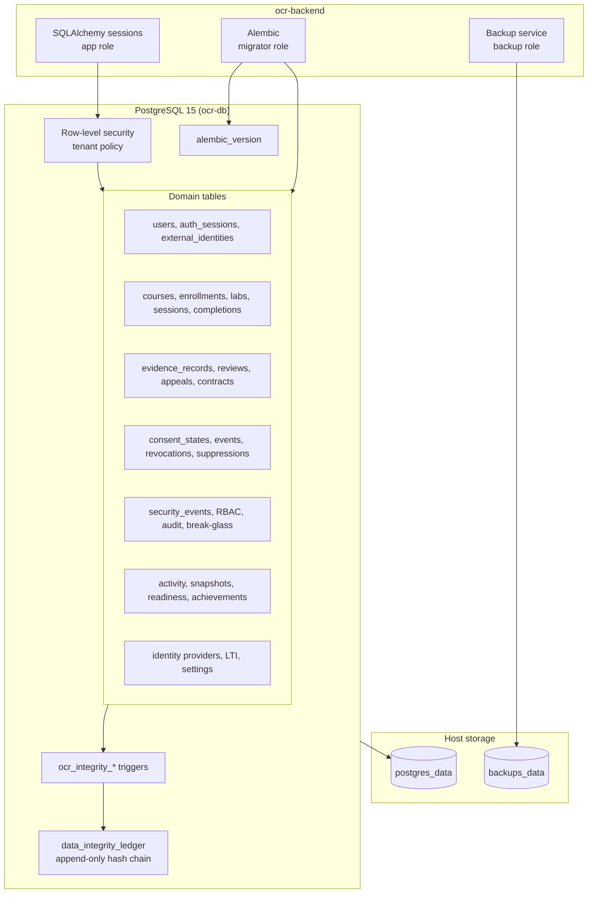

# Database technical architecture

## Request-to-row path

1. `get_current_user` sets the tenant context from the session.
2. SQLAlchemy opens a transaction with the application role.
3. PostgreSQL applies RLS for the tenant on protected tables.
4. The write fires an integrity trigger for instrumented tables.
5. The trigger writes a ledger entry with the previous hash and the entry hash.
6. Commit.

## Why the ledger exists

The ledger is tamper-evident evidence that a critical row changed. It records
the table, primary key, operation, row hash, actor, request id, and a hash chain.
`database_integrity.py --ledger` verifies the chain and reports unattributed
writes.

## Related

- [Schema and ownership](schema-and-ownership.md)
- [Migrations](migrations.md)
- [Backup and restore](backup-and-restore.md)
- [Database integrity](../../docs/DATABASE-INTEGRITY.md)
