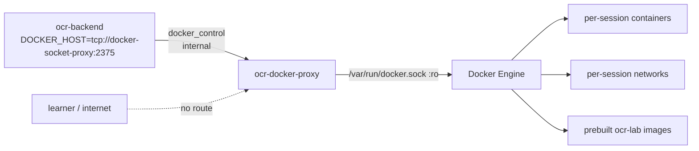

# Docker control subsystem

## Purpose

Let the backend create and remove lab containers and networks without giving it
unrestricted access to the host Docker socket.

## Service

| Item | Value |
|---|---|
| Container | `ocr-docker-proxy` |
| Image | `tecnativa/docker-socket-proxy:0.3.0` |
| Socket | `/var/run/docker.sock`, read-only mount |
| Network | `docker_control`, `internal: true` |
| Port | 2375, internal only |
| Auth | none; network isolation is the control |

## Allowed API groups

| Flag | Value | Why |
|---|---|---|
| `CONTAINERS` | 1 | create, start, stop, remove lab containers |
| `IMAGES` | 1 | inspect and use prebuilt images |
| `NETWORKS` | 1 | create and remove per-session networks |
| `VOLUMES` | 1 | inspect and clean lab volumes |
| `INFO` | 1 | host and engine info |
| `SYSTEM` | 1 | disk usage for admin |
| `POST` | 1 | container/network operations |
| `EXEC` | configurable | exercise tester and network setup |
| `BUILD` | 0 | no build recipes from the backend |

`EXEC` is off by default. Production sets `OCR_DOCKER_PROXY_EXEC=1` when the
exercise tester and lab network setup need it. `BUILD` stays off; a compromised
backend must not be able to submit a build recipe.

## Diagram



## Why not mount the socket directly

Mounting `/var/run/docker.sock` into the backend gives it root-equivalent
control of the host. The proxy narrows the API to the operations the platform
needs and keeps the control network off learner-reachable paths.

## Rules

- `docker_control` stays internal.
- Never publish 2375.
- Keep `BUILD=0`.
- Enable `EXEC` only when a feature actually needs it.
- Treat a backend compromise as a host compromise if `EXEC` is on; keep the
  backend patched and least-privileged.
- Do not add a second service to `docker_control` without a review.

## Tests

```bash
cd platform/backend
python -m pytest tests/test_compose_security.py tests/test_rangebox_images.py \
  tests/test_rangebox_transport.py tests/test_lab_network_cleanup.py -q
```

## Related

- [Lab runtime](../lab-runtime/subsystem-overview.md)
- [Deployment network](../deployment/network-and-ports.md)
- [Host-script security](../../docs/HOST-SCRIPT-SECURITY.md)
