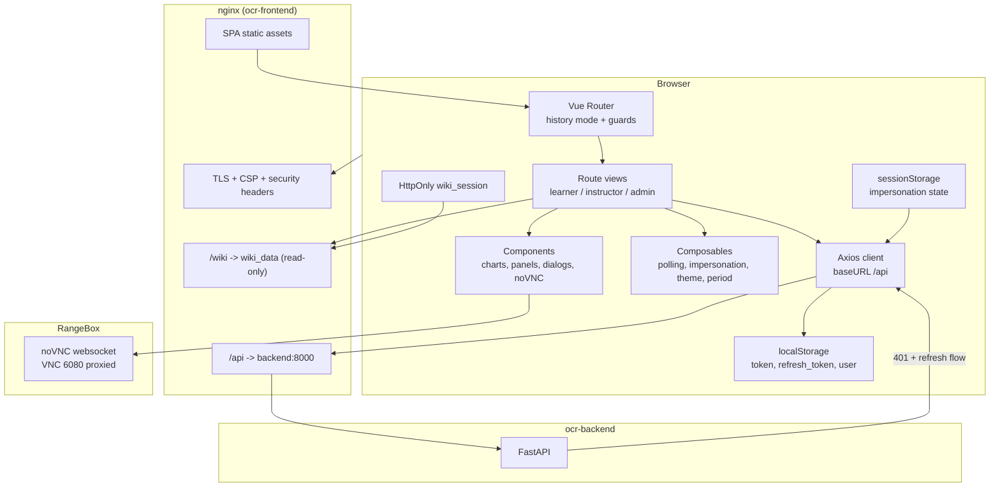

# Frontend technical architecture

## Data flow

1. A route renders a view. The view calls `src/api/axios.js`.
2. The request interceptor reads `token` from `localStorage` and adds
   `Authorization: Bearer`.
3. nginx proxies `/api` to FastAPI.
4. A `401` triggers one refresh attempt using `refresh_token`. A failed refresh
   clears the session and redirects to `/login`.
5. A `403` with `X-Reauth-Required` opens the reauth dialog instead of logging
   the user out.
6. Impersonation stores the original session in `sessionStorage` and restores it
   on exit.

## State ownership

| State | Owner | Store |
|---|---|---|
| Auth token | backend | browser `localStorage` |
| Refresh token | backend | browser `localStorage` |
| Current user | backend | `localStorage` cache + `/api/auth/me` |
| Route guard state | frontend | router |
| Impersonation | backend + frontend | `sessionStorage` |
| Wiki access | backend | HttpOnly cookie |
| UI theme / career goal | frontend | `localStorage` |
| Charts and filters | frontend | component state / URL query |

## Rendering and safety

- Markdown from the API is rendered with `marked` and sanitised with
  `DOMPurify`.
- The CSP is defined in nginx; inline scripts require the hash process.
- The workbook may be served from a separate origin with its own cookie scope.
- The RangeBox uses noVNC over a proxied websocket; do not expose VNC directly.

## Related

- [Frontend overview](subsystem-overview.md)
- [Backend](../backend/subsystem-overview.md)
- [Deployment network](../deployment/network-and-ports.md)
- [Accessibility](../../docs/ACCESSIBILITY.md)
