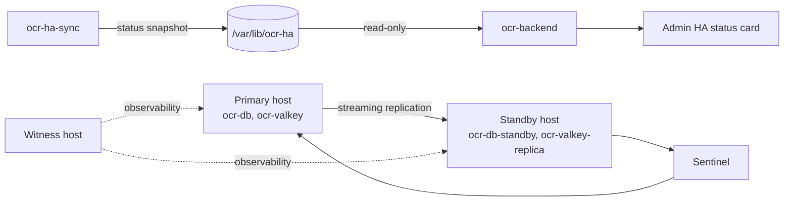

# High availability (optional)

HA is an optional control plane for monitoring and standby readiness. It is not
an active-active cluster, not Kubernetes, and not a supported split-database
topology in Release 5. The supported production shape remains one Linux host
with Docker Compose.

## Components

| Component | Container | Role |
|---|---|---|
| Sync agent | `ocr-ha-sync` | publishes a read-only status snapshot to `/var/lib/ocr-ha` |
| Database standby | `ocr-db-standby` | streaming replica of PostgreSQL |
| Valkey replica | `ocr-valkey-replica` | replica for rate-limit counters |
| Sentinel | `ocr-redis-sentinel` | observes the primary/replica pair |
| Witness | external host | quorum/observability, not a promotion authority |

The backend only **reads** the host snapshot. It never promotes a database,
fails over, or writes witness state.

## Diagram



## What the backend shows

- Primary and standby reachability.
- Replication lag.
- Last snapshot timestamp.
- Sentinel view.
- A clear "unknown" state when the snapshot is absent.

It does not show a failover button. Promotion is an operator procedure with an
approved production window.

## Current limitations

- The witness/collector install on the Unraid host and the two HA hosts is
  blocked by SSH key access.
- Live failover and partition drills have not run.
- The separate `opencyberrange-ha` runtime workflow is failing for billing
  reasons, not code.
- Do not claim HA is proven until the drills and evidence exist.

## Run and verify

The HA stack is separate from the platform Compose file. Follow
[V3 HA lab pool](../../docs/V3-HA-LAB-POOL.md) and
[HA and Kubernetes](../../docs/HA-AND-KUBERNETES.md). The platform-side checks:

```bash
cd platform/backend
python -m pytest tests/test_ha_status.py tests/test_ha_status_api.py -q
```

## Rules

- Read-only from the application.
- No automatic promotion.
- No learner data in the replication status snapshot.
- A drill requires an approved production window.
- Record the result; an unproven HA claim is a documentation defect.

## Related

- [HA and Kubernetes](../../docs/HA-AND-KUBERNETES.md)
- [V3 HA lab pool](../../docs/V3-HA-LAB-POOL.md)
- [Database subsystem](../database/subsystem-overview.md)
- [Deployment](../deployment/subsystem-overview.md)
