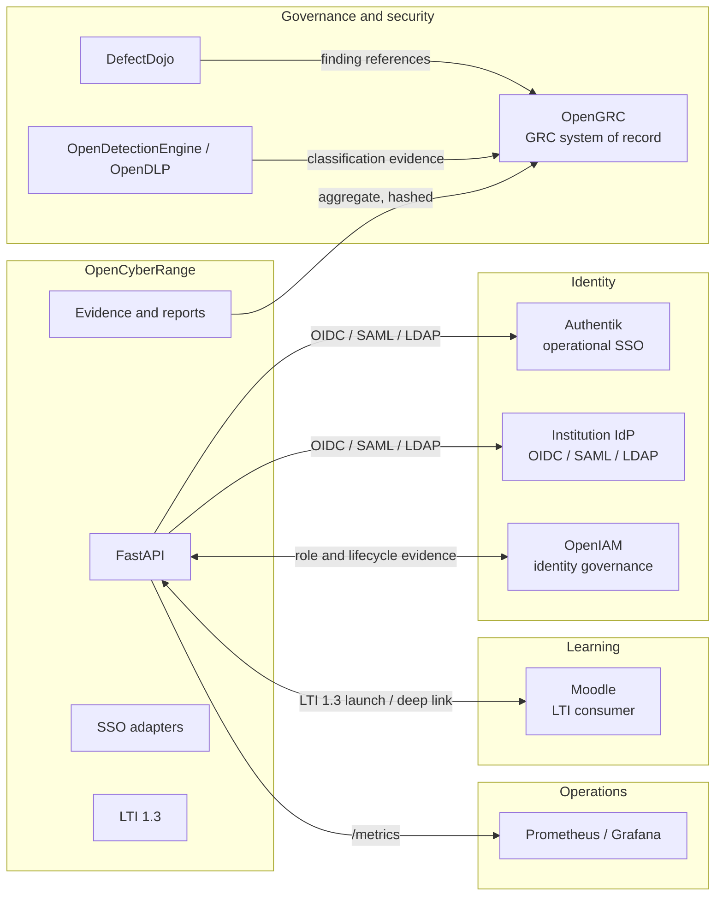

# Integration technical architecture

## Boundary rules

| Boundary | Send | Never send |
|---|---|---|
| OpenGRC | aggregate counts, control references, stable IDs, hashes, periods | learner rows, PCAP, payloads |
| Moodle | LTI launch context, assignment reference, grade passback where configured | full learner record |
| Identity provider | subject, email, display name, role mapping | password, MFA secret |
| OpenIAM | role and lifecycle evidence | learner academic record |
| Monitoring | service metrics and status | learner identifiers or content |

## Related

- [Ecosystem map](../../docs/ECOSYSTEM-TOOLING-MAP.md)
- [Reporting roadmap](../../docs/REPORTING-ROADMAP.md)
- [OpenGRC](opengrc/README.md)
