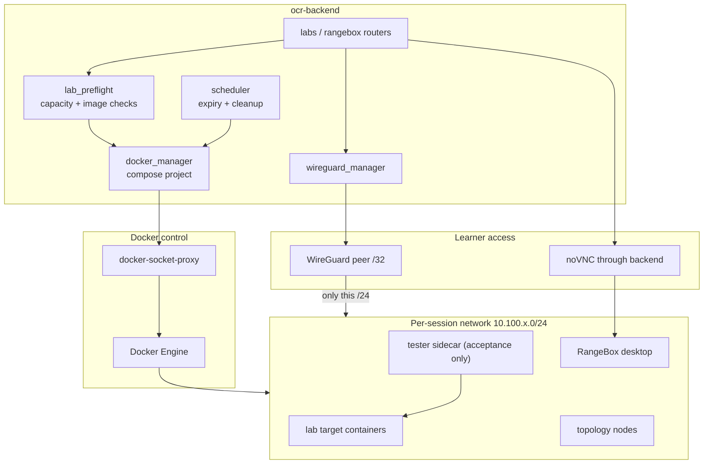

# Lab runtime technical architecture

## Start sequence

1. Authorize the learner and the lab.
2. Check image presence, session quota, host capacity, and RangeBox capacity.
3. Allocate the next `/24`.
4. Create the Compose project and network.
5. Start services; wait for declared TCP/UDP ports.
6. Start RangeBox and wait for 6080 if requested.
7. Create the VPN peer and firewall rule.
8. Mark the session ready.

## Stop sequence

1. Mark the session stopping.
2. `docker compose down -v --remove-orphans` for the project.
3. Remove the per-session network.
4. Revoke the peer and firewall rule.
5. Record the closure and free the address.

Every failure path runs the stop sequence. A leaked network or peer is a defect.

## Resource model

| Resource | Source |
|---|---|
| Memory / CPU | compose `mem_limit` and `cpus`, reflected in the manifest |
| Session count | backend quota and host capacity |
| RangeBox count | `MAX_CONCURRENT_RANGEBOXES`, CPU reserve, free disk |
| Disk | image store plus per-session writable layers |
| Network | one `/24` per session |

## Related

- [Lab runtime overview](subsystem-overview.md)
- [Tester](tester/README.md)
- [RangeBox](rangebox/README.md)
- [Docker proxy](../docker-proxy/subsystem-overview.md)
- [VPN network rules](../deployment/network-and-ports.md)
