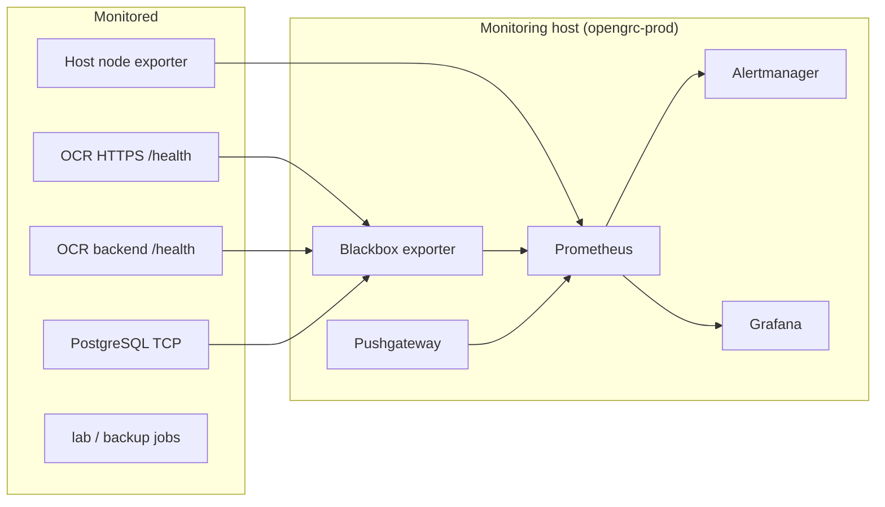

# Monitoring

## Purpose

Prove the platform is reachable and healthy from outside itself. The monitoring
stack runs on a separate host (`opengrc-prod`), not on the platform host. A host
cannot prove its own health.

## Stack

| Component | Role |
|---|---|
| Prometheus | scrape, rules, 30-day TSDB |
| Alertmanager | route and deduplicate alerts |
| Pushgateway | receive short-lived job results |
| Blackbox exporter | HTTP/TCP probes |
| Node exporter | host metrics |
| Grafana | dashboards, published through Nginx Proxy Manager |

## Files

```text
deploy/monitoring/
├── docker-compose.yml
├── prometheus/
│   ├── prometheus.yml
│   ├── rules/health.yml
│   └── targets/*.yml
├── alertmanager/
├── blackbox/
├── grafana/
└── agent/            separate host agent
```

## Run

```bash
cd deploy/monitoring
cp .env.example .env
chmod 600 .env
docker compose up -d
```

Prometheus, Alertmanager, and Pushgateway bind to loopback only. Grafana is
published through the reverse proxy at `https://health.swocts.com`.

## Diagram



## Rules

- Do not scrape learner content, identifiers, or tokens.
- Do not run monitoring on the platform host.
- Keep Grafana behind the proxy and authentication.
- A dead-man switch needs an external ping URL; it is currently blocked.
- Lab-host agents are blocked on host access.
- An alert that nobody receives is not monitoring; test the route.

## Related

- [Operations monitoring](../../docs/OPERATIONS-MONITORING.md)
- [Health dashboard plan](../../docs/HEALTH-DASHBOARD-PLAN.md)
- [Deployment](../deployment/subsystem-overview.md)
