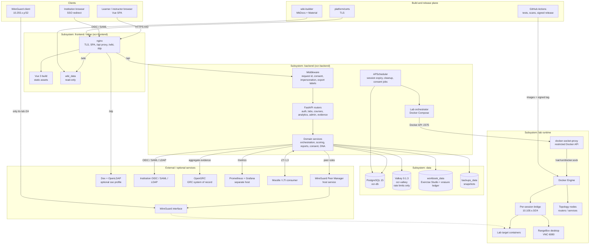

# Platform technical architecture

This page is the macro view. Each subsystem has its own folder with a lower-level
diagram and a component guide.

## Runtime topology

## Subsystems

| Subsystem | Folder | Responsibility | Owns persistent state |
|---|---|---|---|
| Backend | [`backend/`](backend/subsystem-overview.md) | API, domain logic, scheduler, lab orchestration | Indirectly, through PostgreSQL and volumes |
| Frontend / edge | [`frontend/`](frontend/subsystem-overview.md) | SPA, TLS, `/api` proxy, wiki serving | Browser storage; no server state |
| Database | [`database/`](database/subsystem-overview.md) | Transactional records, RLS, migrations, backups | `postgres_data` |
| Cache | [`cache/`](cache/subsystem-overview.md) | Shared rate-limit counters | None (ephemeral) |
| Docker control | [`docker-proxy/`](docker-proxy/subsystem-overview.md) | Restricted Docker API for lab orchestration | None |
| Lab runtime | [`lab-runtime/`](lab-runtime/subsystem-overview.md) | Lab targets, topology, RangeBox, tester | Per-session ephemeral containers |
| Wiki | [`wiki/`](wiki/subsystem-overview.md) | Builds and serves the workbook | `wiki_data` |
| HA (optional) | [`ha/`](ha/subsystem-overview.md) | Sync, standby database, replica, sentinel | Replicated state |
| Integrations | [`integrations/`](integrations/subsystem-overview.md) | SSO, LTI, OpenGRC, ecosystem boundaries | Provider state only |
| Monitoring | [`monitoring/`](monitoring/subsystem-overview.md) | Metrics and alerting | Prometheus TSDB on its own host |
| Deployment | [`deployment/`](deployment/subsystem-overview.md) | Host, network, volumes, releases | Host-level configuration |

## Request path

1. The browser loads the SPA from nginx over HTTPS.
2. The SPA calls `/api/*`. nginx proxies to the backend over the private Compose
   network.
3. Middleware assigns a request id, enforces consent for gated paths, and
   caches the decoded JWT for downstream dependencies.
4. FastAPI resolves dependencies: authentication, active/approved checks, role
   and permission policy, and tenant scope.
5. The router calls a domain service. The service reads or writes PostgreSQL,
   using RLS context for tenant isolation.
6. Writes are attributed to an actor and recorded in the integrity ledger by a
   database trigger when the table is instrumented.
7. The response is labelled for export classification where relevant.

## Lab start path

1. The learner asks to start a lab.
2. The backend checks visibility, course scope, session quota, image
   availability, and RangeBox capacity.
3. The orchestrator creates a Compose project and a per-session bridge network
   on `10.100.x.0/24`.
4. It starts the lab target containers from prebuilt `ocr-lab/*` images; it does
   not build images during a production spawn.
5. If RangeBox is requested, it starts the desktop container and waits for VNC
   port 6080.
6. The Peer Manager receives the peer and firewall rule so the learner's
   `/32` can reach only this session's `/24`.
7. On expiry or stop, the scheduler removes containers, networks, and peers.

## Trust boundaries

| Boundary | Rule |
|---|---|
| Browser to edge | TLS, CSP, CORS allow-list, security headers |
| Edge to backend | Private Compose network; backend binds `127.0.0.1:8000` |
| Backend to data | Private network; separate migration and backup roles |
| Backend to Docker | Only through the restricted socket proxy |
| Learner to lab | Only the learner's session `/24`; no management or other learners |
| Platform to OpenGRC | Aggregate evidence, stable IDs and hashes; no learner rows |
| Platform to AI | No learner data in prompts; AI explains, never grades alone |
| Tenant to tenant | PostgreSQL row-level security plus application policy checks |

## Scaling

- Scale vertically first: CPU, RAM, disk, PostgreSQL tuning.
- The backend worker count is `OCR_UVICORN_WORKERS`; keep
  `(DB_POOL_SIZE + DB_MAX_OVERFLOW) * workers + reserved < max_connections`.
- Valkey is required for global rate limits when there is more than one worker.
- Lab density is bounded by CPU, RAM, disk, and image cache, not by the API.
- HA is read-only observability plus a standby; it is not a load-balancing
  cluster.

## Failure domains

| Failure | Effect | Recovery |
|---|---|---|
| Frontend down | No UI or API proxy; backend still runs | Restart `ocr-frontend` |
| Backend down | No API; running lab containers continue | Restart `ocr-backend` |
| PostgreSQL down | API fails; labs may continue | Restore service or fail over to standby |
| Valkey down | Rate limiting degrades to in-process | Restart; counters reset |
| Docker proxy down | New labs and cleanup fail; existing labs continue | Restart proxy and backend |
| Host disk full | Spawns fail; database writes can fail | Free space, prune only safe images, restore service |
| Certificate expiry | Browser TLS errors | Replace certs and recreate frontend |

## Related documents

- [Deployment topology and sizing](../docs/DEPLOYMENT-TOPOLOGY-AND-SIZING.md)
- [Full runtime architecture](../docs/ARCHITECTURE.md)
- [Database integrity](../docs/DATABASE-INTEGRITY.md)
- [Security events](../docs/SECURITY-EVENTS.md)
- [HA and Kubernetes](../docs/HA-AND-KUBERNETES.md)
