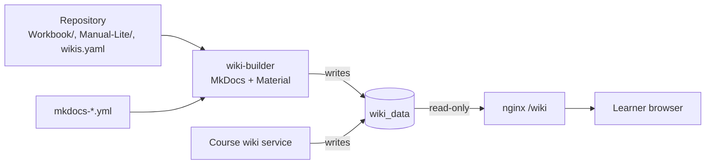

# Wiki subsystem

The wiki is the learner-facing workbook and course reference. It is a static
MkDocs build, not a runtime service. The builder writes a namespaced tree into
the `wiki_data` volume; nginx serves it read-only.

## What it builds

| Output | Source | Config |
|---|---|---|
| Track workbook | `Workbook/CH_*` | `mkdocs-<track>.yml` |
| Manual | `Manual-Lite/` | `mkdocs-manual-lite.yml` |
| Course wiki | course chapters and course config | built by the course wiki service |
| Reference pages | generated curriculum, glossary, frameworks | generated by scripts |

There are 13 track configs plus the manual config. They are all active; see
[MkDocs governance](../../docs/MKDOCS-GOVERNANCE.md).

## Build

```bash
cd platform
docker compose --env-file .env -f docker-compose.dev.yml --profile tools \
  run --rm wiki-builder
```

The one-shot container mounts the repository read-only and `wiki_data` as the
output. The frontend mounts `wiki_data` read-only at `/usr/share/nginx/wiki`.

Manual only:

```bash
python -m mkdocs build -f mkdocs-manual-lite.yml --strict
```

## Checks

```bash
python scripts/check-links.py --mkdocs
python scripts/check-doc-assets.py
python scripts/check-minor-safe.py
python scripts/generate-curriculum-docs.py --check
python scripts/generate-framework-docs.py --check
```

## Diagram



## Rules

- The wiki is a build artifact; do not edit it in place.
- Keep the manual and workbook origins separate.
- A navigation change requires a link check.
- The high-school config keeps its minor-safe exclusions.
- Do not put learner rows, secrets, or live addresses in a page.
- Generated pages are regenerated, never hand-edited.

## Related

- [Frontend wiki and workbook](../frontend/features/wiki-and-workbook/README.md)
- [Backend uploads and workbook](../backend/features/uploads-and-workbook/README.md)
- [MkDocs governance](../../docs/MKDOCS-GOVERNANCE.md)
- [Manual publishing](../../docs/MANUAL-PUBLISHING.md)
