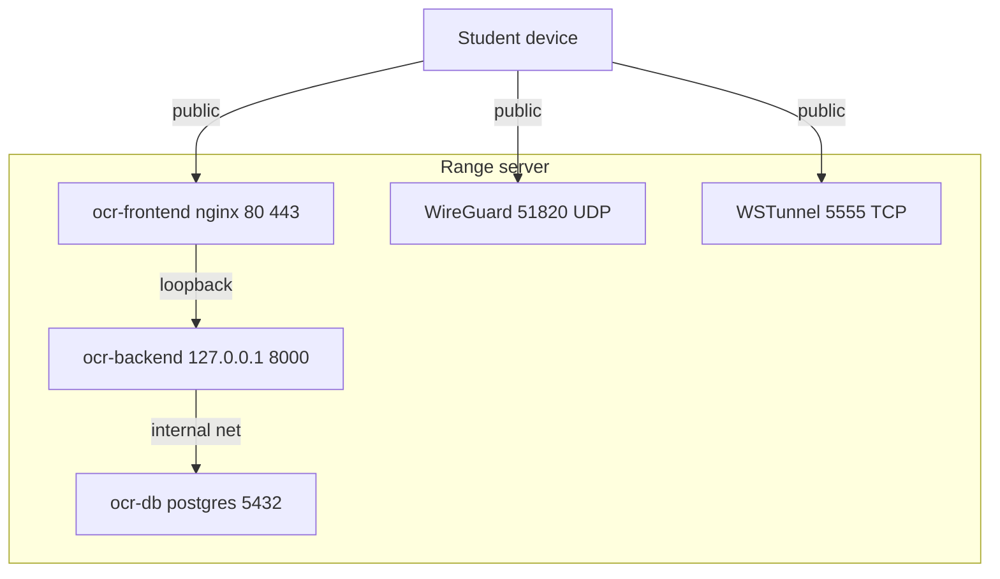

# Prerequisites and Sizing

Before you install SWOCTS Cyber Range you size the host, open the right ports, and confirm Docker is available. Read this page first, then follow either [Local Deployment](02_Local_Deployment.md) or [Cloud Deployment](03_Cloud_Deployment.md).

## Operating system

Use **Ubuntu 24.04 LTS** for a new 2.1 deployment. **Community / Academic profile** supports both Ubuntu 22.04 and 24.04 LTS, and **Ubuntu 22.04** remains an upgrade source for 2.1. The setup script installs all dependencies through `apt`, so a clean server install is the simplest starting point. See [Host OS support](../../docs/OS-SUPPORT.md) and the [24.04 migration plan](../../docs/V2-UBUNTU-24.04-MIGRATION.md).

## Platform versions

The current supported stack for the 2.1.4 release line is:

| Component | Version | Notes |
|---|---|---|
| Host OS | Ubuntu 24.04 LTS for 2.1 | Community / Academic profile supports 22.04 and 24.04 LTS |
| SWOCTS Cyber Range | `2.1.4` | Shown in the page footer and returned by `GET /api/version` |
| Python | 3.11 | Backend image: `python:3.11-slim` |
| Node.js | 22 LTS | Frontend build image: `node:22-alpine` |
| PostgreSQL | 15 | Database image: `postgres:15-alpine` |
| Redis | 7 | `redis:7-alpine`, shared rate-limit counters |
| nginx | stable Alpine | Frontend runtime image |
| Docker Engine | 24 or newer | With the Compose v2 plugin |

[`versions.yaml`](../../versions.yaml) is the source of truth for exact dependency
and image pins. Python 3.13, Node.js 24, and PostgreSQL 17 are tracked there as
future targets; they are not part of the current single-host installation.

## Hardware

The host runs four core containers plus every lab container students spawn. Size for the largest class you expect to run at once.

| Resource | Minimum | Recommended (20+ students) |
|----------|---------|----------------------------|
| CPU cores | 4 | 8 or more |
| RAM | 32 GB | 64 GB |
| Disk (evaluation) | 100 GB | 100 GB |
| Disk (production, prebuilt images) | 500 GB | 500 GB |

CPU core count matters beyond raw throughput: the backend computes its worker count from the host CPU, so an undersized processor lowers concurrency. See [Architecture](06_Architecture.md) for the worker formula.

Prebuilt lab images consume roughly 200 GB on a production host. An evaluation install that builds images on demand fits in 100 GB.

The optional REMnux RangeBox image is the largest single artifact: roughly 6 GB to download and 14 GB on disk. The installer builds it after RangeBox and UbuntuBox and treats a failure as non-fatal, so add its footprint to the disk budget only if you plan to offer REMnux to students.

## Memory and RangeBox capacity

RAM is the resource that decides how large a class the host can serve at once, and most of it goes to RangeBoxes, the in-browser Kali, Ubuntu, and REMnux desktops students use when they skip the VPN. Each tenant has a predictable footprint:

| Tenant | Approximate RAM | When it runs |
|--------|-----------------|--------------|
| Base platform (backend, database, frontend, VPN manager) | ~3 GB | Always |
| Each RangeBox desktop | 2 GB hard cap | Per active box |

The platform sizes RangeBox concurrency itself. The dashboard denominator is a stable capacity based on total RAM minus the reserve (8 GB by default), so it does not drift upward as boxes start. A separate live check refuses a new launch when free memory cannot fit another 2 GB box, which protects the platform and the SIEM when they are running. You do not hand-tune a box count. Two environment variables adjust the behavior if you need to:

- `RANGEBOX_MEM_RESERVE_GB` raises or lowers the memory kept free for the platform.
- `MAX_CONCURRENT_RANGEBOXES` pins a fixed cap and disables the automatic sizing.

A rough budget for planning: `RAM = 3 GB base + (peak concurrent RangeBoxes x 2 GB) + 8 GB reserve`. A 25-student class fits comfortably in 64 GB.

## Network ports

The platform exposes a small, fixed set of ports. The backend API is never public.

| Port | Protocol | Exposure | Purpose |
|------|----------|----------|---------|
| 80 | TCP | Public | Frontend HTTP, redirects to HTTPS when a cert is present |
| 443 | TCP | Public | Frontend HTTPS |
| 51820 | UDP | Public | WireGuard VPN |
| 5555 | TCP | Public | WSTunnel fallback for VPN over WebSocket |
| 8000 | TCP | Loopback only | Backend API, bound to 127.0.0.1 |
| 5000 | TCP | Internal only | Peer Manager API, reached by the backend container — never expose it |
| 5432 | TCP | Internal | PostgreSQL, container network only |

The diagram shows which surfaces face the internet and which stay on the host.



!!! warning "Never expose ports 8000 or 5000"
    The backend binds to 127.0.0.1:8000 inside the compose file. Publishing it to a public interface would expose the full API surface. The Peer Manager on port 5000 is likewise internal to the host and Docker network. Leave both closed in the cloud firewall.

## Docker

The installer runs preflight checks and installs Docker Engine and Docker Compose v2 if they are missing, then adds your user to the `docker` group.

!!! warning "Log out after the group is added"
    Docker group membership takes effect on your next login. If you run the installer and immediately call `docker ps` in the same shell, it fails with a permission error. Log out and back in, then continue.

## Getting the source

Clone the repository into a directory named `opencyberrange`. The runtime directory and the helper scripts both assume that name.

```bash
git clone https://github.com/RobChaykoski/opencyberrange.git
cd opencyberrange
```

The runtime directory is `~/opencyberrange`. Deployment scripts live in the repository root under `scripts/`.

!!! tip "Next step"
    For a classroom on one LAN, go to [Local Deployment](02_Local_Deployment.md). For an internet-reachable range, go to [Cloud Deployment](03_Cloud_Deployment.md). For a direct Compose deployment, use the [Docker Compose Deployment Manual](08_Docker_Deploy_Manual.md).
