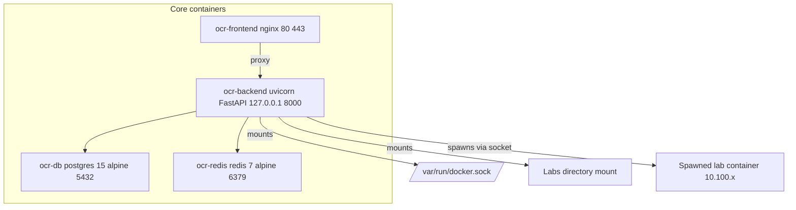
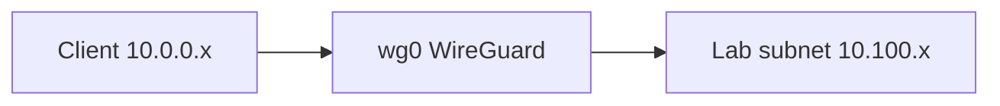
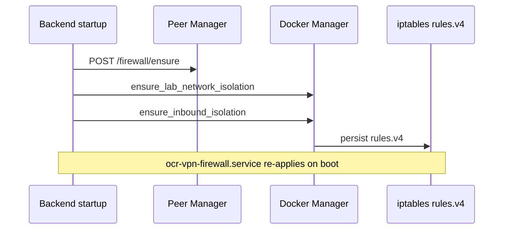
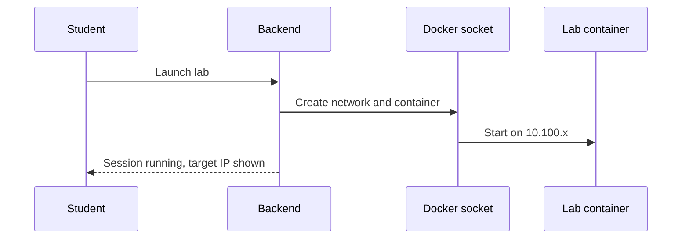
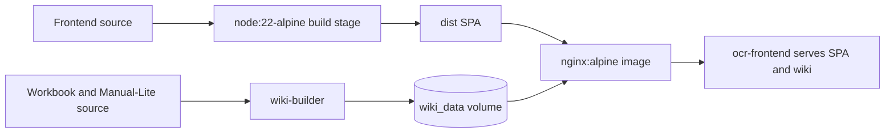
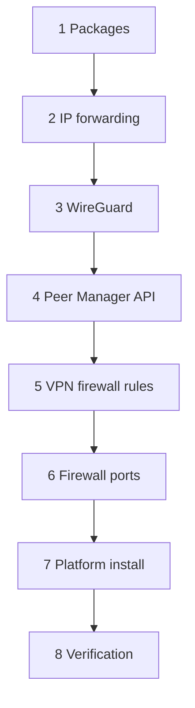

# Architecture

The architecture page describes how SWOCTS Cyber Range runs: the container stack, the network and IP scheme, the firewall model, lab spawning, and wiki delivery. Read it when you operate a range, debug an install, or plan capacity.

## Container stack

The platform runs four core containers defined in `docker-compose.prod.yml`. The backend mounts the Docker socket so it can spawn lab containers on demand.

The diagram shows the core services, their ports, and the key mounts.

| Container | Image | Binding | Role |
|-----------|-------|---------|------|
| `ocr-frontend` | nginx:alpine | 80 and 443 | Serves the SPA and the `wiki_data` volume, proxies the API |
| `ocr-backend` | python:3.11-slim + uvicorn / FastAPI | 127.0.0.1:8000 | API, lab orchestration, firewall apply |
| `ocr-db` | postgres:15-alpine | internal 5432 | PostgreSQL, `max_connections=300` |
| `ocr-redis` | redis:7-alpine | internal 6379 | Shared rate-limit counters |

The backend mounts the Docker socket, the labs directory, the workbook volume, and the Exercise Studio templates.

!!! note "Worker count is dynamic"
    The backend image computes its default worker count as `(nproc * 2) + 1`, capped at 9. The production Compose file currently starts a single worker so the scheduler and file-based session state stay on one process; Redis still keeps rate-limit counters shared if you raise that value.

!!! warning "In-memory state is not shared across workers"
    With multiple workers running, a Python dictionary held at module level in one worker is invisible to the others. A value written on one request can read back empty on the next. Any state that must survive across requests uses file-based storage under `/tmp`, not a module-level variable. Keep this in mind when you debug intermittent empty responses.

## Network and IP scheme

Student VPN clients live on `10.0.0.x`. Lab networks live under `10.100.0.0/16`, one `10.100.x` subnet per user session.

The diagram shows a client crossing the VPN to reach its lab subnet.

| Range | Purpose |
|-------|---------|
| `10.0.0.x` | VPN clients (WireGuard) |
| `10.100.0.0/16` | Lab networks, one `10.100.x` subnet per session |

## Firewall model

The firewall isolates the OCR subnets from external interfaces while leaving published ports reachable. `DOCKER-USER` DROP rules block external interfaces from reaching the OCR subnets. Published ports are unaffected because DNAT in `PREROUTING` runs before the `FORWARD` chain.

The rules apply automatically when the backend starts. The diagram shows the startup sequence.

Because the rules apply on backend start, a reboot self-heals the firewall with no manual step. The rules also persist to `/etc/iptables/rules.v4` and re-apply through `ocr-vpn-firewall.service`. See [How Prerequisite Unlocking Works](../06_Lab_Workflow_Reference/02_How_Prerequisite_Unlocking_Works.md) for related lab-access behavior and [Cannot Reach Lab Target](../07_Troubleshooting/05_Cannot_Reach_Lab_Target.md) for isolation symptoms.

## Lab spawn flow

When a student launches a lab, the backend uses the Docker socket to create a per-session container on a fresh `10.100.x` subnet.

For the full session lifecycle see [Lab Lifecycle Overview](../06_Lab_Workflow_Reference/01_Lab_Lifecycle_Overview.md).

## Wiki delivery

The frontend Dockerfile is a multi-stage build: a Node 22 stage builds the SPA, then the nginx stage serves it. Workbook HTML is no longer baked into the frontend image. The `wiki-builder` tool profile runs MkDocs and writes the namespaced tree (`range/`, `course/`, `reference/`, and `index.html`) into the `wiki_data` volume, which the frontend mounts read-only at `/usr/share/nginx/wiki`.

!!! warning "Do not docker cp wiki content"
    Wiki content ships in the `wiki_data` volume. Copying files into the running frontend container with `docker cp` is lost on the next container recreation. To change wiki content, rebuild it with `scripts/build-wiki.sh` and bring the frontend back up if needed.

## Install phase sequence

The full-server installer runs eight phases in order. The diagram shows the sequence.

## Security model

An impersonation read-only middleware enforces that an admin viewing a student account cannot mutate data: it returns 403 for POST, PUT, DELETE, and PATCH while impersonating, whitelisting only the impersonate, exit, and change-password actions. The admin view is observe-only.

## Schema changes and migrations

Database tables are created with SQLAlchemy `create_all`. Additive column
changes for existing databases are applied idempotently at backend startup in
`platform/backend/app/main.py`, so a normal upgrade does not require manual SQL.

Tracked schema revisions live in `platform/backend/alembic/versions/`. The
current head is:

| Revision | Change |
|----------|--------|
| `0004_user_avatar` | Adds `users.avatar_data` for profile avatars |

For an explicitly managed migration, run `alembic upgrade head` from
`platform/backend` with the deployment database URL. Back up the database
before any schema change. The startup checks cover the columns the application
expects today; they are not a replacement for reviewing and testing a migration
on a copy of production data.

!!! note "Profile avatars are database-backed"
    Avatars are stored as small base64 data URLs in `users.avatar_data`. They do
    not use a shared upload volume, so they survive container rebuilds with the
    rest of the database. The browser resizes images before upload and the
    backend rejects oversized or non-image payloads.
