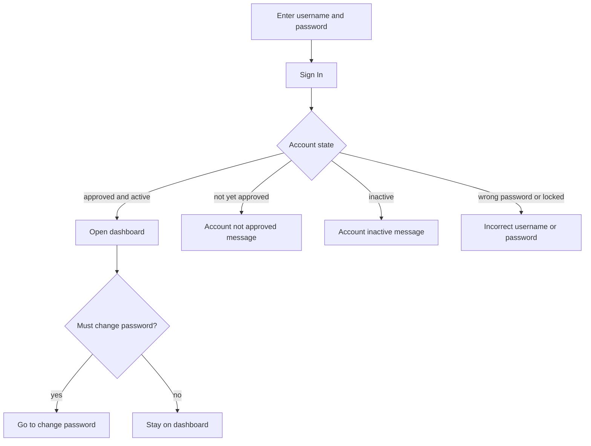

# Logging In

Logging in opens your session on the platform. You enter your username and password once, and the platform takes you to your dashboard. Read this page when you are signing in for the first time or troubleshooting a failed attempt.

## Prerequisites

- A registered local account that an admin has approved, **or** an institution
  account enabled for SSO. See [Registering an Account](04_Registering_an_Account.md).
- Your local username and password, or your institution credentials.

## Steps

1. Open the login page at `/login`.
2. Either use the **Institution sign-in** panel, or enter your local
   **Username** and **Password**.
3. Click **Sign In**.

**What you should see:** the platform signs you in and opens your dashboard. Students land on the student dashboard; instructors and admins land on the instructor and admin dashboard.

<figure markdown>

<figcaption>The login page keeps the local form and adds institution sign-in when SSO is enabled.</figcaption>
</figure>

## Institution sign-in (SSO)

If your institution has enabled single sign-on, the login page shows a
**Institution sign-in** panel above the local form. Supported methods are OIDC,
SAML 2.0, and LDAP/Active Directory.

1. Select your institution. An OIDC or SAML provider opens the institution's
   page; an LDAP provider shows a directory username and password form.
2. Sign in with your institution account, including any MFA it requires.
3. The platform returns you to your dashboard.

SSO-provisioned accounts do not use the local password form. If your account is
pending approval, the platform asks you to contact an administrator. Keep the
local administrator account available as a break-glass path if the identity
provider is unavailable.

If your institution changes your directory group, the platform applies the new
role on your next SSO login. You do not need a new account.

## What happens when you sign in

Local login is single factor: a username and a password, with no second step.
Institution sign-in may add the institution's own MFA. The platform checks your
credentials and then routes you based on your account state.

If your account is flagged to change its password on first sign-in, the platform sends you to the change-password screen before you reach the dashboard.

## Forgot your username

If you remember the email address on your account but not your username:

1. Open the login page and click **Forgot username?** under the username field.
2. Enter the email address on your account and click **Email my username**.
3. Check that mailbox. The platform sends the username to that address only.

The response is deliberately the same whether or not the address is
registered, so the form cannot be used to discover which emails have accounts.
Mail delivery is best effort: if the administrator has not configured SMTP yet,
the request is accepted but no message is sent. Ask your instructor or
administrator to enable **Admin -> Settings -> Email**.

!!! note
    The username email never contains your password. If you also need a
    password reset, ask an administrator. The platform does not email password
    reset links.

## When sign-in fails

| Message | What it means | What to do |
| --- | --- | --- |
| Incorrect username or password | The username or password is wrong, or the account is locked from too many failed attempts | Re-enter your credentials carefully. If it keeps failing, see [Account Locked](../07_Troubleshooting/02_Account_Locked.md). |
| User account not approved. Please wait for admin approval. | An admin has not approved your account yet | Wait for approval, then sign in. See [Registering an Account](04_Registering_an_Account.md). |
| User account is inactive | An admin has disabled your account | Contact your instructor or admin. |
| The directory rejected those credentials | The LDAP/institution username or password is wrong | Re-enter the directory credentials. Your local platform password is not used here. |
| Your directory account cannot sign in to this platform | The directory account exists but is not approved here | Ask your instructor or administrator to approve or link the account. |
| Institution sign-in is temporarily unavailable | The identity provider or directory is unreachable | Use your local account, or try again when the provider is available. |

!!! warning
    A locked account shows the same "Incorrect username or password" message as a simple typo. The platform does not announce a lockout, so if your correct password is being rejected repeatedly, treat it as a possible lockout and see [Account Locked](../07_Troubleshooting/02_Account_Locked.md).

!!! note
    Repeated rapid attempts are rate limited. If you submit too quickly, pause for a minute before trying again.

## After you sign in

Get oriented with the layout: [Navigating the Interface](06_Navigating_the_Interface.md). For more on failed sign-ins, see [Login Issues](../07_Troubleshooting/01_Login_Issues.md).
