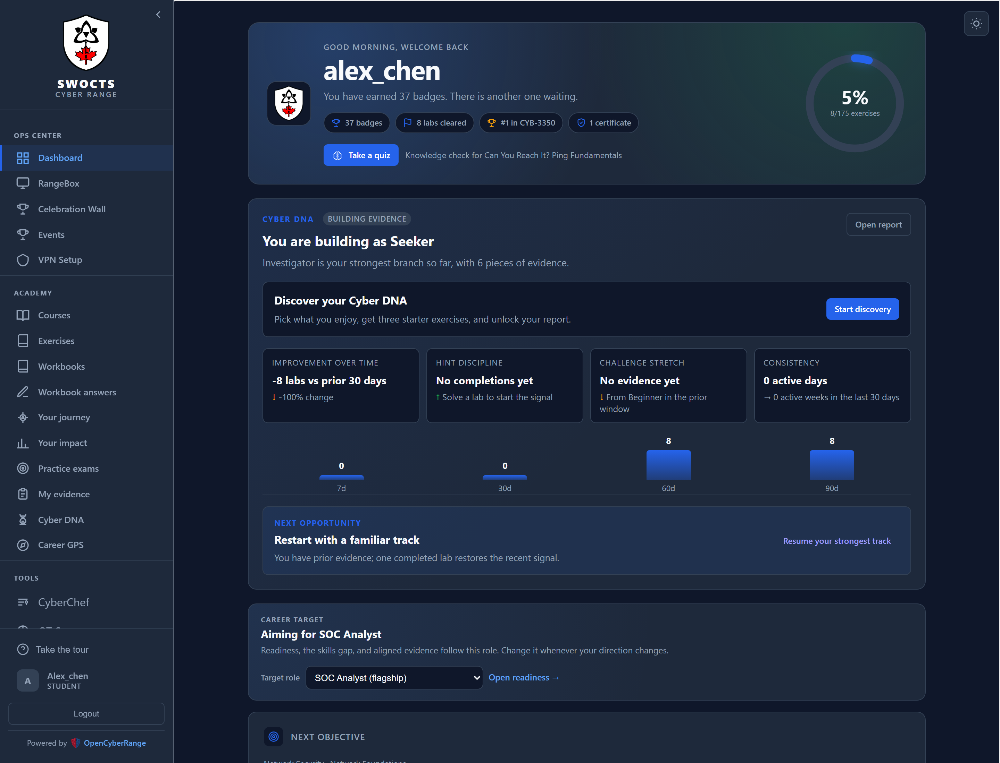
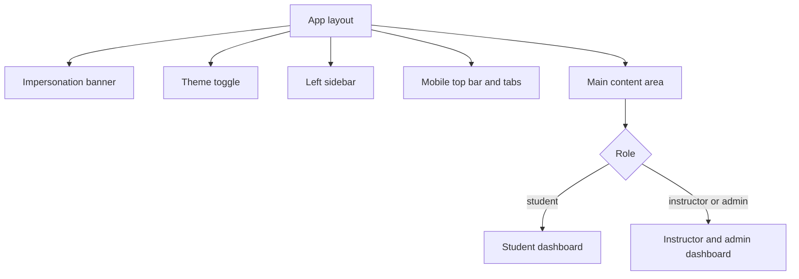

# Navigating the Interface

The interface is a left sidebar plus a main content area, and nearly everything you do starts from a sidebar link. Read this page after you sign in to learn what each section does and which links your role gives you.

## Prerequisites

- A signed-in session. See [Logging In](05_Logging_In.md).

## Layout

The platform places primary navigation in a left sidebar on desktop. There is no desktop top navigation bar. The only other global elements are a floating theme toggle in the top-right corner and, when an admin is viewing the platform as another user, an impersonation banner across the top. On a phone-width screen the sidebar becomes an off-canvas menu drawer, and a compact top bar carries the menu and theme controls plus a student bottom tab bar.

### Display and contrast

The theme button cycles through three settings:

1. **Dark** (default) - slate surfaces for lab and evening work.
2. **Light** - white surfaces for bright rooms and printing.
3. **High contrast** - a black canvas, white text, white borders, and a cyan
   accent. Use it when a projector, a low-quality monitor, or a vision
   condition makes the standard themes hard to read.

The choice is stored in your browser, so it follows you between pages on the
same device. It does not change permissions, progress, or any learning data.

<figure markdown>

<figcaption>The sidebar holds every navigation link; the main area renders the selected page.</figcaption>
</figure>

The diagram below shows how the layout fits together and where the dashboard splits by role.

## Sidebar sections

The sidebar groups links into sections. You see only the sections your role allows.

| Section | Links | Who sees it |
| --- | --- | --- |
| Workspace | Dashboard, RangeBox | Learners and instructors |
| Learn | Courses, Exercises, Workbooks, Analyst answers, Practice exams | Learners and instructors |
| Tools | All tools, CyberChef, OT scan, ATT&CK, ZAP scan | Everyone |
| Your progress | Journey & mission, Impact & recognition, Cyber DNA, Career GPS, Evidence portfolio | Learners and instructors |
| Explore | Threat map, Events, Celebration wall | Learners and instructors |
| Teaching | Course workspace, Exercise authoring, Evidence review, Contract review, Reports & analytics, Surveys | Instructors |
| Governance | Privacy & audit, Contract review | Admin, institution admin, privacy officer, and auditor roles |
| Administration | Users, Course catalogue, Exercise library, Evidence review | Admins |
| Operations | Sessions & activity, Reports & analytics, Surveys, System health, Platform settings | Admins |
| Resources | User manual | Everyone |

**Reports & analytics** opens at `/reports`. Admins see it in Operations; instructors see it in Teaching. **Surveys** opens at `/surveys` for instructors and admins. See [Reporting and Analytics](../04_Admin_Guide/28_Reporting_And_Analytics.md).

**Tools** is one catalogue for every role. **All tools** opens `/tools`; the
shortcuts open the same allow-listed panel as the active-lab toolbar. The
**ZAP scan** planner writes a command for a practice target; it does not run a
scan. See [Threat map and tools](../02_Student_Guide/32_Threat_Map_And_Tools.md).

**Events** replaces the older Team Challenges module: it lists opt-in,
time-boxed competitions and the community calendar. Events appear only when an
administrator has published one or enabled the community source, so the list
may be empty in a new deployment. See [Community Events](../02_Student_Guide/23_Community_Events.md).

## On a phone

On a phone-width screen the sidebar becomes a menu drawer and a bottom tab bar
shows Home, Exercises, RangeBox, Courses, and Profile. See
[Using a Mobile Device](../02_Student_Guide/19_Using_a_Mobile_Device.md) for what
works well and what is better on a laptop.

## Footer controls

At the bottom of the sidebar you find:

- **Profile**, which opens your profile page with your avatar, completion stats, certificates, achievements, and PDF transcript download.
- **Logout**, which ends your session.
- **Privacy Mode** (instructors and admins only), a toggle that masks student names across the views you see.

## Collapsing the sidebar

Use the chevron button at the top of the sidebar to collapse it to a narrow strip and expand it again. Collapsing frees up horizontal space for lab consoles and wide tables.

!!! tip
    Collapse the sidebar with the chevron while you work inside a lab console so the console has more room.

!!! note
    The Admin "Workbook" link opens the workbook wiki in a new browser tab. The other links navigate within the same tab.

!!! tip
    In a RangeBox-enabled exercise, the **Open in new tab** controls open the
    RangeBox desktop or the workbook in a separate tab. The exercise panel stays
    open in the original tab.

## Where to go next

- Students: start at [Browsing Exercises](../02_Student_Guide/02_Browsing_Exercises.md) or [Student Dashboard](../02_Student_Guide/01_Student_Dashboard.md).
- Instructors: start at [Instructor Dashboard](../03_Instructor_Guide/01_Instructor_Dashboard.md).
- Set up lab access first: [VPN Overview](../05_VPN_Setup_Guide/01_VPN_Overview.md).
