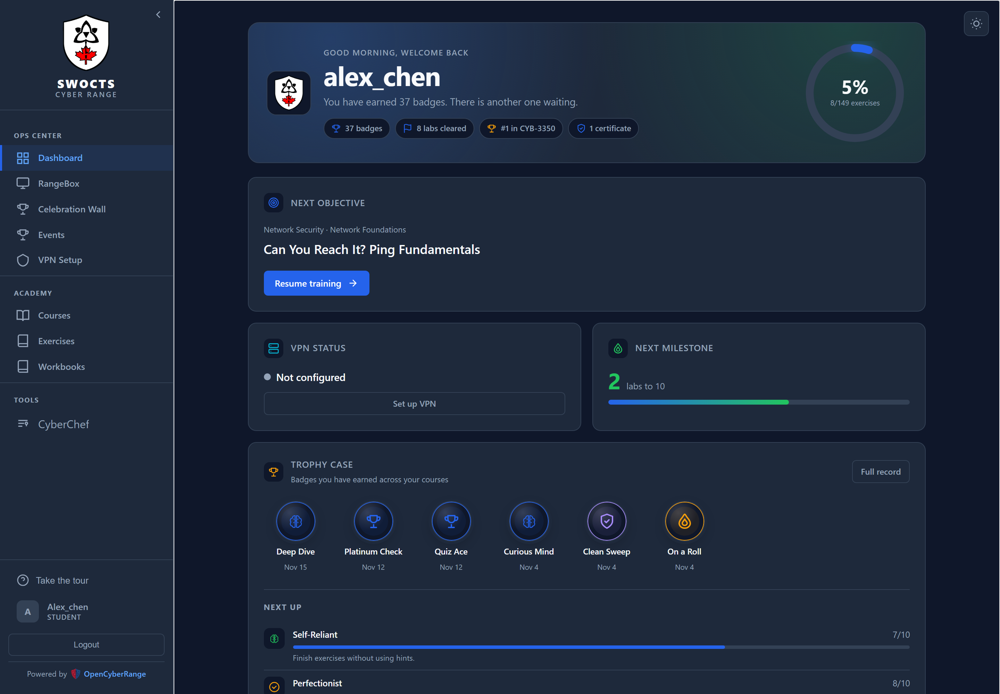
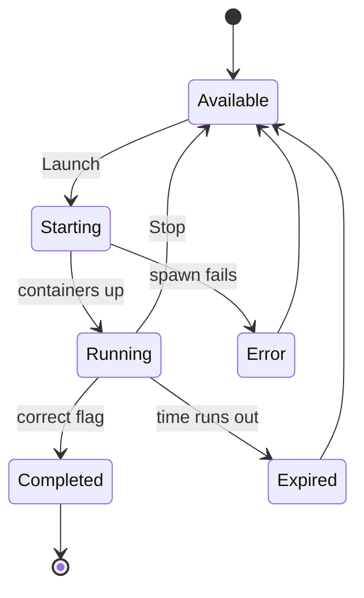

# Student Dashboard

The dashboard is your landing page after you log in. It tells you what to work on next, how far you have come, whether your VPN is ready, and which badges are closest. Open it any time you want a quick read on your training before you start an exercise.

## Prerequisites

- A platform account that an admin has approved. See [Registering an Account](../01_Getting_Started/04_Registering_an_Account.md).
- A successful login. See [Logging In](../01_Getting_Started/05_Logging_In.md).

## What the dashboard shows

After login the platform routes you to `/dashboard` and renders the student view. The hero greets you with "Good morning, welcome back" and your username, then shows a row of pills: badges earned, labs cleared, your private course position, and certificates. The percentage ring counts completed exercises across every track.

<figure markdown>

<figcaption>The student dashboard combines your next objective, VPN status, milestone progress, recent badges, and the badges closest to completion.</figcaption>
</figure>

| Section | What it tells you | Action |
|---------|-------------------|--------|
| Next objective | The track, level, and lab the platform suggests next | **Resume training**, which opens the track page |
| VPN status | A status dot reading "Configured" or "Not configured", with the client IP when assigned | **Set up VPN**, which opens the VPN setup page |
| Next milestone | How many labs remain before the next learning milestone, with a progress bar | None |
| Trophy case | The badges you earned most recently, with the date | **Full record**, which opens your profile |
| Next up | The badges closest to completion and the rule for each, such as "Finish exercises without using hints" | None |
| Track progress | A per-track progress bar for every track you have started | None |
| Recent victories | Recently completed exercises and the points they awarded | None |
| Learning analytics | Completion, streak, accuracy, and time-on-task statistics | None |
| Growth indicators | Competency growth by domain for the current period | None |

## Move from the dashboard into training

1. Read the **Next objective** card to see the suggested track, level, and lab.
2. Click **Resume training**. The platform opens the track page for that lab.
3. Pick the level and lab you want, then click **Launch**. See [Launching a Lab](04_Launching_a_Lab.md).

**What you should see:** the track page loads with level sections, completion rings, and the lab rows for that track.

## When sections do not appear

!!! note "The rank pill is private"
    The "#N in {course}" pill appears only when you are enrolled in an active course with assigned labs. It is a private position for your own view, not a public scoreboard. If you have not joined a course, or the course has no labs assigned yet, the pill stays hidden. See [Joining a Course](12_Joining_a_Course.md).

!!! tip "Set up your VPN early"
    A fresh account shows "Not configured" on the VPN card with a **Set up VPN** button. Lab targets sit on isolated subnets that you reach only through the tunnel or RangeBox, so download your config before your first lab. See [Connecting via VPN](05_Connecting_via_VPN.md).

The completion ring and track bars count only labs that are active and visible to you. Solving a flag advances them; opening or stopping a lab does not. See [Tracking Your Progress](11_Tracking_Your_Progress.md).

## How a lab session moves through its life

Your dashboard and the lab panel both reflect the same session lifecycle. The diagram below shows the states a lab session passes through from launch to completion.

A correct flag moves the session to Completed and tears down the environment. A stop returns the lab to Available without marking it complete. See [Lab Statuses Explained](../06_Lab_Workflow_Reference/06_Lab_Statuses_Explained.md).

If the dashboard does not load or your login fails, see [Login Issues](../07_Troubleshooting/01_Login_Issues.md).
