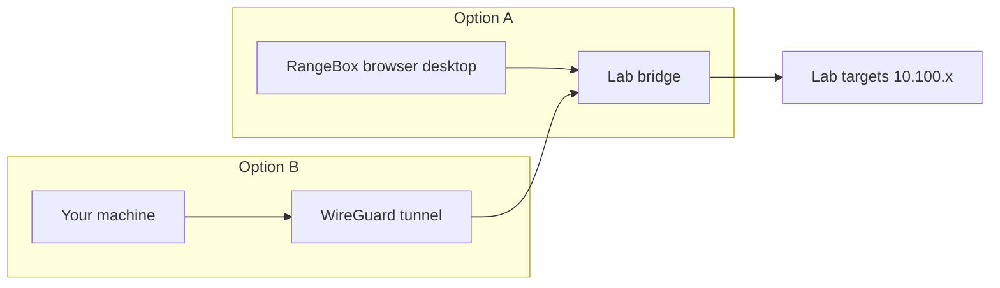

# Working Inside a Lab

The Active Lab panel is the single screen that hosts everything you do during an exercise: the scenario, your objectives, the network and target details, the workbook link, the flag form, hints, and the session timer. Once a lab is running, you spend your time here.

## Prerequisites

- A running lab. See [Launching a Lab](04_Launching_a_Lab.md).
- A way to reach the targets: either the VPN tunnel or the in-browser RangeBox desktop. See [Connecting via VPN](05_Connecting_via_VPN.md).

## What the panel contains

The Active Lab panel slides up on the track page. From top to bottom it shows:

- **Scenario:** the situation and goal, rendered from the lab's brief.
- **Objectives:** the list of things to accomplish.
- **Exercise Network:** the subnet for the lab, plus a "Your targets:" list of per-node IPs when the lab provides them. When it does not, the section reads "Scan the network to discover target machines."
- **Target Hostnames:** the names workbook steps use. They resolve automatically inside RangeBox. If you connect over VPN from your own machine, add the same hostnames to your `/etc/hosts` file (or `C:\Windows\System32\drivers\etc\hosts` on Windows).
- **Open Workbook:** a button that opens the lab's workbook in a new tab.
- **Submit Flag:** the form where you enter your answer. See [Submitting Flags](07_Submitting_Flags.md).
- **Hints:** time-gated help. See [Using Hints](08_Using_Hints.md).
- A countdown timer and a **+1 Hour** button. See [Extending a Lab Session](09_Extending_a_Lab_Session.md).

<figure markdown>

<figcaption>The Active Lab panel hosts the scenario, network details, workbook link, flag form, and hints for the running lab.</figcaption>
</figure>

## Reach the targets two ways

You attack the same lab targets from one of two starting points. The diagram below shows both.

**RangeBox** is a Kali, Ubuntu, or REMnux desktop that runs in your browser, already on the lab network. Pick the image you need before you launch: Kali for general pentesting, Ubuntu for a plain Linux environment, and REMnux for malware analysis and reverse engineering. When a running exercise has RangeBox enabled, the Active Lab panel shows **Open RangeBox**. On a desktop, the exercise opens the combined workspace: RangeBox on the left, the briefing and flag on the right, and the workbook along the bottom. You need no VPN for RangeBox.

The RangeBox toolbar offers:

- **Stream quality**: High quality, Balanced, or Low bandwidth.
- **Ctrl+Alt+Del**: send the key combination to the guest.
- **Clipboard**: text-only send, get, and read.
- **Minimize** and **Fullscreen** (native fullscreen where the browser allows it).
- **Pop out**: move the desktop into its own resizable window while the main tab keeps the briefing, notes, and workbook.

!!! note "Standalone RangeBox"
    The **RangeBox** item in the sidebar opens a standalone practice desktop. It is not attached to a lab, so use it for tool access or connectivity checks. To work an exercise with the lab network and flag dock, launch RangeBox from that exercise instead.

!!! note "Phones and tablets"
    The in-browser desktop needs a keyboard and mouse for comfortable lab work.
    On a phone, the platform shows a desktop-recommended notice instead of the
    embedded viewer. See [Using a Mobile Device](19_Using_a_Mobile_Device.md).

At the bottom of the RangeBox window, the **lab dock** shows the lab name,
its subnet, and the target IPs when the exercise is built to reveal them. The
same dock contains a **Flag** field and **Submit flag** button. Copying an
`OCR{...}` value inside the desktop fills the field automatically; if it does
not, use **Paste** or Ctrl+V. You can capture the flag in the desktop, submit it
without leaving RangeBox, and then close the window or return to the exercise. A
correct flag shows the usual success message and tears the environment down.

!!! tip "Workbook and flags in one place"
    In the workspace, the workbook is the full-width pane under the desktop. It
    scrolls on its own and hides the wiki header and sidebars, so you can read a
    step while the RangeBox stays open. Use **Expand** for a taller pane or
    **Open in new tab** for a separate reading tab. The **Pop out** button moves
    the desktop to its own window if you want more room for the workbook.

**Your own machine** reaches the same targets over the WireGuard tunnel. Use this when you prefer your local tools.

## Steps to start working

1. Read the **Scenario** and **Objectives** at the top of the panel.
2. Note the target IPs in **Exercise Network**, or plan to scan the subnet if no IPs are listed.
3. Connect: launch RangeBox from the panel, or activate your VPN tunnel.
4. Open the workbook with **Open Workbook** for guided steps when one is provided.
5. Work toward the objectives, then submit your flag.

**What you should see:** target IPs in the Exercise Network section, or a prompt to scan the network, and a reachable target once your connection is up.

## When something looks off

!!! note "Per-node IPs only appear for some labs"
    Target IPs in "Your targets:" show only when the lab is built to expose them. Other labs ask you to scan the subnet to find hosts. Both are normal.

If a target will not respond, see [Cannot Reach Lab Target](../07_Troubleshooting/05_Cannot_Reach_Lab_Target.md).
