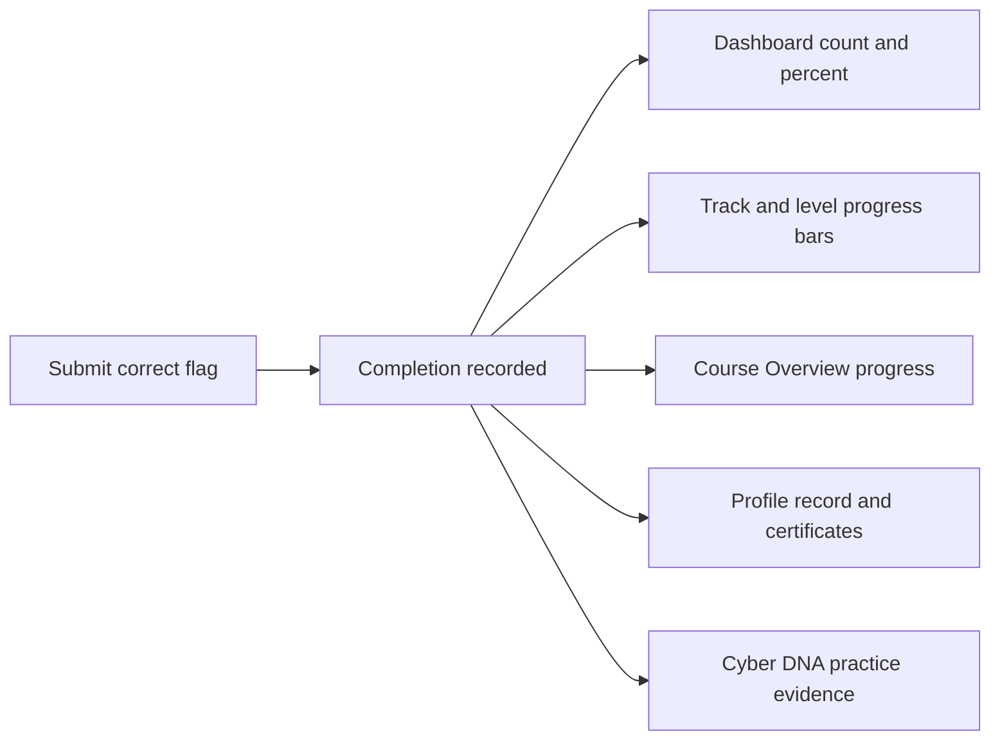

# Tracking Your Progress

Track how many exercises you have solved, see which exercise comes next, and
check your course progress and feedback. Progress appears on your dashboard, the
Exercises hub, each track, and inside a course. There is no public course
scoreboard or rank.

## Where progress shows

Your progress appears in six places:

- **Dashboard cards:** Next Objective, My Progress (a bar plus "X / Y labs
  completed"), and VPN Status.
- **Exercises hub:** a three-stat summary at the top (Completed, Total
  Exercises, Overall Progress percent) plus a progress bar on each track card.
- **Track page:** a per-level completion ring and a green "Complete" badge when
  a level is finished.
- **Course Overview:** completed exercises, the next assigned exercise, and your
  feedback status. See
  [Course Progress and Feedback](14_Viewing_the_Scoreboard.md).
- **Profile:** completion totals, track and level progress, certificates, the
  completion table, achievements, Cyber DNA, and the PDF transcript. See
  [Viewing Your Profile](16_Viewing_Your_Profile.md).
- **Cyber DNA:** six practice traits built from your completed work. It is
  descriptive, not a grade.
- **Momentum and Career Atlas:** a development-preview view of where practice is
  gaining or under friction, and which career families your evidence points
  toward. See
  [Career Atlas and Momentum](21_Career_Atlas_And_Momentum.md).

<figure markdown>

<figcaption>The dashboard shows your next exercise, completed count, and VPN state. A course adds progress and feedback, not a public rank.</figcaption>
</figure>

## What counts as completed

A lab counts as completed only when you submit its correct flag. Opening a lab,
working in it, or stopping it does not advance your progress. The platform
records a completion when a flag is solved, so your numbers reflect solved
exercises, not attempts.

## How your dashboard numbers are built

The diagram below shows how a solved flag flows into the progress surfaces.

## Certificates and transcript

When every visible exercise in a level is complete, the platform issues a
certificate for that level. The certificate page shows the level, track,
completion count, award date, and certificate ID. Your profile collects every
certificate you have earned and can generate a PDF transcript of your full
completion record.

## Course progress and feedback

Inside a course, the **Overview** tab shows your progress, the next assigned
exercise, and your feedback status. The **Feedback** tab holds the course
check-in, the aggregate student voice, and any coaching note addressed to you.
Your progress is private; other students cannot see it.

See [Course Progress and Feedback](14_Viewing_the_Scoreboard.md).

!!! tip "All labs completed"
    When you finish every available exercise, the Next Objective card reads
    "All labs completed!" instead of pointing to a next lab.

Course-exclusive labs count toward your progress only while you are enrolled and
the course is active. To see your full account state and enrollment, open
[Viewing Your Profile](16_Viewing_Your_Profile.md).
