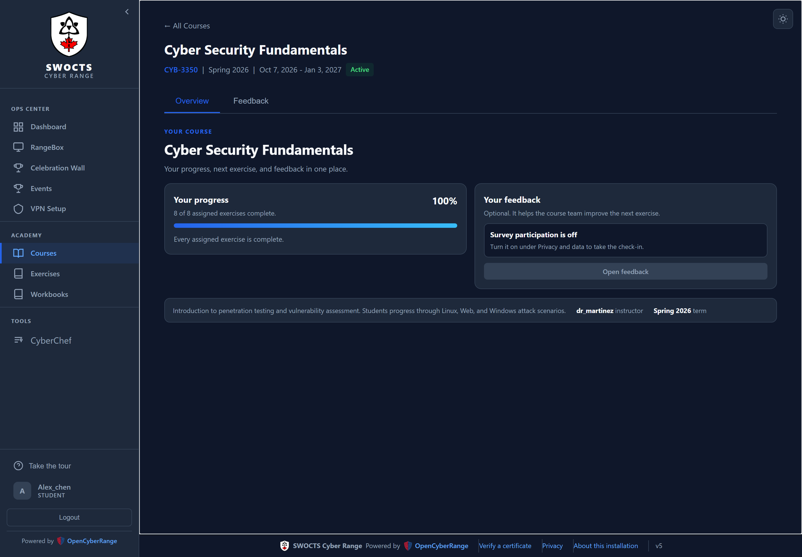
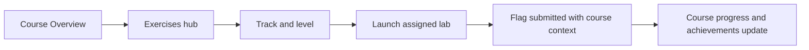

# Course Labs and Assignments

Your instructor assigns a set of exercises to the course. The course workspace
shows how far you have progressed through them; the labs themselves open from
the track pages, with the course context attached so the solve counts for the
course.

## Prerequisites

- Enrollment in an active course. See [Joining a Course](12_Joining_a_Course.md).

## The course workspace

Open a course from your Courses list. Students see two tabs:

- **Overview:** your progress and next exercise, the course description, your
  instructor, the term, and your feedback status.
- **Feedback:** the course check-in, aggregate student voice, and coaching
  notes. See [Course Progress and Feedback](14_Viewing_the_Scoreboard.md).

The Overview reports how many assigned exercises you have completed out of the
total, the percentage, and a one-line next step. It does not list a leaderboard
or another student's progress.

<figure markdown>

<figcaption>The course Overview summarises assigned-exercise progress and links to the check-in; the labs themselves open from their tracks.</figcaption>
</figure>

## Open an assigned exercise

1. Open the course from **Courses** and read the **Your progress** panel for the
   next exercise.
2. Open **Exercises** in the sidebar and pick the track named in your course.
3. Expand the level and click **Launch** on the assigned lab. See
   [Launching a Lab](04_Launching_a_Lab.md).
4. Solve the exercise and submit the flag. See
   [Submitting Flags](07_Submitting_Flags.md).

**What you should see:** the lab opens with the course context attached. A
correct flag updates the course progress and any course-scoped achievements.

The path below shows how a course assignment gives course credit.

## Course-only labs

Some labs are assigned only through a course. They do not appear in the main
Exercises hub; your instructor shares how to reach them, and the course view
grants access even when sequential track locking would otherwise hide them.

!!! note "Course wiki needs active enrollment"
    The course workbook opens only while the course is active and you are
    enrolled. An ended or inactive course returns an access error when you open
    its wiki.

!!! warning "Assignments can be time-boxed"
    An assignment with a future start date stays closed until that date. Check
    the assignment's start and due badges in the course workspace.

If a course lab will not open or its workbook is blocked, see
[Cannot Reach Lab Target](../07_Troubleshooting/05_Cannot_Reach_Lab_Target.md).
