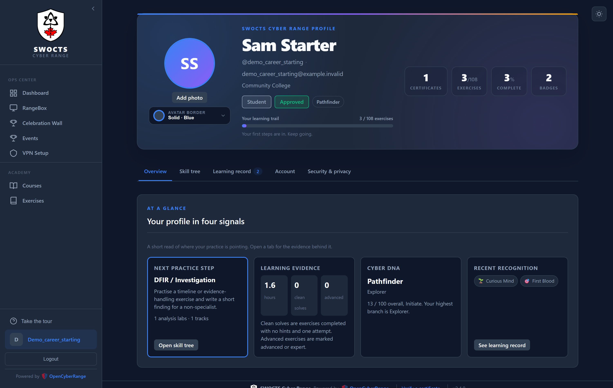
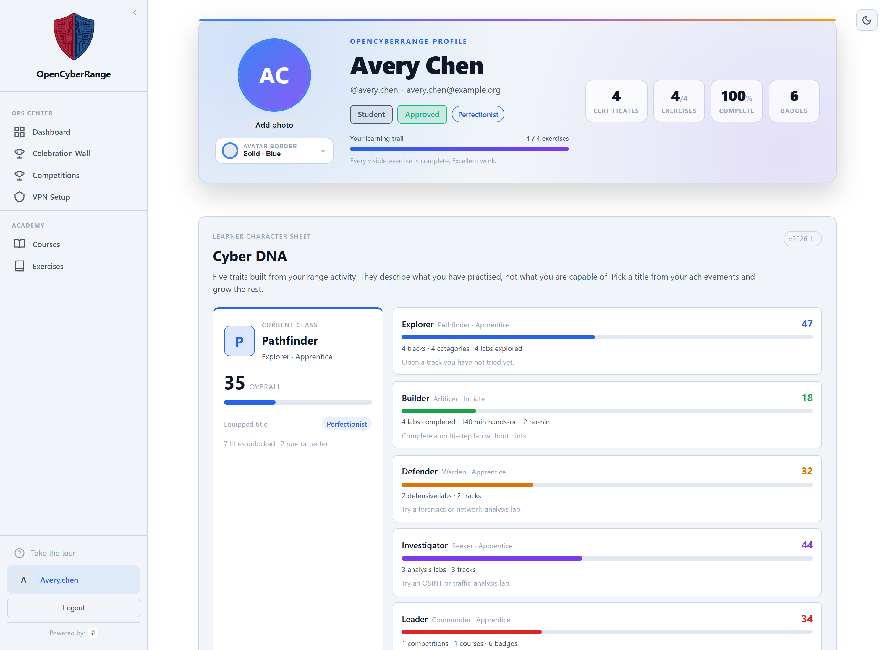

# Viewing Your Profile

Open your profile to check your account details, view your certificates and completion record, download a PDF transcript, see your enrolled courses, join a new course, and change your password. The profile is your single account page.

## Opening your profile

Click **Profile** in the sidebar. The page opens with your profile card: avatar, display name, account badges, and completion stats.

<figure markdown>

<figcaption>The profile page shows your avatar and completion summary, your certificates and track progress, your account fields, enrolled courses, and the change password section.</figcaption>
</figure>

## Profile photo

Use **Add photo** under your avatar to upload a profile picture. The browser resizes the image before saving it, so ordinary phone photos work. PNG, JPEG, and WebP images are accepted, up to 10 MB before resizing. Use **Change photo** to replace it or **Remove** to go back to your initials.

## Cyber DNA and titles

The **Cyber DNA** section is your learner character sheet. It shows five traits
built from your range activity:

<figure markdown>

<figcaption>The Cyber DNA section shows your current class, five activity-based traits, and your equipped title.</figcaption>
</figure>

| Trait | What it reflects |
|---|---|
| Explorer | Breadth across tracks, categories, and labs you have opened |
| Builder | Hands-on completions, time on task, and clean solves |
| Defender | Defensive, forensics, network-analysis, and OT practice |
| Investigator | OSINT, reconnaissance, traffic analysis, and forensics |
| Leader | Competitions, courses, badges, advanced labs, and teaching |

Your highest trait becomes your **class**: Pathfinder, Artificer, Warden,
Seeker, or Commander. Each trait has a score from 0 to 100 and a tier from
Initiate to Master. The numbers describe what you have practised; they are not a
grade or a ranking.

The **Career alignment** card maps your current class to a certification path
using the same track guidance as the certification panel. The roadmap link opens
Paul Jerimy's Security Certification Roadmap. Treat it as guidance, not an
official mapping.

Achievements also unlock cosmetic **titles**. Open **Title collection**, choose
an unlocked title, and select **Equip**. Select **Clear** to return to your class
title. Hidden titles show as **Secret title** until you unlock them.

Your DNA updates as you complete labs and earn badges. A new account starts as a
Recruit; open an exercise to begin.

## Certificates and completion

The **Certificates & completion** section lists every certificate you have earned. Each card opens that level's printable certificate. The section also shows:

- **Track progress** with a bar and per-level completion pills. A check mark marks a level where you earned a certificate.
- **Completion details**, an expandable table of every completed exercise with its completed date, attempts, and hints used.
- **Course achievements** earned in your enrolled courses, including the
  range-wide learning-hour badges.
- **Secret badges** when you click **Show secret badges**. The switch is
  remembered on your account and can be turned off again.

## Downloading a PDF transcript

Click **Download PDF** at the top of the certificates section. The PDF contains your display name and account details, completion totals, every certificate ID, track progress, every completed exercise, and your course achievements. The file downloads as `SWOCTS-Cyber-Range-Transcript-<username>.pdf`.

## Account Information

The Account Information grid shows:

| Field | Meaning |
|-------|---------|
| Username | Your login name |
| Email | The address on your account |
| Account Status | Approved or Pending |
| Account Active | Whether your account is enabled |
| Registration Date | When you registered |
| VPN Registered | Yes or No, whether your VPN peer is set up |
| Role | Student, Instructor, or Admin |

## Course Enrollment

The Course Enrollment section holds a join by code form and your My Courses list. You can join a course here exactly as on the Courses page. See [Joining a Course](12_Joining_a_Course.md).

## Change Password

A Change Password section is embedded on the profile page. For the full procedure and the password rules, see [Changing Your Password](17_Changing_Your_Password.md).

!!! note "VPN Registered field"
    The VPN Registered field reads Yes only after you download your VPN config and your peer registers. If it reads No, download your config. See [Connecting via VPN](05_Connecting_via_VPN.md).

!!! tip "Account Status Pending"
    A new account shows Account Status as Pending until an admin approves it. While pending, you cannot launch labs. Approval is required once, after registration.
