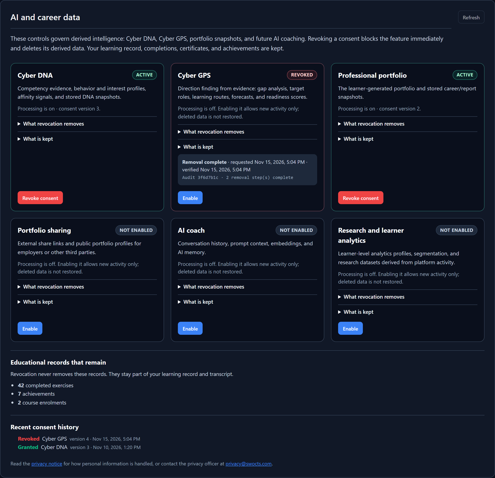

# Privacy and Your Data

You can choose how your derived learning data is used, download a copy of your
account data, or delete your account from **Profile > Security & privacy**.

## Choose how your data is used

Cyber DNA, Career GPS, the professional portfolio, portfolio sharing, AI
coaching, and research are separate choices. Open **Profile > Security &
privacy > AI and career data** to review each one.

<figure markdown>

<figcaption>Each consent can be changed independently. Revoked features show their removal status and audit ID; the educational record stays intact.</figcaption>
</figure>

| Consent | What it enables | Default |
|---|---|---|
| Cyber DNA | competency evidence, behaviour/interest profiles, affinity signals, DNA snapshots | Off — explicit opt-in |
| Career GPS | direction finding, learning routes, gap analysis, readiness | Off — explicit opt-in |
| Professional portfolio | stored portfolio and career/report snapshots | Off — explicit opt-in |
| Portfolio sharing | employer/public share links and public profiles | Off |
| AI coach | conversations, prompt context, embeddings, and memory | Off |
| Research | learner-level analytics, segmentation, and research datasets | Off |

Public scoreboards and public certificate verification are **off by default**.
You choose whether to appear publicly. Learners under 13 need an
institution-managed account created by an instructor with a parental or
guardian consent reference.

When you **revoke** a consent:

1. The feature is blocked immediately.
2. Its derived data is queued for deletion and verified when it runs, again at
   24 hours, and again at 7 days.
3. The page shows the removal status and an audit ID.
4. A keyed suppression record prevents a backup restore or replayed event from
   recreating the data.
5. Your completion record, attempts, transcript, certificates, achievements,
   enrolments, and course progress remain.

You can **enable** a feature again later. New activity is allowed, but anything
already deleted is not restored. If removal says **needs attention**, contact
your platform administrator; the job retries automatically.

## Download your data

1. Open your profile and select the **Security & privacy** tab.
2. Scroll to **Privacy and data**.
3. Click **Download my data**.

The download is a JSON file containing your profile, VPN metadata, course
enrolments, completions, flag attempts, quiz attempts, achievements, lab
sessions, event entries, and activity history. Password hashes, MFA
secrets, recovery codes, and your WireGuard private key are not included. The
download is recorded in the audit trail with the purpose "Self-service subject
access request".

## Delete your account

Deletion is immediate and cannot be undone.

1. Open **Profile > Security & privacy > Privacy and data**.
2. Click **Delete my account**.
3. Enter your current password.
4. If MFA is enabled, enter an authenticator or recovery code.
5. Type `DELETE` and click **Delete permanently**.

You are signed out when the deletion completes.

**What is removed:** your profile, email, avatar, password, MFA settings, VPN
configuration, course enrolments, progress, flags, quiz attempts, badges, lab
sessions, WebSocket tickets, and activity identifiers.

**What is kept:**

- Security and audit records are anonymised and kept for a limited period.
- Authored course material is kept with the author link removed.
- A backup taken before the deletion may contain your account until the backup
  retention period ends (30 days by default). Restores re-apply the deletion
  suppression ledger.

## If deletion is blocked

- **You own courses.** A platform administrator must transfer each course to
  another instructor first. Deleting you would also delete every enrolled
  student's course records.
- **You are the last administrator.** Promote or create another administrator
  first.

Contact your platform administrator if either applies. An instructor can
transfer your courses from **Admin → Courses → Manage**.

## Related pages

- [Changing Your Password](17_Changing_Your_Password.md)
- [Viewing Your Profile](16_Viewing_Your_Profile.md)
- [Achievements and Badges](15_Achievements_and_Badges.md)
