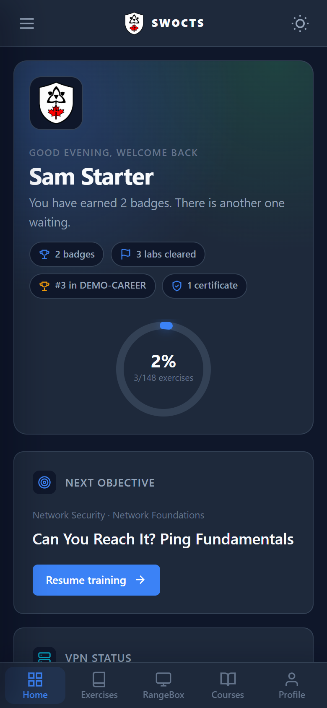

# Using a Mobile Device

The platform detects a phone-width screen and switches to a compact student
shell. The desktop layout is still used on laptops and larger tablets; a tablet
in portrait at `768px` or below gets the mobile shell.

## What changes on a phone

<figure markdown>

<figcaption>The mobile shell replaces the sidebar with a menu button, a compact top bar, and a five-tab student bottom bar.</figcaption>
</figure>

- A top bar carries the **menu** and **theme** controls.
- The sidebar becomes an off-canvas drawer. Open it with the menu button, close
  it with the close button, the backdrop, or the Escape key.
- A bottom tab bar exposes the five most-used student areas: **Home**,
  **Exercises**, **RangeBox**, **Courses**, and **Profile**.
- Wide tables and cards scroll inside their own container instead of widening
  the page.
- The fixed desktop theme switch is hidden; the top bar theme button replaces it.
- The theme button cycles **dark**, **light**, and **high contrast**. High
  contrast is the best choice for bright outdoor light or a low-quality phone
  screen.
- Pages that are much easier on a larger screen show a dismissible notice. It
  explains what will be awkward before you start; dismissing it hides it for the
  rest of the browser session.

## What works well

- Viewing the dashboard and progress.
- Browsing tracks, exercises, courses, events, and the celebration wall.
- Reading exercise briefings and launching a lab.
- Checking RangeBox status and launching a standalone desktop.
- Reading the workbook and user manual.
- Reviewing your profile, achievements, and certificates.

## What is limited

- **RangeBox desktop:** the interactive desktop is built for a keyboard and
  mouse. On a phone the embedded viewer is replaced with a short notice and an
  optional **Open the full-screen desktop anyway** link. Use a laptop for
  hands-on lab work when you can.
- **Instructor and admin views:** these are dense operational screens. They are
  reachable on a phone but are not optimised for one; use a larger screen.
- **Long workbook commands:** copying and pasting between a phone browser and a
  lab is awkward. A laptop is the better choice for command-heavy exercises.

## If the desktop layout appears

The mobile shell is applied at widths of `768px` and below. Rotate the device or
refresh the page after changing zoom. If the layout still looks wrong, report the
device and browser version to your instructor or administrator.

## Related pages

- [Navigating the Interface](../01_Getting_Started/06_Navigating_the_Interface.md)
- [Working Inside a Lab](06_Working_Inside_a_Lab.md)
- [Viewing Your Profile](16_Viewing_Your_Profile.md)
