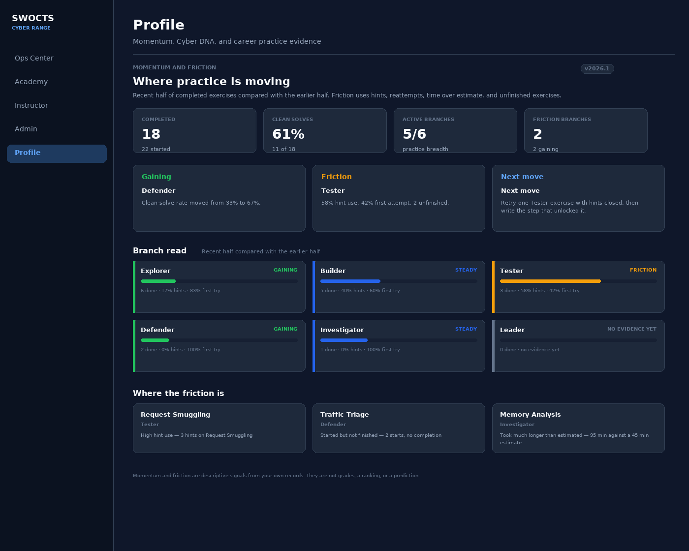
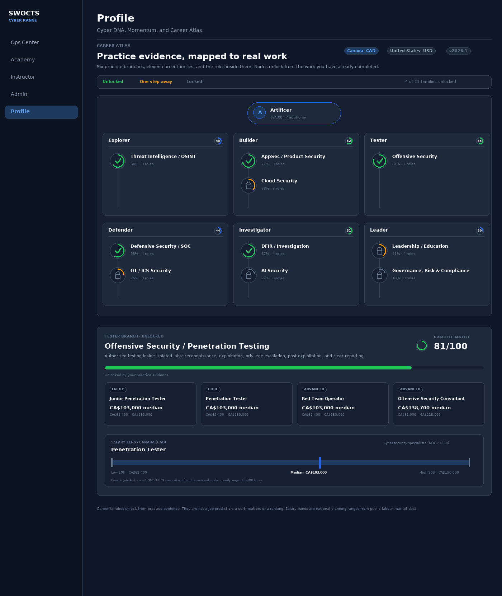

# Career Atlas and Momentum

The **Career Atlas** and **Momentum** panels extend Cyber DNA from a description
of what you have practised into a conversation about what to try next and what
kind of work that practice resembles. They are descriptive, private, and
positive. They are not grades, rankings, job predictions, or salary promises.

!!! note "Development preview"
    These surfaces are gated by **Admin -> Settings -> Features -> Advanced DNA
    Insights**. A development host may show them while production keeps the
    setting off. If the **Careers** tab is missing from your profile, the feature
    is not enabled on your deployment. Ask an administrator.

The Cyber DNA formula itself does not change. The six traits still use formula
**2026.13**. Momentum uses its own version (`2026.1`) and the Career Atlas uses
its own version (`2026.1`), so a change to the reporting layer cannot silently
change your trait scores.

## Open the surfaces

1. Open **Profile** in the sidebar.
2. Choose **Skill tree** to see **Momentum and friction** below the Cyber DNA
   section.
3. Choose **Careers** to open the Career Atlas. The tab appears only when the
   feature is enabled.

<figure markdown>

<figcaption>The Momentum panel compares your recent work with your earlier work and names one practical next move. It is a practice signal, not a grade.</figcaption>
</figure>

## Momentum and friction

Momentum answers two questions from your own completion records:

- **Where is practice gaining?** It compares the recent half of your completed
  exercises with the earlier half. A rising clean-solve rate means fewer hints
  and more first-attempt completions.
- **Where is practice under friction?** It looks at hint use, reattempts, time
  over the exercise estimate, and exercises you started but did not finish.

The panel is deliberately not a deficit score. A branch with no evidence shows
**No evidence yet**, not a zero.

### Read the summary cards

| Card | What it means |
|---|---|
| **Completed** | Completed exercises, with the number you started beside it. |
| **Clean solves** | Share of completions with no hints and one attempt. |
| **Active branches** | How many of the six Cyber DNA branches have at least one completion. |
| **Friction branches** | Branches above the friction threshold, plus how many are gaining. |

### Read the three prompt cards

- **Gaining** lists branches where the recent clean-solve rate improved by at
  least eight points. Use it to notice a habit that is working.
- **Friction** lists branches where hints, reattempts, unfinished exercises, or
  time pressure are concentrated. Use it to choose a review target, not to
  label yourself.
- **Next move** is one concrete action. Start there if you feel stuck.

### Read the branch cards

Each branch card shows:

- the branch name and status: **Gaining**, **Steady**, **Friction**, or **No
  evidence yet**;
- a friction bar from 0 to 100;
- completed exercises, hint use, and first-attempt rate;
- an earlier-versus-recent clean-solve comparison when there is enough evidence;
- one next action written for that branch.

The **Where the friction is** list names up to three exercises with a specific
reason, such as high hint use, repeated attempts, a long solve against the
estimate, or a start without a completion. Use it as a review prompt. It is not
proof that you used outside help or that you are failing.

!!! tip "Use Momentum without turning it into a grade"
    Pick one next move, try it in the next study session, and then look again.
    Do not compare your friction score with another learner. The panel is
    private to you and staff who already have access to your learner record.

## Career Atlas

The Career Atlas maps your six practice branches to eleven career families and
the roles inside them. Each family is a node on a skill tree. A node unlocks
from your practice evidence: completed labs in its branch and the strength of
your Cyber DNA affinity.

<figure markdown>

<figcaption>The Career Atlas uses a skill-tree layout. Unlocked nodes are green, one-step-away nodes are amber, and locked nodes stay visible as the next part of the map. The salary lens shows a national planning range, not an offer.</figcaption>
</figure>

### Unlock states

| State | What it means |
|---|---|
| **Unlocked** | Your completed work and affinity evidence support this direction. Open it to see the role ladder. |
| **One step away** | You have some evidence. One or two more labs in the branch usually moves the node to unlocked. |
| **Locked** | The branch has little or no evidence yet. It is the next part of the map to explore, not a negative label. |

Select any node, locked or unlocked, to read its summary, role ladder, and next
practice step. Locked nodes are intentionally readable: the point is to show a
route, not to hide one.

### Choose a salary region

Use the **Canada (CAD)** / **United States (USD)** switch in the header. The
role cards and the salary lens update to the selected country. The switch does
not change your practice evidence or unlock state.

### Read the role ladder

Each family lists roles at three levels:

- **Entry** roles are common first steps into the family.
- **Core** roles are the main professional practice.
- **Advanced** roles add scope, leadership, or specialist depth.

The role cards show the median salary for the selected region and the low-to-high
range. Select a card to open the **Salary lens**.

### Read the salary lens

The salary lens shows three national planning points:

- **Low 10th**: the 10th percentile. This is not an entry-level offer.
- **Median**: the 50th percentile. Half of workers in the official occupation
  earn more and half earn less.
- **High 90th**: the 90th percentile. Senior and specialist work can reach this
  band, but most roles do not start there.

The lens names the official occupation used for the band, the source, the
as-of date, and the basis. Open **Salary table (all roles, both regions)** for a
single table you can copy into a career conversation.

### Salary sources

| Region | Source | What it contributes |
|---|---|---|
| Canada | [Canada Job Bank](https://www.jobbank.gc.ca/trend-analysis/search-wages) | National low, median, and high hourly wages from the Statistics Canada Labour Force Survey, 2023-2024 reference period, updated 19 November 2025. Annualised at 2,080 hours. |
| United States | [U.S. Bureau of Labor Statistics OEWS](https://www.bls.gov/oes/) | National annual 10th, 50th, and 90th percentiles from the May 2025 release, via O*NET OnLine. |

The platform links to these sources; it does not copy their tables. Verify every
figure, occupation code, and requirement with the source before using it in a
job application, advising conversation, or programme decision.

!!! warning "Salary numbers are context, not a promise"
    National bands hide large differences by region, sector, experience,
    certification, and employer. They are not an offer, a starting salary, or a
    prediction that you will earn a particular amount. Use them to ask better
    questions, not to set an expectation.

## How to use the Atlas responsibly

- Treat an unlocked family as **practice evidence**, not a job label. The
  platform is saying "your completed work points here", not "you are ready for
  this role".
- Use the **next practice step** on each family to close the gap between
  interest and evidence.
- Pair technical practice with the professional skills the role needs:
  scoping, rules of engagement, reporting, communication, risk, and evidence.
- Ask an instructor, mentor, or career adviser to review the evidence with you.
  The Atlas is a conversation aid.
- Do not use the Atlas to rank learners, make admissions or hiring decisions, or
  predict performance. It is not designed or validated for high-stakes use.

## Career profile exports

The **Skill tree** tab still offers the career-profile downloads. When Advanced
DNA Insights is enabled, the Markdown and printable HTML dossiers also include
the Momentum section and the Career Atlas, including the salary source notes.
The export contains only your own data, is logged for accountability, and is not
shared automatically. See [Viewing Your Profile](16_Viewing_Your_Profile.md).

## Portfolio tab: readiness, GPS, and the evidence record

When the preview is enabled, a **Portfolio** tab sits beside **Careers**. It
turns the Atlas from a map into an answer:

- **Role readiness** for the pathway you choose, with skills held, next
  workbooks, gaps, capstone, certifications, and employer evidence.
- **Cybersecurity GPS**, an optional direction finder built from evidence,
  recent growth, and a few questions you can skip.
- **Professional portfolio**, the printable record with a portfolio ID.
- **Competency taxonomy**, the domain-by-domain assessment view.

Readiness is a curriculum-coverage estimate, not a grade or a hiring prediction.
The platform does not track employment outcomes. See
[Career readiness and the Cybersecurity GPS](https://github.com/RobChaykoski/opencyberrange/blob/main/docs/CAREER-READINESS-AND-GPS.md).

## Related pages

- [Viewing Your Profile](16_Viewing_Your_Profile.md)
- [Tracking Your Progress](11_Tracking_Your_Progress.md)
- [Career and certification resources](https://github.com/RobChaykoski/opencyberrange/blob/main/docs/CAREER-AND-CERTIFICATION-RESOURCES.md)
- [Career Atlas and Momentum design](https://github.com/RobChaykoski/opencyberrange/blob/main/docs/CAREER-ATLAS-AND-MOMENTUM.md)
- [Skill DNA reference](https://github.com/RobChaykoski/opencyberrange/blob/main/docs/SKILL-DNA.md)
