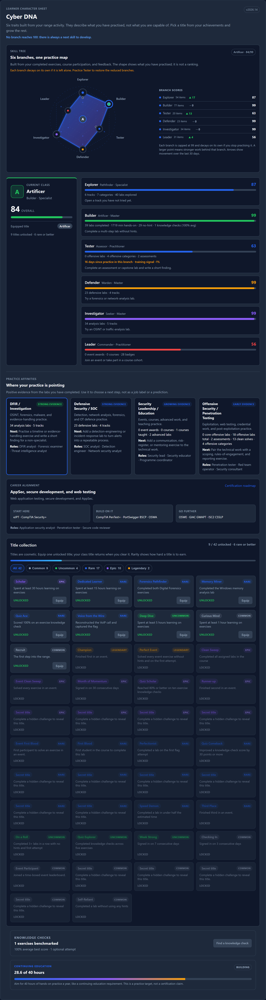
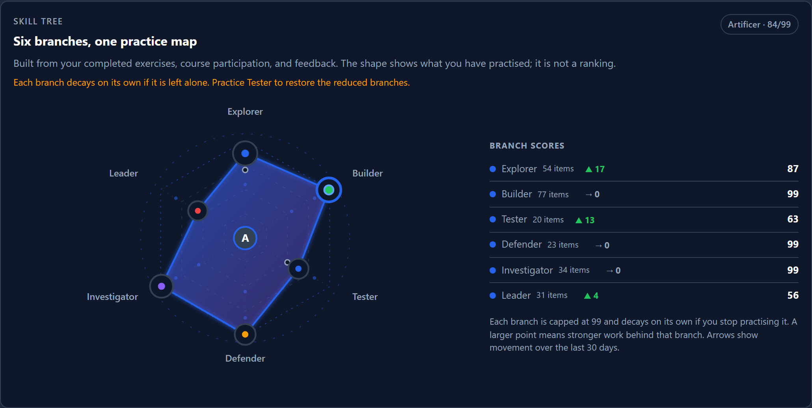
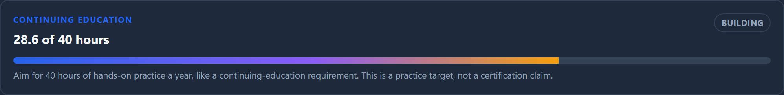
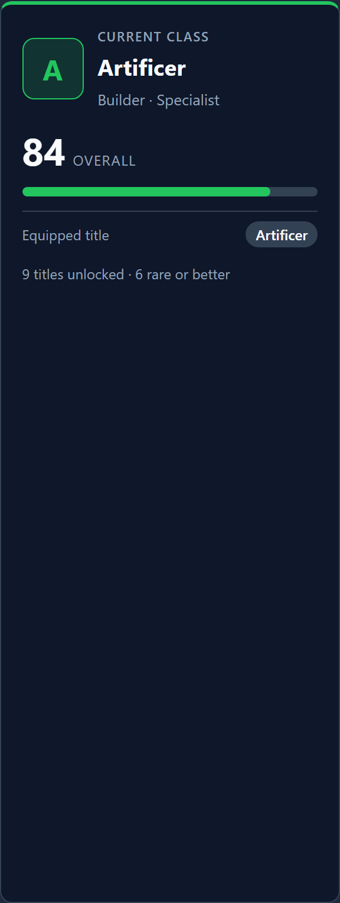

# Navigating your Cyber DNA

Cyber DNA is the learner character sheet on your profile. It turns your range
activity into six practice branches so you can see what you have practised, what
is getting stronger, and what to try next. It is descriptive, not a grade, a
ranking, or a prediction of employability.

<figure markdown>

<figcaption>The Cyber DNA section on the Skill tree tab. The class card, branch cards, affinities, titles, and continuing-education card all come from the same practice record.</figcaption>
</figure>

## Open your Cyber DNA

1. Click **Profile** in the sidebar.
2. Choose the **Skill tree** tab.
3. Read the **Six branches, one practice map** chart first, then the branch
   cards below it for the evidence and a practical next step.

The selected tab is kept in the URL, so `?tab=skill-tree` opens this view
directly. The page is private to you and to staff who already have access to
your learner record.

## The six branches

| Branch | What it reflects |
|---|---|
| **Explorer** | Breadth across tracks, categories, and labs you have opened |
| **Builder** | Hands-on completions, time on task, clean solves, and knowledge checks |
| **Tester** | Authorised offensive testing, exploitation, assessment, and reporting |
| **Defender** | Defensive, forensics, network-analysis, and OT practice |
| **Investigator** | OSINT, reconnaissance, traffic analysis, and forensics |
| **Leader** | Events, courses, badges, advanced labs, and teaching |

Your highest branch becomes your **class**: Pathfinder, Artificer, Assessor,
Warden, Seeker, or Commander. Each branch has a score, a tier from **Unranked**
(no activity yet) through Initiate to Master, and a short evidence line.

## How the score grows

- Every branch is scored from **0 to 99**. It never reaches 100: there is always
  another skill or branch to develop.
- The score grows from completed exercises, knowledge checks, course
  participation, achievements, event success, and the strength of the work.
- Stronger work leaves a heavier mark. A clean, unaided solve of an advanced or
  assessment lab counts for more than a hinted walkthrough.
- A quiz adds strength in proportion to your best score on that knowledge check.
- The overall Cyber DNA score is the average of the six branch scores, also
  capped at 99.

<figure markdown>

<figcaption>The spider chart shows the six branch scores. Larger points mean stronger work behind a branch. The arrows show movement over the last 30 days.</figcaption>
</figure>

## Branch decay and repair

Each branch has its own clock. If you stop practising a branch, it slowly gets
weaker; it does not affect the other branches. A new completion in that branch
restores it.

| Time since your last work in the branch | Training signal |
|---|---:|
| 14 days or less | 100% |
| 15 to 30 days | 99% |
| 31 to 60 days | 97% |
| 61 to 90 days | 94% |
| More than 90 days | 90% |

The floor is 90%, so the effect is a prompt to return, not a punishment. The
branch card shows the number of days since practice and the current reduction.
The overall Cyber DNA card uses the weakest branch to explain the current
signal.

## Continuing education

The **Continuing education** card tracks hands-on practice over the trailing 12
months against a **40-hour target**, similar to a continuing-education
requirement. The card shows the hours, a 0-100% bar, and whether the target is
met.

<figure markdown>

<figcaption>The continuing-education card counts hands-on minutes in the last 12 months. The target is 40 hours; the bar never goes over 100%.</figcaption>
</figure>

The target is a practice goal, not a certification claim. It is not used for
grading or access.

## Directional trend

The chart can show where a branch moved over the **last 30 days**:

- an **outward arrow** means the branch grew;
- an **inward arrow** means it moved down, for example because a branch decayed
  or older evidence fell outside the window;
- a **flat marker** means there was no movement.

The platform rebuilds the previous score from the completion and quiz
timestamps, so the trend is honest even when older data is imported or removed.
Hover a point or read the branch legend to see the previous score and the change.

## Point size and strength

The six points grow with the amount of **strong work** behind a branch, not only
with the branch score. A point backed by many labs, clean solves, advanced
labs, assessments, and high-scoring quizzes is visibly larger than a point
backed by a single completion. The branch legend shows the evidence count and
the tooltip shows the strength value.

## Class and titles

<figure markdown>

<figcaption>The class card shows your current class, overall Cyber DNA score, equipped title, and how many titles you have unlocked.</figcaption>
</figure>

Achievements unlock cosmetic **titles**. Open **Title collection**, choose an
unlocked title, and select **Equip**. Select **Clear** to return to your class
title. Hidden titles show as **Secret title** until you unlock them.

## What Cyber DNA is not

- It is not a grade, a pass/fail record, or a ranking against other learners.
- It is not a certification or a claim that you are ready for a job.
- It is not a prediction of performance or employment.
- It does not replace instructor feedback, assessment, or professional
  judgement.

Use it to notice a habit that is working, to spot a branch that has gone quiet,
and to choose one next step.

## Related pages

- [Viewing Your Profile](16_Viewing_Your_Profile.md)
- [Career Atlas and Momentum](21_Career_Atlas_And_Momentum.md)
- [Tracking Your Progress](11_Tracking_Your_Progress.md)
- [Skill DNA reference](https://github.com/RobChaykoski/opencyberrange/blob/main/docs/SKILL-DNA.md)
