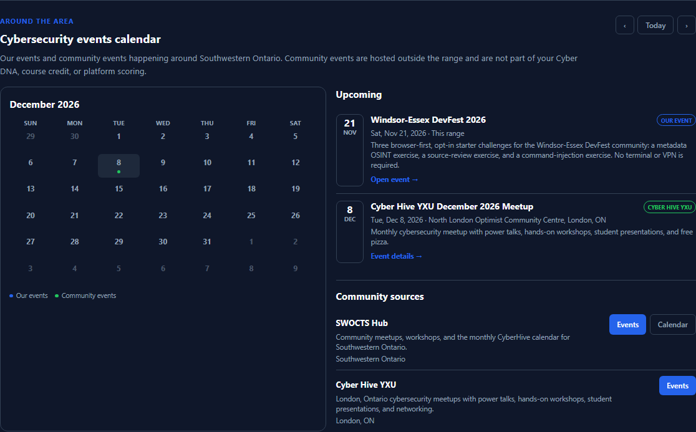

# Community Events

The **Events** tab keeps the platform's opt-in events at the top and adds an
**Around the area** calendar underneath. The calendar combines our events with
community cybersecurity events happening around Southwestern Ontario.

<figure markdown>

<figcaption>The Around the area calendar shows our events and community events on the same month grid. The upcoming list and community source cards sit beside it.</figcaption>
</figure>

## What is on the calendar

- **Our events** are platform events. They use the range exercises, follow the
  event window, and may contribute to the event leaderboard.
- **Community events** are hosted outside the range. They are listed so you can
  find local meetups and workshops. They are not part of your Cyber DNA, course
  credit, or platform scoring.

The month grid marks both kinds of event. The legend under the calendar shows
which colour is which. Use the **previous**, **Today**, and **next** controls to
move between months.

## Read the upcoming list

The **Upcoming** list shows the next events in date order. Each entry shows the
date, location, a short description, and a link:

- **Open event** for a platform event opens its detail page.
- **Event details** for a community event opens the organiser's page in a new
  tab.

## Community sources

The **Community sources** section links to the organisers we track:

- **SWOCTS Hub** — the SWOCTS events page and calendar.
- **Cyber Hive YXU** — the London, Ontario Eventbrite organiser page.

Always check the organiser's page for the latest date, time, location, and
registration details. Community events can change or fill up without notice.

!!! note "External links"
    Community links leave the platform. Their content, registration, and privacy
    practices are controlled by the organiser, not by SWOCTS Cyber Range.

## Related pages

- [Student Dashboard](01_Student_Dashboard.md)
- [Browsing Exercises](02_Browsing_Exercises.md)
- [Achievements and Badges](15_Achievements_and_Badges.md)
- [Celebration Wall](20_Celebration_Wall.md)
