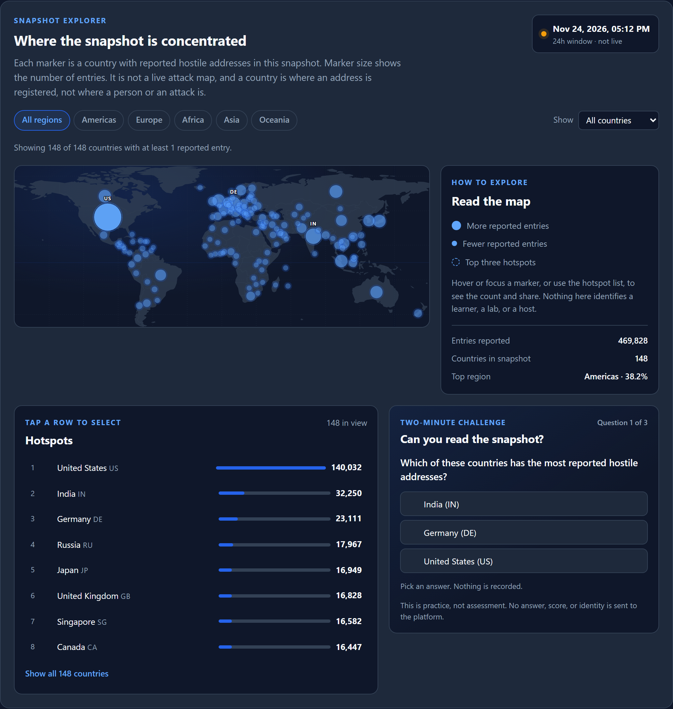
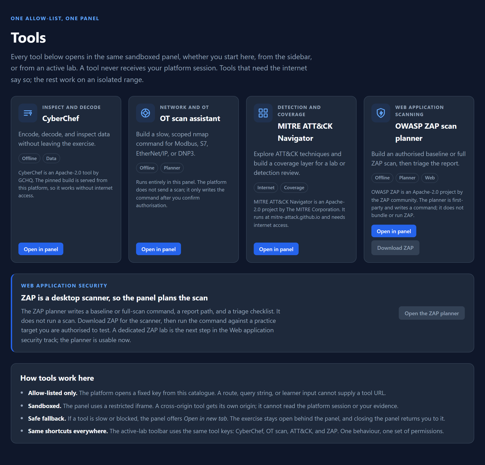

# Threat map and tools

Two parts of the sidebar help you explore beyond a single exercise: **Threat
map** under Explore, and **Tools** available to every role.

## Threat map

Open **Explore → Threat map**. The page shows where reported hostile addresses
are concentrated in the current snapshot. It is awareness material, not a live
attack map.

<figure markdown>

<figcaption>The map uses aggregate country counts. Marker size shows the number of reported entries.</figcaption>
</figure>

### What the map shows

- A world outline with one marker per country that appears in the snapshot.
- **Marker size** is the number of reported entries. The top three countries
  have a dashed ring.
- A **detail panel** with the selected country's count, share of the snapshot,
  and rank. It also repeats the attribution caveat.
- An **OpenStreetMap** link for the selected country. It opens an external site
  in a new tab; the platform does not fetch map tiles.
- A **hotspot list** with the same rows in order. It is the keyboard-friendly
  alternative to the map.
- A **two-minute challenge** with three questions. It is practice, not
  assessment. Nothing is recorded.

### Filters

- **Region** narrows the map to the Americas, Europe, Africa, Asia, Oceania, or
  Other.
- **Show** sets the minimum number of entries. The ingest suppresses small
  buckets, so a country with a tiny count may not appear at all.

### What it does not show

- Individual IP addresses, hostnames, attack paths, victims, or post links.
- Live traffic or simulated attack animation.
- Your learner record, lab session, prompts, packets, or flows.

A country is where an address is registered, not where a person or an attack is.
Shared hosting, VPNs, Tor exits, and stale feed entries all distort the picture.
Read the **How to read this** section before you use a country count in an
argument.

### Keyboard and mobile

Use the arrow keys to move between countries, **Enter** or **Space** to select,
**Home** and **End** to jump, and **Escape** to clear. The hotspot list below the
map is a complete fallback.

On a phone, the map is a preview and the hotspot list is the main way to explore.
The page is designed to be read without hover.

## Tools

Open **Tools → All tools** to see the full catalogue. Every tool opens in the
same sandboxed panel, whether you start from the catalogue, the sidebar
shortcut, or the active-lab toolbar.

<figure markdown>

<figcaption>All tools use the same allow-listed, sandboxed panel.</figcaption>
</figure>

| Tool | What it does | Works offline? |
| --- | --- | --- |
| **CyberChef** | Encode, decode, and inspect data | Yes, pinned build |
| **OT scan** | Build a slow, scoped nmap command for OT protocols | Yes, command planner |
| **ATT&CK** | Explore techniques and build a coverage layer | No, needs internet |
| **ZAP scan** | Build an authorised ZAP baseline or full-scan command | Yes, command planner |

### How the panel behaves

- The platform opens a fixed, allow-listed tool. A route or query string cannot
  supply a tool URL.
- The iframe is sandboxed. A cross-origin tool cannot read the platform session.
- If a tool is slow or blocked, use **Open in new tab**. The exercise stays open
  behind the panel.
- **Esc** or **Close** returns you to the platform. Selecting a route also closes
  the panel.

### ZAP scan planner

OWASP ZAP is a desktop scanner, so it cannot run inside the browser panel. The
planner writes a command and a triage checklist; it does not run a scan.

1. Choose **Baseline** (passive) or **Full** (active). A full scan can change or
   delete data.
2. Enter a practice target URL. Do not put credentials in the URL.
3. Choose Docker or a local ZAP install, the scan minutes, and the report
   formats.
4. Tick all three authorisation boxes to enable **Copy command**.
5. Download ZAP if you do not have it, run the command in your lab, then follow
   the **After the scan** checklist.

!!! warning
    Use a disposable target with a restore path. A full scan against a shared or
    production service is out of scope for this tool.

ZAP reports candidates. A person still has to reproduce each finding, decide
whether it matters, and write the remediation and retest note.

## Privacy

The threat map uses a local, aggregated snapshot. The Tools panel does not send
your learner record, prompts, or lab traffic to a third party. External tools
such as ATT&CK Navigator need internet access and are labelled. The ZAP planner
makes no network request at all.

## Where to go next

- [Tracking your progress](11_Tracking_Your_Progress.md)
- [Analyst answers](24_Workbook_Answers.md)
- [Evidence portfolio](26_My_Evidence.md)
- [Journey & mission](27_Your_Journey.md)
- [Impact & recognition](28_Your_Impact.md)
