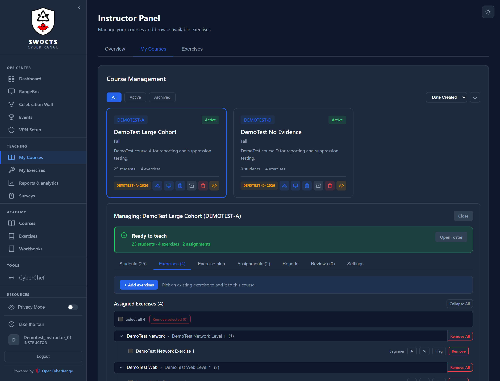

# Assigning Labs to a Course

Assigning labs is how you build the practical content of a course. From the Exercises sub-tab you pick which labs your enrolled students can launch, give them per-course display names, and remove ones you no longer need. The page covers assigning and unassigning labs; ordering them is covered separately in [Exercise Plan and Cohorts](08_Exercise_Plan_and_Cohorts.md).

## Prerequisites

- A course assigned to you. See [Creating a Course](02_Creating_a_Course.md).

## Opening the Exercises sub-tab

1. Open the **Instructor** entry in the left sidebar.
2. On the **Course workspace** tab, click **Manage** on the course card.
3. Select the **Exercises** sub-tab.

<figure markdown>

<figcaption>The Exercises sub-tab lists the assigned labs grouped by track and level, with Add exercises and per-lab actions.</figcaption>
</figure>

The sub-tab has two controls:

- **+ Add exercises**: opens the picker to add existing labs to the course.
- **Assigned Exercises**: an accordion grouped by track and level, listing the labs already in the course. Each entry has a rename (pencil) control, a Flag control, a launch (play) control, and Remove. Select all or use Remove All to clear a group.

## Assigning labs

1. Click **+ Add exercises**.
2. Pick the track, level, and labs to add from the catalog.
3. Confirm the selection.

**What you should see:** the selected labs move into **Assigned Exercises**. This adds them to the course's exercise pool; students see the labs once an assignment includes them. Create one and add these labs to it -- see [Creating and Managing Assignments](15_Creating_and_Managing_Assignments.md). Until then the course Overview reports no assigned exercises.

## Renaming a lab for the course

1. In **Assigned Exercises**, click the rename (pencil) control on a lab.
2. Enter a per-course display name.
3. Save.

**What you should see:** The lab shows your custom name in the course. Leaving the name blank restores the lab's default title.

## Removing a lab

1. In **Assigned Exercises**, click **Remove** on the lab, or **Remove All** for a whole group.

**What you should see:** The lab returns to the **Assign Exercises** picker and is no longer available to students in the course.

## Adding exercises from the picker

The **+ Add exercises** button opens a picker for adding labs **From an existing lab**. Pick the track, level, and labs you want from the built-in catalog, then add them to the course.

!!! note
    Labs with course-only visibility appear only inside the course view and stay hidden from the main exercise catalog. Assigning such a lab is what lets your enrolled students reach it.

!!! tip
    A per-course display name only changes the label inside this course. The underlying lab and its flag are unchanged.

To set the order students see these labs in, continue to [Exercise Plan and Cohorts](08_Exercise_Plan_and_Cohorts.md). To group labs into timed weeks, see [Creating and Managing Assignments](15_Creating_and_Managing_Assignments.md).

## Exporting an exercise for reuse

In the **Exercises** catalog, the download action on a row exports that exercise
as a reusable ZIP. The archive contains `lab.yaml`, `docker-compose.yml`, the
container source, a manifest, and a README.

- The flag is replaced with `OCR{REPLACE_ME}` in instructor exports, so the
  archive is safe to share.
- An administrator can import the ZIP from **Admin -> Exercises -> Import
  Exercise** and assign it to a track and level. The imported exercise is a
  draft with a newly generated flag.
- To create a new exercise from a template in this platform, use **Exercise
  Studio** when it is available on the deployment.

The Admin guide's [Managing Labs](../04_Admin_Guide/08_Managing_Labs.md) page
documents the archive format and the import steps.
