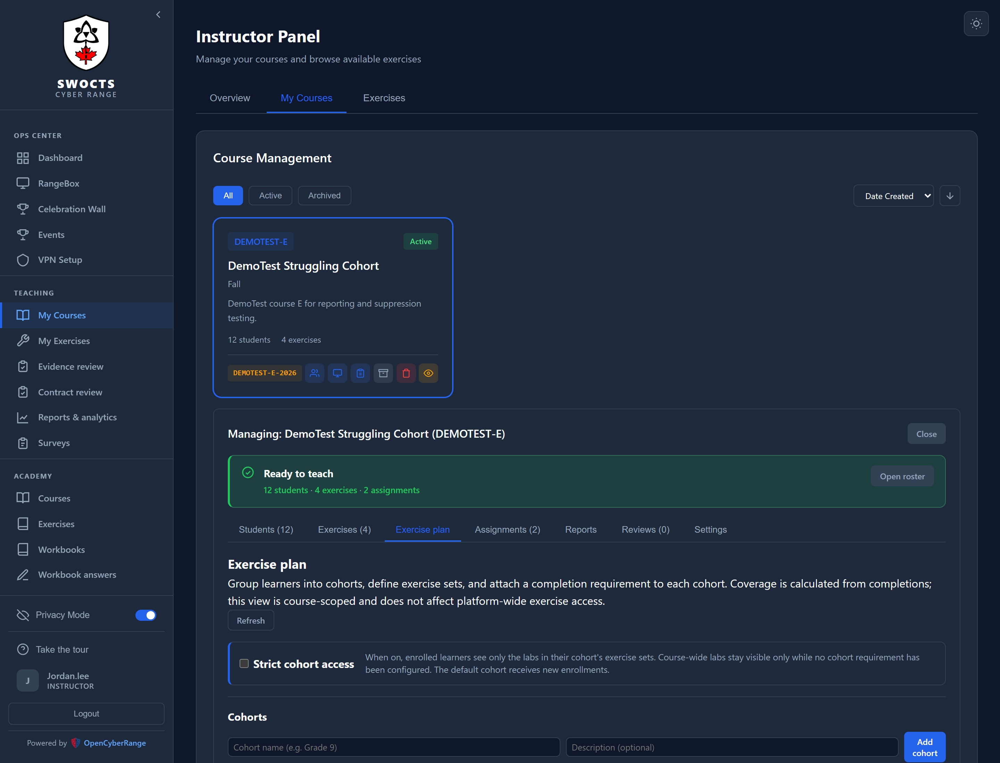

# Exercise Plan and Cohorts

The **Exercise plan** sub-tab groups learners into cohorts and gives each cohort
its own exercise set. Use it when one course runs several classes, sites, or
ability groups that should not see the same labs. Without a cohort
requirement, every enrolled learner sees the course's assigned exercises in the
normal track order.

## Prerequisites

- A course assigned to you. See [Creating a Course](02_Creating_a_Course.md).
- Labs assigned to the course. See
  [Assigning Labs to a Course](07_Assigning_Labs_to_a_Course.md).

## Open the exercise plan

1. Open the **Teaching** section in the left sidebar.
2. On the **Course workspace** tab, click **Manage** on the course card.
3. Select **Exercise plan**.

<figure markdown>

<figcaption>The Exercise plan sub-tab holds the strict cohort access switch, the cohort list, and each cohort's exercise set.</figcaption>
</figure>

## Strict cohort access

**Strict cohort access** is opt-in. When it is on:

- an enrolled learner sees only the labs in their cohort's exercise set;
- a learner with no cohort falls into the default cohort, which receives new
  enrollments;
- course-wide labs stay visible only while no cohort requirement is configured.

Leave it off for a single-cohort course. The course then behaves like a normal
assigned-lab course. Turning strict mode on for a course that already has
completions does not delete them; it only filters what each learner sees next.

## Create a cohort

1. In **Cohorts**, enter a name such as `Grade 9` or `Site B`.
2. Add an optional description for other instructors.
3. Click **Add cohort**.
4. Open the cohort, then attach the exercise set and completion requirement.

**What you should see:** the cohort appears in the list with its learner count
and its exercise-set coverage. Coverage is computed from completions and is
scoped to the course.

## Ordering

- **Assignments** reorder by dragging the cards in the **Assignments** sub-tab.
- **Labs inside an assignment** follow the order you add them; use the remove
  control and re-add to change the sequence.
- **Track and level order** comes from the curriculum catalog, not from the
  course. See [Managing Tracks and Levels](../04_Admin_Guide/18_Managing_Tracks_and_Levels.md).

!!! tip "Check the learner view"
    After you turn on strict access, use the eye icon on the course card
    (**Student Preview**) to check what a learner in that course sees. The
    preview is read-only and exits from the banner. See
    [Impersonation](../04_Admin_Guide/25_Impersonation.md).
