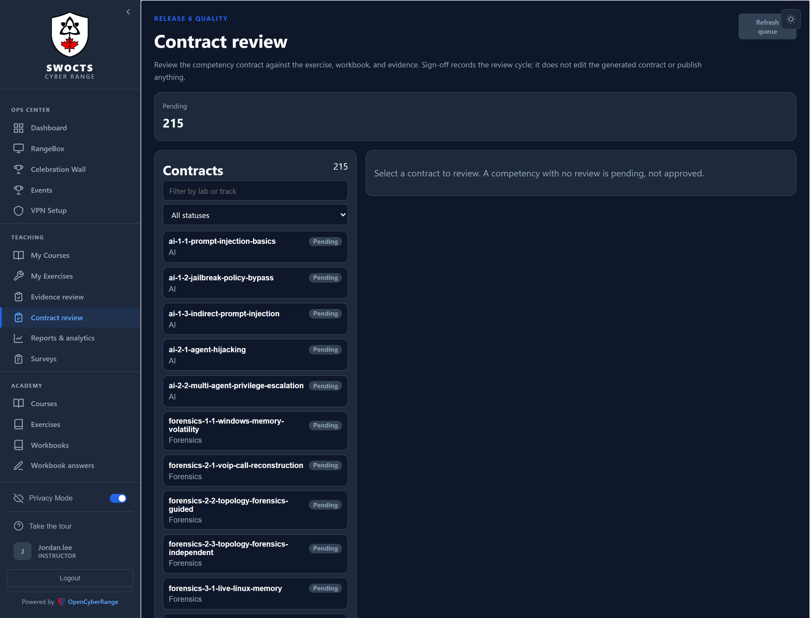
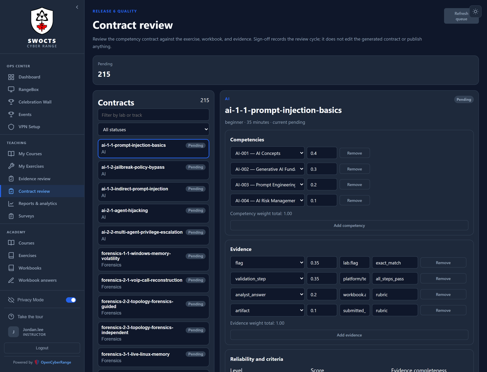

# Contract Review

Contract review is the instructor surface for the competency contract behind an
exercise. A contract states which taxonomy competencies the exercise teaches,
how much each contributes, which evidence types are accepted, and how reliable
the assessment is. The review records a signed decision and the date the
contract is due again.



## Who can use it

Instructors, institution administrators, and platform administrators can sign a
review. Mentors, teaching assistants, privacy officers, and auditors can open the
queue but cannot sign. Learners never see individual review records.

Open **Contract review** from the left navigation. The page reads the generated
contracts; it does not edit them.

## Cycle states

| State | Meaning |
|---|---|
| Pending | No signed review exists |
| Draft | A reviewer started a review but has not signed |
| Changes requested | The reviewer asked for changes; the contract is not approved |
| Current | A signed approval exists and the lab and taxonomy hashes still match |
| Due soon | The next review date is within 60 days |
| Overdue | The next review date has passed |
| Stale | The lab content or the taxonomy changed after the signature |

A later lab or taxonomy change makes the signature stale. The page shows the
current state and the review history so a stale approval is not mistaken for a
current one.

## Reviewing a contract

1. Choose a contract from the queue. Use the search and status filters to work by
   track or by urgency.
2. Check the competencies and weights against the exercise, workbook, and
   evidence. Weights must total 1.00.
3. Check the evidence types, weights, sources, and validation. Every evidence
   type must be producible and observable in the exercise.
4. Review the reliability level, score, completeness, determinism, independent
   validation, and rationale.
5. Adjust the assessment criteria when the exercise measures something different.
6. Choose a review cycle: 6, 12, or 24 months. The default is 12.
7. Write a rationale of at least 20 characters that explains what you inspected
   and why the contract is right.
8. Tick the attestation, choose **Approve** or **Request changes**, and select
   **Sign review**. **Save draft** stores the work without signing.



A signature records the contract hash, the lab content hash, and the taxonomy
hash. Another reviewer cannot overwrite your draft; an administrator must
reassign it.

## Cycle length

- **6 months** for advanced, high-use, or low-reliability contracts.
- **12 months** for most contracts.
- **24 months** for stable, low-change contracts with strong evidence.

The next review date is calculated from the signature date.

## Export

Signing does not publish anything. An administrator exports approved reviews into
`competency-contract-overrides.yaml`, regenerates the contracts, validates them,
and signs the supply-chain lock. Reviews that are stale, overdue, or
changes-requested are blocked from export.

```bash
python scripts/export-contract-reviews.py --export \
  --database-url "$DATABASE_URL" \
  --admin-export /secure/ocr-contract-reviews.json
python scripts/export-contract-reviews.py --write-overrides \
  --database-url "$DATABASE_URL"
python scripts/generate-competency-contracts.py
python scripts/export-contract-reviews.py --check
```

The manifest is pseudonymous and committable. The administrator export contains
reviewer names and rationales; store it outside the repository.

## Troubleshooting

| Problem | What to check |
|---|---|
| Sign review is disabled | The decision, attestation, 20-character rationale, and weights that total 1.00 are required. |
| The contract is marked stale | The lab content or the taxonomy changed after the signature. Review it again. |
| Another reviewer owns the draft | An administrator must reassign the draft before you can edit it. |
| Export is blocked | Only a current or due-soon approved review can be exported. |
| The competency is missing | The competency must exist in the reviewed taxonomy before it can be attached. |

## Related pages

- [Evidence Review](17_Evidence_Review.md) for the evidence that supports a
  contract.
- [Competency contract review guide](https://github.com/RobChaykoski/opencyberrange/blob/main/docs/COMPETENCY-REVIEW-GUIDE.md)
  for the operator workflow.
- [Competency review cycle](https://github.com/RobChaykoski/opencyberrange/blob/main/docs/COMPETENCY-REVIEW-CYCLE.md)
  for cycle policy and controls.
- [Competency contracts](https://github.com/RobChaykoski/opencyberrange/blob/main/docs/COMPETENCY-CONTRACTS.md)
  for the generated contract report.
