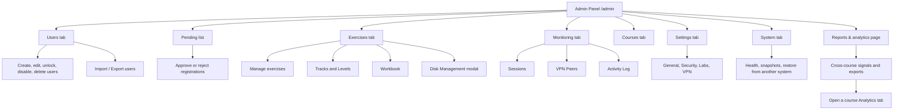

# Admin Panel Overview

The Admin Panel is the operator console for the platform. You open it to approve accounts, manage exercises, monitor live lab sessions, manage VPN peers, and change platform settings. Open it whenever you administer the range rather than play as a student.

!!! note "Edition limits"
    SWOCTS Cyber Range Community/Academic runs with one privileged account, the administrator who also owns and manages courses, and up to five active courses at a time. Student accounts are unlimited. Archive a course to free a course slot.

## Prerequisites

- An account with the admin role. See [Logging In](../01_Getting_Started/05_Logging_In.md).

## Where the Admin Panel lives

The Admin Panel is reached at `/admin`. Sign in as an admin, then open the **Admin** section of the left sidebar. The sidebar exposes seven admin links: **Users**, **Courses**, **Exercises**, **Monitoring**, **Reports & analytics**, **System**, and **Settings**, plus an external **Wiki** link. There is no top navigation bar; you move between areas from the sidebar.

The whole Admin Panel is one screen. Each admin tab link sets a `?tab=` value on the `/admin` route and swaps the main area, so Users is `/admin?tab=users`, Monitoring is `/admin?tab=monitoring`, and so on. The manual pages in this guide are task oriented, so several of them describe controls that live under the same tab.

**Reports & analytics** is the exception: it opens the separate `/reports` page rather than a tab inside `/admin`. The Admin Panel keeps its current tab while you review reporting, and the Report link is highlighted in the sidebar. See [Reporting and Analytics](28_Reporting_And_Analytics.md).

<figure markdown>

<figcaption>The Admin Panel opens on the Users tab, with platform stat cards across the top and the left sidebar for navigation.</figcaption>
</figure>

## Stat cards

The top of the panel shows stat cards that summarize platform state:

| Card | Shows | Click action |
| --- | --- | --- |
| System / Firewall / Security | Health rollup; reads "Checking..." until health loads | Opens System Health |
| Pending | Count of accounts awaiting approval | Opens the Pending list |
| Locked | Count of locked accounts | Opens the Users tab |
| Active Exercises | Count of running lab sessions | Opens Monitoring |
| VPN Peers | Count of registered WireGuard peers | Opens Monitoring |

The Pending card is the only way to reach the pending list; there is no separate sidebar link for it. See [Approving New Users](02_Approving_New_Users.md).

## Tab and sub-tab map

The Admin Panel groups every operator task under seven tabs. Some tabs hold sub-tabs or sub-views; one opens a modal. The map below shows which tab holds each task this guide covers.

## Reports and analytics

The **Reports & analytics** page gives you the cross-course view of teaching
health. It sits outside the Admin Panel tabs and opens at `/reports`.

- Summary cards: courses, learners, learning hours, pulse responses, exercise
  feedback, and red/amber/green signal counts.
- A course table with completion, abandonment, learning, feedback, confidence,
  pulse, and signal reason per course.
- A skill-tree radar for exercise coverage across the five Skill DNA branches,
  with an all-courses or single-course scope selector.
- Trending topics from optional pulse surveys.
- CSV and PDF export, each requiring a reason of at least five characters. The
  reason is written to the audit log.

Administrators see every active course. Instructors see only the courses they
own. The page is a teaching signal, not a learner ranking. Follow a course link
to the **Analytics** tab for the per-exercise evidence. See
[Reporting and Analytics](28_Reporting_And_Analytics.md) for the full walkthrough.

## Users tab at a glance

The Users tab opens by default and shows one row per account:

| Column | What it shows |
| --- | --- |
| User | Masked username and an active/inactive dot |
| Email | Masked address |
| Role | Admin, Instructor, or Student |
| Status | Active, Pending approval, Locked, or Disabled |
| Last sign-in | A relative label such as `5 min ago` or `Never`; hover for the exact local time |
| VPN | Whether a WireGuard peer is registered |
| Actions | View details, unlock, approve, edit, enable/disable, delete |

The toolbar above the table lets you:

- search by name, username, email, student ID, or organization;
- filter by status and role;
- filter by last sign-in: today, last 7 days, last 30 days, or never;
- filter by VPN registration;
- sort by needs-attention first, newest or oldest sign-in, username, or newest
  account;
- see the visible result range and clear every filter at once.

Filters compose. If a combination has no matches, the table shows an empty state
with a **Clear filters** action. Pagination returns to page 1 when a filter
changes.

### Import / Export Users

The Users tab includes an **Import / Export Users** panel:

- **Export accounts** downloads a portable JSON file. Enter a reason first; the
  reason is written to the audit log. Enable avatars only when they are needed.
- **Import accounts** accepts a file from this or another installation. Use
  **Preview** first, then **Import**. Existing usernames are skipped unless
  **Update existing usernames** is enabled.
- Password hashes travel so imported users keep their existing password. MFA,
  trusted devices, VPN keys, sessions, and learning progress are not included.
- Existing administrators are never overwritten by an import, including the
  administrator performing it.

See [Migrating Users](26_Migrating_Users.md) for the full procedure.

!!! note "Last sign-in is recorded on successful login"
    An account that has never signed in shows `Never`. The relative label is a
    quick scan; hover the cell to see the exact timestamp in the timezone
    configured for your admin account.

## Legacy deep links

Older bookmarks still resolve. The following query values redirect to the current location:

| Old link | Resolves to |
| --- | --- |
| `?tab=sessions` | Monitoring, Sessions sub-tab |
| `?tab=vpn` | Monitoring, VPN Peers sub-tab |
| `?tab=activity` | Monitoring, Activity Log sub-tab |
| `?tab=labs` | Exercises, manage view |
| `?tab=curriculum` | Exercises, Tracks and Levels view |

!!! note "Privacy mode masks identities"
    Privacy Mode is an optional toggle in the instructor and admin sidebar, off by default. Turn it on to mask usernames and emails in the Users table and any roster, session, or activity view, so you can share the panel during a class even when real accounts are present.

!!! tip "Health card reads Checking..."
    A health card that reads "Checking..." has not finished its first poll. Give it a moment, or open System Health directly from the card.
