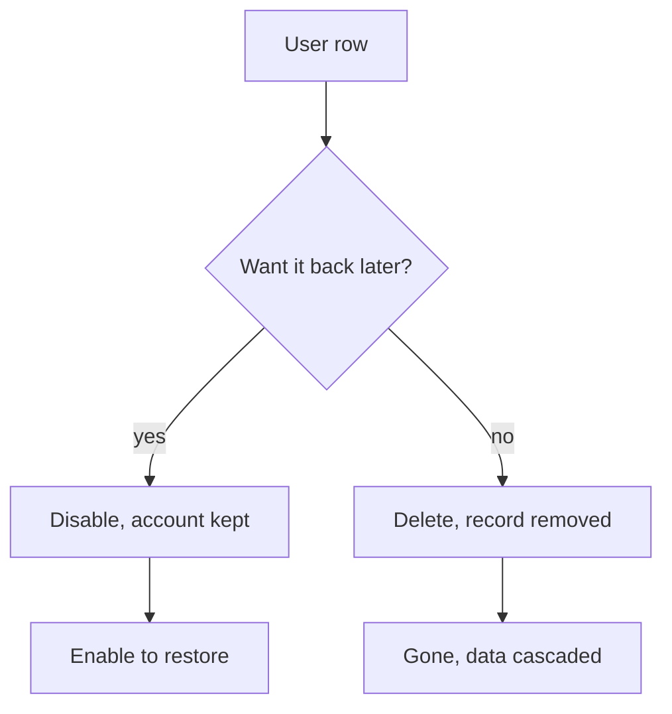

# Deleting Users

You delete a user to remove a throwaway or duplicate account for good. Deletion is permanent and removes the account's data with it, so prefer disabling an account when you only want to stop someone from signing in.

## Prerequisites

- An admin account. See [Admin Panel Overview](01_Admin_Panel_Overview.md).

## Delete versus disable

Two row actions remove access in different ways. Disable is reversible; Delete is not.

| Action | Control | Effect | Reversible |
| --- | --- | --- | --- |
| Disable | Disable/Enable toggle | Deactivates the account; it cannot sign in but the record stays | Yes, re-enable from the same toggle |
| Delete | Trash icon | Removes the account and cascades to its sessions, enrollments, and progress | No |

## Disable an account

1. Open the Admin Panel and click **Users** in the sidebar (`/admin?tab=users`).
2. On the row, click the **Disable** action. The same control reads **Enable** for an account that is already disabled.

**What you should see:** the row marks the account inactive. The Disabled status filter lists it, and the user can no longer sign in until you enable it again.

## Delete an account

1. Find the account on the Users tab.
2. Click the **Delete** action (the trash icon) on the row.
3. Type the username exactly when prompted, then confirm.

**What you should see:** the row disappears and the account's personal data is erased. Rejecting a pending account from the [Pending list](02_Approving_New_Users.md) performs the same delete.

!!! warning "Delete is an erasure, not a hide"
    Deletion removes the account's profile, VPN configuration, lab sessions, course enrolments, progress, badges, quiz attempts, and activity identifiers. It cannot be undone. Never delete a real student without a documented request. When in doubt, disable instead.

### If deletion is blocked

Two guards protect other people's data:

- **The account owns courses.** Transfer each course first in **Admin → Courses → Manage → Assigned instructor**. Deleting the instructor would otherwise delete every enrolled student's course records.
- **The account is the last usable administrator.** Promote or create another administrator first.

### Backups and erased accounts

A backup taken before the deletion can still contain the account until it ages out of the retention window. After restoring a database, run `scripts/purge_erased_accounts.py` so the live suppression ledger is re-applied. The upgrade script copies the ledger and skips erased accounts during a user merge. See [Privacy, Erasure, and Backups](27_Privacy_And_Erasure.md).

Students can also delete their own account from **Profile → Privacy and data**. That path requires their password, MFA code when enabled, and typing `DELETE`.

To deactivate without removing data, use Disable above. To change account details, see [Editing User Accounts](04_Editing_User_Accounts.md).
