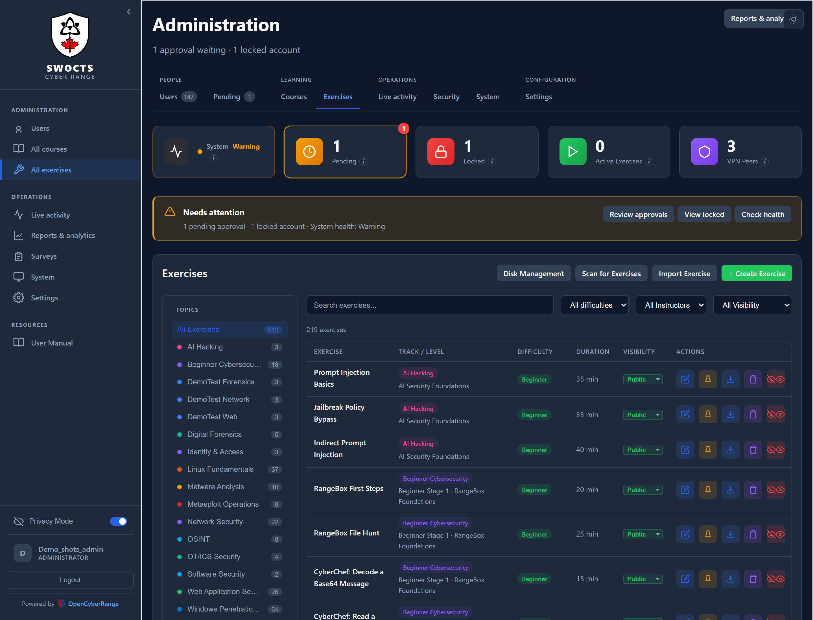
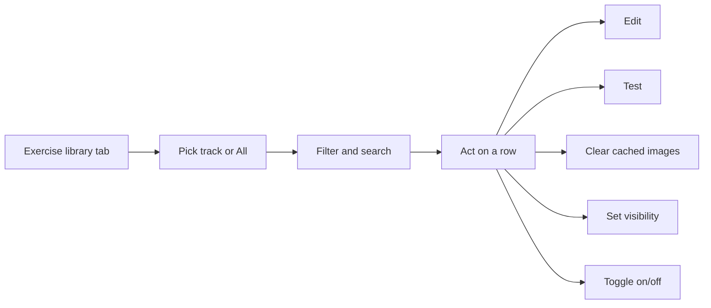
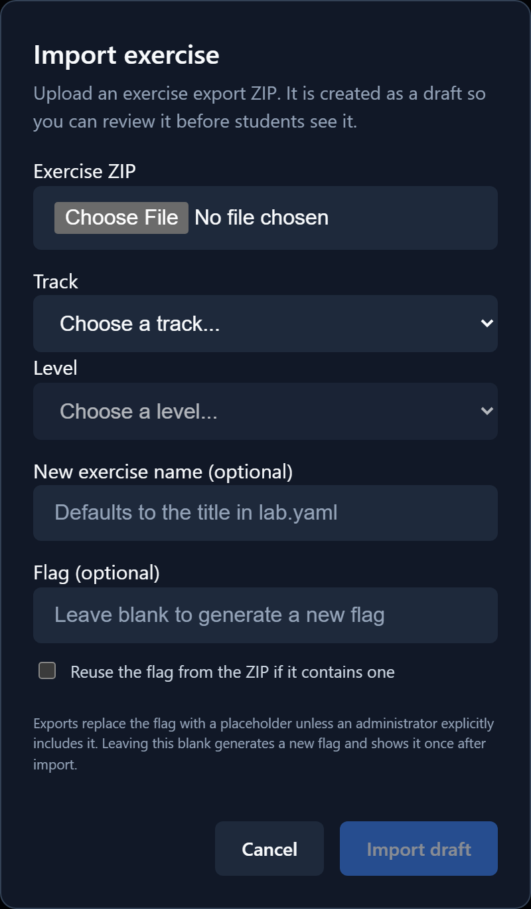

# Managing Labs

The Exercise library tab is where you browse, filter, and act on every lab on the platform. You work here to find an exercise, change its visibility, run a quick test, clear cached images, or open it for editing. The platform calls each lab an Exercise.

## Prerequisites

- An admin account. See [Admin Panel Overview](01_Admin_Panel_Overview.md).

## Open the Exercise library tab

1. Open the Admin Panel and click **Exercises** in the sidebar. The route is `/admin?tab=labs`.

**What you should see:** the Exercises panel with a left sidebar (Topics, Status, Management), header buttons, and the exercise table.

<figure markdown>

<figcaption>The Exercise library tab lists every exercise, with a left sidebar for topic, status, and management views.</figcaption>
</figure>

## Review status

The **Review** column shows the current competency-contract state for an
exercise:

| Badge | Meaning |
| --- | --- |
| Reviewed | A subject-matter review and a live harness run are recorded. |
| Pathway | Implemented from a pathway plan; the contract is still provisional. |
| Baseline | Derived from the baseline catalogue and awaiting review. |
| Pending | A contract exists but the review is incomplete. |
| Unmapped | No competency contract is registered for the exercise. |

Hover the badge to see the content version, review date, and whether a flag is
recorded. This is a review-record indicator, not proof of a live harness run.
Use the test-tube action on a row to run the exercise tester.

## Header buttons

| Button | Action |
| --- | --- |
| Disk Management | Opens the Docker images and build-cache modal |
| Scan for Exercises | Runs lab discovery to pick up new or changed lab definitions |
| Import Exercise | Uploads an exercise export ZIP as a draft |
| + Create Exercise | Opens the modal to define a new exercise |

## Filter and find an exercise

The left sidebar narrows the list:

- **Topics** filters by track, or shows **All Exercises**.
- **Status** filters by Enabled or Disabled, or shows All.
- **Management** switches to the **Tracks & Levels** and **Workbook** views.

The filter bar above the table adds a search box, a difficulty filter, an instructor filter, and a visibility filter.

## Per-row actions

Each exercise row carries these actions:

| Action | Effect |
| --- | --- |
| Edit exercise (pencil) | Opens the Edit Exercise modal. See [Editing Lab Metadata](10_Editing_Lab_Metadata.md) |
| Export exercise (download) | Downloads a reusable ZIP with the flag replaced by a placeholder |
| Delete cached Docker images (trash) | Clears the cached image so the next spawn rebuilds |
| Disable/Enable toggle (eye) | Turns the exercise on or off. See [Enabling and Disabling Labs](09_Enabling_and_Disabling_Labs.md) |

The Visibility select in each row sets Public, Course, Pending, or Draft.

!!! tip "Scan for Exercises picks up new labs"
    After adding or changing a lab definition on disk, click **Scan for Exercises** to register it. Discovery may report scan warnings, which appear in a dismissible banner above the table.

## Export and import exercises

Use **Export exercise** on a row to download the exercise source as a ZIP. The
archive contains `lab.yaml`, `docker-compose.yml`, the `containers/` files, a
manifest, and a short README. By default the flag is replaced with
`OCR{REPLACE_ME}` so the archive is safe to share for reuse. A trusted operator
can call the export API with `include_flag=true` for a backup; treat that archive
as credential material.

<figure markdown>

<figcaption>Import creates a draft. Leave the flag blank to generate a new one; it is shown once after import.</figcaption>
</figure>

To import:

1. Click **Import Exercise** in the Exercises header.
2. Select the ZIP, a track, and a level.
3. Optionally enter a new name or flag. Leave the flag blank to generate one.
4. Click **Import draft**.
5. Store the generated flag if one is shown. The exercise is created with
   visibility **Draft** and owned by you.
6. Review and test it, then change visibility when it is ready.

The importer runs the same validation as an instructor upload: ZIP size and
bomb limits, path traversal rejection, required files, and compose checks. It
never publishes automatically. If `test.steps` or an entrypoint hardcodes the
old flag, update it to the new flag after import.

The exporter and importer both use the platform's exercise-transfer service;
the archive format is the same `lab.yaml` + `docker-compose.yml` + `containers/`
layout described above.

!!! warning "Stale cached images hide changes"
    A cached lab image can mask a changed Dockerfile, so the next spawn runs the old build. Click the per-row **Delete cached Docker images** action to force a rebuild on the next spawn.
