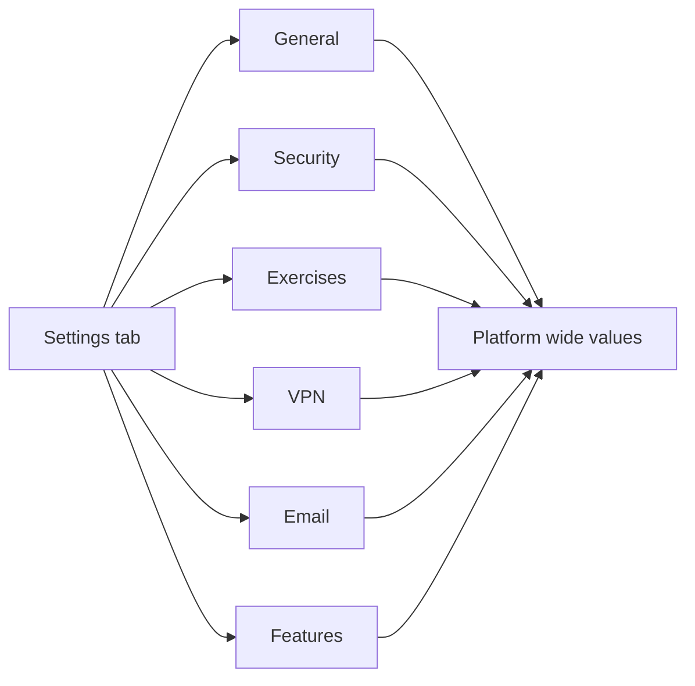
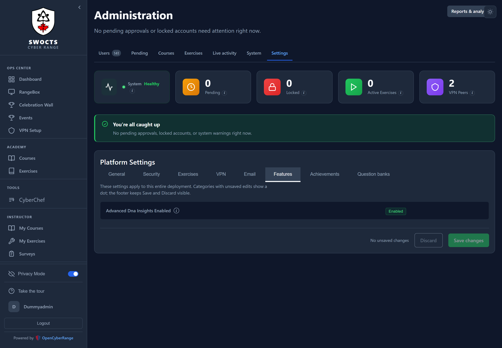

# Platform Settings

Platform Settings is where you tune platform-wide behavior: general identity values, security limits, lab defaults, and VPN parameters. You open it when you need to change a value that applies to every user, not to a single course or lab.

## Prerequisites

- An admin account. See [Admin Panel Overview](01_Admin_Panel_Overview.md).

## Where it lives

The settings screen is the **Settings** tab of the Admin Panel, reached from the **Settings** link in the left sidebar (or directly at `/admin?tab=settings`). The settings live behind six category tabs: General, Security, Exercises, VPN, Email, and Features.

The six settings categories and what each one controls.

## Steps

1. Open the **Settings** tab from the sidebar.
2. Click a category tab: **General**, **Security**, **Exercises**, **VPN**,
   **Email**, **Features**, **Modules**, **Achievements**, or **Question banks**.
   The last three appear as their own workspaces rather than key/value rows.
3. Edit the values in the rows. Each row uses the control that fits its type:
   - A boolean shows an **Enabled** / **Disabled** toggle button.
   - A value whose key contains "color" shows a color picker.
   - Any other value shows a text or password input. Keys with units show the unit beside the input.
4. Hover the small **i** icon next to a setting name to read its description.
5. Click **Save Settings** to write your changes.

<figure markdown>

<figcaption>The Settings tab with category tabs across the top and one editable row per value.</figcaption>
</figure>

## What you should see

After you click **Save Settings**, the button shows "Saving..." and then returns to "Save Settings". The values you entered persist when you switch categories and return.

!!! warning "No exclamation marks in any value"
    Use `#` instead of `!` in any credential or password setting. An exclamation mark breaks shell handling through bash history expansion.

!!! warning "No Unicode dashes in any value"
    Do not paste en-dashes or em-dashes into a setting value. The PDF report generator uses a latin-1 font and crashes on Unicode dashes. Use a hyphen, comma, colon, or period.

!!! note "Secret values are masked"
    A secret value renders as a row of dots. To change it you type the full new value; the masked placeholder is not the stored secret.

## Privacy mode

The **Security** tab includes the administrator privacy controls. **Privacy Mode
(this browser)** masks usernames, emails, display names, and student IDs in the
admin views for the current browser; hover or focus a masked value to reveal it.
**Default Privacy Mode** sets whether administrators start with masking on when
they have no saved preference. An explicit per-browser choice always wins. The
sidebar keeps the same current-browser toggle for quick access.

The same tab includes **Analytics Minimum Cohort**. Course and exercise
analytics below that learner count are suppressed rather than shown as zero;
the interface distinguishes **Suppressed** from **No evidence yet**. Reports and
exports also exclude suppressed courses from aggregate totals. The default is
5 learners; set it to 0 only in a trusted test environment.

### Instructor and administrator accounts

**Maximum Privileged Accounts** controls how many instructor and administrator
accounts the install may have. The edition default is **1**. Raise it to add
more instructors or admins, or set it to **0** for unlimited. The cap applies
when you create a user or change a user's role to instructor or admin.

Use **Admin -> Users -> Create User** to add an account and choose the role.
Use **Edit** on an existing user to promote a student to instructor or admin.
The change takes effect on the account's next request.

**Timed Exercise Accommodation** adds extra time to lab sessions and session
extensions. `100%` is the normal length; `150%` gives 50% extra time; the
maximum is `300%`. Record the accommodation decision outside the platform and
use the smallest percentage that meets the learner's approved plan.

## Achievement studio

The **Achievements** tab is a grouped, filterable studio for every badge in the
platform. Built-in badges and your own goals share one catalogue, with summary
cards, a search box, and filters for group, tier, source, and state.

Each badge has a **tier** (Bronze, Silver, Gold, Platinum) and a **difficulty**
(Starter, Standard, Advanced, Expert). The point value is derived from both, so a
Platinum Expert badge is worth more than a Bronze Starter badge. Use the preview
card while you create or edit a goal to see the value before you save it.

- **Built-in** badges are code paths. They are read-only in the studio.
- **Custom** badges use a trigger and a threshold. They are evaluated after the
  built-in checks on the next correct flag.
- **Hidden** badges stay out of the learner's list until they are earned.
- Deleting a custom badge keeps awards that learners already earned.

The **Question banks** tab is separate and admin-only. It shows the full
certification-aligned question data, including answers, explanations, and public
references. Learners only ever receive a three-question sample and see the
answer key after they submit. Run **Run validation** after editing a bank; it
checks ids, correct indexes, explanations, objectives, duplicate prompts, and
references. References must be public `https://` sources, not the platform
itself.

## Advanced DNA Insights (development preview)

The **Features** tab contains **Advanced DNA Insights**
(`advanced_dna_insights_enabled`). It is **Off by default**. When enabled, it
adds three learner-facing surfaces:

- **Momentum and friction** below the Cyber DNA skill tree.
- A **Careers** profile tab with the Career Atlas.
- Momentum and Career Atlas sections in the career-profile Markdown and
  printable HTML dossiers.

The Cyber DNA formula does not change. Momentum and the Career Atlas are a
derived reporting layer with their own version numbers. The Career Atlas links
salary bands from Canada Job Bank and the U.S. Bureau of Labor Statistics; the
figures are national planning ranges, not offers or predictions.

<figure markdown>

<figcaption>The Features tab holds the Advanced DNA Insights gate. Production keeps the default Off until the review in docs/CAREER-ATLAS-AND-MOMENTUM.md is signed off.</figcaption>
</figure>

To enable it on a development host:

1. Open **Admin -> Settings -> Features**.
2. Set **Advanced DNA Insights** to **Enabled**.
3. Click **Save Settings**.
4. Ask the learner to reload the profile. The **Careers** tab appears when the
   profile API returns the new data.

To disable it, set the same toggle to **Disabled** and save. The surfaces and
dossier sections disappear immediately; learner completion records are not
deleted. The setting is audited like any other platform setting.

!!! warning "Development preview only"
    Keep this setting **Off** on production until the review in
    `docs/CAREER-ATLAS-AND-MOMENTUM.md` is signed off. The feature is
    descriptive and private, but salary data and career framing need an
    institutional review before learner-facing release.

## RangeBox capacity

The **Exercises** tab includes the **RangeBox capacity** card. The platform
computes a physical maximum from the host's memory, CPU, and disk headroom. The
live cap is a percentage of the capacity ceiling, **75% by default**. The ceiling
is the measured Level 4 stress-test maximum when one has been recorded; until
then it is the computed maximum. The remaining headroom protects the backend,
database, SIEM, and interactive VNC.

The card shows the computed maximum, the measured ceiling, the saved live cap,
and the number of RangeBoxes running now. Change **RangeBox Capacity Percentage**
to any value between 10 and 100, then click **Save Settings**. The effective cap
is applied without restarting the platform.

**Run ceiling test** starts a Level 4 RangeBox VNC load test at the computed
maximum. The test spawns real desktop containers, so run it on an idle host and
follow progress in **System → Stress Tester**. A run that attempts at least 90%
of the computed maximum is recorded as the measured ceiling and the live cap is
recalculated from it. Lower the percentage if the test reports failed first-frame
latency or host pressure.

An explicit `MAX_CONCURRENT_RANGEBOXES` environment variable pins an exact cap
and bypasses the percentage. The card says so when that override is active.

## Registration email

The **Email** tab configures the SMTP relay used for registration messages and
admin test email.

1. Set **Mail Enabled** to **Enabled**.
2. Enter the **Mail Host**, **Mail Port**, and **Mail Security** values from your
   provider. Use STARTTLS on port 587, SSL/TLS on port 465, or None on port 25.
3. Enter the SMTP username and password when your relay requires authentication.
4. Set **Mail From Email** to an address your relay is allowed to send from, and
   optionally change **Mail From Name**.
5. Set **Mail Public URL** to the address students use in the browser, for
   example `https://range.example.com`. This is used in the sign-in link.
6. Click **Save Settings**, then click **Send test email**. The test goes to the
   signed-in administrator unless the API is called with another recipient.

Registration email is best effort. A missing or failed SMTP relay never blocks
account creation; the failure is logged and the account remains usable.

The same relay also sends the **Forgot username** message. A learner enters the
email address on their account and the platform mails the username to that
address only. The response is identical for unknown addresses, so the form
cannot be used to enumerate accounts. No password is ever included. Configure
SMTP before telling learners to use the **Forgot username?** link on the login
page.

!!! warning "Protect the settings database"
    The SMTP password is stored in `platform_settings` and masked in the admin
    API, not encrypted separately. Treat database backups and exports as
    sensitive, and use a relay-specific credential rather than a personal
    mailbox password.

!!! tip "Empty categories are normal"
    A category with no live settings shows "No settings in this category." That is expected, not an error.
