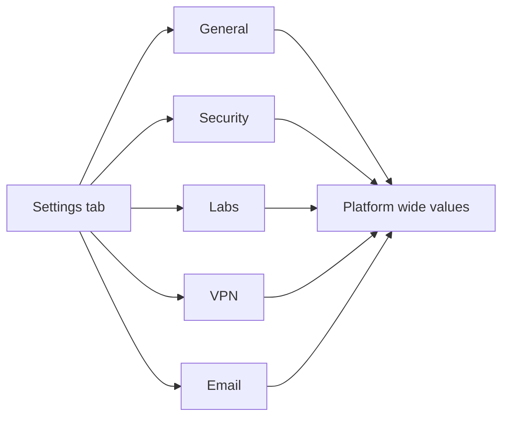

# Platform Settings

Platform Settings is where you tune platform-wide behavior: general identity values, security limits, lab defaults, and VPN parameters. You open it when you need to change a value that applies to every user, not to a single course or lab.

## Prerequisites

- An admin account. See [Admin Panel Overview](01_Admin_Panel_Overview.md).

## Where it lives

The settings screen is the **Settings** tab of the Admin Panel, reached from the **Settings** link in the left sidebar (or directly at `/admin?tab=settings`). The settings live behind five category tabs: General, Security, Labs, VPN, and Email.

The five settings categories and what each one controls.

## Steps

1. Open the **Settings** tab from the sidebar.
2. Click a category tab: **General**, **Security**, **Labs**, **VPN**, or **Email**.
3. Edit the values in the rows. Each row uses the control that fits its type:
   - A boolean shows an **Enabled** / **Disabled** toggle button.
   - A value whose key contains "color" shows a color picker.
   - Any other value shows a text or password input. Keys with units show the unit beside the input.
4. Hover the small **i** icon next to a setting name to read its description.
5. Click **Save Settings** to write your changes.

<figure markdown>

<figcaption>The Settings tab with category tabs across the top and one editable row per value.</figcaption>
</figure>

## What you should see

After you click **Save Settings**, the button shows "Saving..." and then returns to "Save Settings". The values you entered persist when you switch categories and return.

!!! warning "No exclamation marks in any value"
    Use `#` instead of `!` in any credential or password setting. An exclamation mark breaks shell handling through bash history expansion.

!!! warning "No Unicode dashes in any value"
    Do not paste en-dashes or em-dashes into a setting value. The PDF report generator uses a latin-1 font and crashes on Unicode dashes. Use a hyphen, comma, colon, or period.

!!! note "Secret values are masked"
    A secret value renders as a row of dots. To change it you type the full new value; the masked placeholder is not the stored secret.

## Privacy mode

The **Security** tab includes the administrator privacy controls. **Privacy Mode
(this browser)** masks usernames, emails, display names, and student IDs in the
admin views for the current browser; hover or focus a masked value to reveal it.
**Default Privacy Mode** sets whether administrators start with masking on when
they have no saved preference. An explicit per-browser choice always wins. The
sidebar keeps the same current-browser toggle for quick access.

The same tab includes **Analytics Minimum Cohort**. Course and exercise
analytics below that learner count are suppressed rather than shown as zero;
the interface distinguishes **Suppressed** from **No evidence yet**. Reports and
exports also exclude suppressed courses from aggregate totals. The default is
5 learners; set it to 0 only in a trusted test environment.

## Registration email

The **Email** tab configures the SMTP relay used for registration messages and
admin test email.

1. Set **Mail Enabled** to **Enabled**.
2. Enter the **Mail Host**, **Mail Port**, and **Mail Security** values from your
   provider. Use STARTTLS on port 587, SSL/TLS on port 465, or None on port 25.
3. Enter the SMTP username and password when your relay requires authentication.
4. Set **Mail From Email** to an address your relay is allowed to send from, and
   optionally change **Mail From Name**.
5. Set **Mail Public URL** to the address students use in the browser, for
   example `https://range.example.com`. This is used in the sign-in link.
6. Click **Save Settings**, then click **Send test email**. The test goes to the
   signed-in administrator unless the API is called with another recipient.

Registration email is best effort. A missing or failed SMTP relay never blocks
account creation; the failure is logged and the account remains usable.

The same relay also sends the **Forgot username** message. A learner enters the
email address on their account and the platform mails the username to that
address only. The response is identical for unknown addresses, so the form
cannot be used to enumerate accounts. No password is ever included. Configure
SMTP before telling learners to use the **Forgot username?** link on the login
page.

!!! warning "Protect the settings database"
    The SMTP password is stored in `platform_settings` and masked in the admin
    API, not encrypted separately. Treat database backups and exports as
    sensitive, and use a relay-specific credential rather than a personal
    mailbox password.

!!! tip "Empty categories are normal"
    A category with no live settings shows "No settings in this category." That is expected, not an error.
