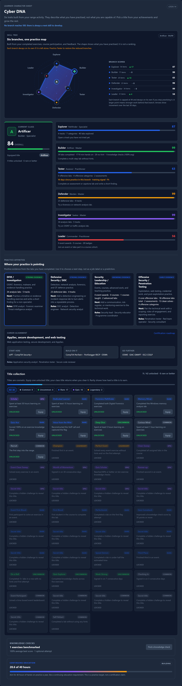

# Cyber DNA and RangeBox Operations

This page is for administrators and instructors who need to understand, verify,
or support the Cyber DNA learner model and the in-browser RangeBox desktop. It
describes the current development build. The learner-facing walkthrough is
[Navigating your Cyber DNA](../02_Student_Guide/22_Navigating_Your_Cyber_DNA.md).

## Cyber DNA model

The Cyber DNA model is formula-based and versioned. The current formula is
**2026.14**. The formula lives in
`platform/backend/app/services/skill_dna.py`; scores are not stored as editable
columns.

| Property | Current behaviour |
|---|---|
| Branches | Explorer, Builder, Tester, Defender, Investigator, Leader |
| Branch score range | 0 to 99 |
| Overall score | Average of the six branches, capped at 99 |
| Score ceiling | A branch and the overall score never reach 100 |
| Decay | Per branch, based on the last completion or quiz in that branch |
| Decay floor | 90% after more than 90 days |
| Repair | A new completion in the branch restores the factor |
| Continuing education | Hands-on minutes in the trailing 12 months against 40 hours |
| Trend window | 30 days, rebuilt from completion and quiz timestamps |
| Point size | Grows with the strength of the work behind the branch |

### Decay schedule

| Days since last work in the branch | Factor |
|---|---:|
| 0 to 14 | 1.00 |
| 15 to 30 | 0.99 |
| 31 to 60 | 0.97 |
| 61 to 90 | 0.94 |
| More than 90 | 0.90 |

The factor is applied only to the branch that has gone quiet. The other branches
keep their own clocks. A completion or knowledge check in the branch resets its
clock to the top band.

### Evidence and strength

The score uses completed labs, knowledge checks, course participation,
achievements, event success, and the strength of the work. A clean, unaided
solve of an advanced or assessment lab weighs more than a hinted walkthrough. A
quiz adds strength in proportion to the learner's best score on that knowledge
check. The spider-chart point size follows this strength value, not only the
branch score.

### Continuing education

The continuing-education card counts hands-on minutes from completions in the
trailing 12 months and compares them with a 40-hour target. The bar is capped at
100%. It is a practice goal, not a certification claim, and it is not used for
grading or access.

### Directional trend

The 30-day trend is reconstructed by rebuilding the branch scores from records
older than the cutoff. No snapshot table is required, and imported or removed
records are reflected honestly. The profile shows an outward arrow for growth,
an inward arrow for decline, and a flat marker for no movement.

<figure markdown>

<figcaption>The learner-facing Cyber DNA section. The formula version is shown at the top right of the section.</figcaption>
</figure>

## Admin controls and feature flags

- **Advanced DNA Insights** is the feature flag for the Careers and Portfolio
  tabs, Momentum, the Career Atlas, and the Cyber GPS. Find it under
  **Admin -> Settings -> Features**.
- There is no admin field that directly edits a learner's Cyber DNA score. The
  score is derived from the learner record on every read.
- The profile summary API returns the formula version, branch scores, evidence
  counts, evidence strength, recency, trend, continuing education, and the
  public signal metadata.
- Reports and PDFs should quote the formula version when they quote a Cyber DNA
  score. A formula change is a version change, not a silent recalculation.

!!! warning "Do not hand-edit scores"
    Editing completion, quiz, or achievement rows to change a learner's Cyber
    DNA breaks the audit trail and can make reports inconsistent. Correct the
    underlying learning record instead, then let the formula recalculate.

## RangeBox desktop

The RangeBox is the in-browser noVNC desktop. It is available when the lab
session has `rangebox_enabled` and a session ID. On desktop, the exercise page
puts the desktop, briefing, flag panel, and workbook into one workspace. On
phones, the platform keeps the stacked panel and the mobile gate.

### Controls

| Control | What it does |
|---|---|
| **Stream quality** | High quality, Balanced, or Low bandwidth. Applies noVNC quality and compression live. |
| **Ctrl+Alt+Del** | Sends the key combination to the guest. Useful for Windows sign-in and lock screens. |
| **Fullscreen** | Uses the browser Fullscreen API when allowed, with a CSS fallback. |
| **Clipboard** | Text-only transfer. Files are rejected in both directions. |
| **Paste** | Reads the browser clipboard, extracts `OCR{...}`, and fills the flag field. |
| **Use as flag** | Copies the RangeBox clipboard text into the flag field. |
| **Pop out** | Opens the desktop in its own resizable window. The main tab keeps the briefing, notes, and workbook. |
| **Open in new tab** | Opens the full RangeBox route in a normal tab. |

### Flag capture

Copying an `OCR{...}` value inside the guest updates the RangeBox clipboard and
fills the in-window flag field automatically. The learner can check the value and
submit. If the guest clipboard does not propagate, the **Paste** button reads the
browser clipboard and extracts the flag. Pasting a log line or shell prompt into
the flag field keeps only the first `OCR{...}` value, so a correct flag is not
rejected for the wrapper around it.

### Workbook in the workspace

The workbook is a same-origin iframe in the workspace. The platform hides the
MkDocs header, tabs, sidebars, and footer inside the frame, widens the article,
and lets the iframe scroll independently. The learner can read and scroll the
workbook while the RangeBox stays open. **Expand** increases the workbook pane;
**Open in new tab** opens the full workbook.

<figure markdown>

<figcaption>The embedded workbook hides site chrome and scrolls independently. This is the reading view used in the workspace.</figcaption>
</figure>

### No files leave the RangeBox

The RangeBox is a text and screen channel, not a file-transfer channel. The
client blocks file drops, file pastes, and drag-out on the RangeBox root and the
clipboard panel. The clipboard note states that only text is allowed. Do not add
shared folders, host mounts, or file-transfer extensions to a RangeBox image
without a separate data-governance review.

## Verification after an upgrade

1. Confirm the deployed version and the formula version on a learner profile.
2. Open **Profile -> Skill tree** and check that the six branches render, the
   overall score is at most 99, and the continuing-education card appears.
3. Open **Profile -> Careers** and check that the Cyber GPS signal badge and the
   fading-interest prompt render.
4. Launch a RangeBox lab and check the stream quality selector, Ctrl+Alt+Del,
   clipboard text transfer, flag capture, and pop-out window.
5. Drop a file on the RangeBox and confirm it is rejected with the text-only
   notice.
6. Run the backend tests, Ruff, the frontend build, and the lab validation suite.

## Troubleshooting

| Symptom | Check |
|---|---|
| Profile shows "Could not load your completion record" | Check the backend log for a serialization error. The public `signals` payload must not contain raw datetimes. |
| Branch score looks lower than expected | Check the branch's last activity and the decay table. A quiet branch decays on its own. |
| Continuing-education hours look low | The card counts completions in the trailing 12 months, not all time. |
| Trend arrow is missing | The branch had no movement in the 30-day window, or there is no prior evidence. |
| Clipboard paste is blocked | Browsers require a secure context and permission for `navigator.clipboard.readText()`. Use the field and Ctrl+V instead. |
| Pop-out window does not open | The browser blocked the popup. Allow popups for the platform, or use **Open in new tab**. |
| Workbook does not scroll | Confirm the iframe is same-origin and the wiki page loaded. The embed CSS only applies to same-origin frames. |
| File drop is rejected | This is intentional. The RangeBox is text-only and does not transfer files. |

## Related pages

- [Navigating your Cyber DNA](../02_Student_Guide/22_Navigating_Your_Cyber_DNA.md)
- [Career Atlas and Momentum](../02_Student_Guide/21_Career_Atlas_And_Momentum.md)
- [Managing Labs](08_Managing_Labs.md)
- [Platform Settings](20_Platform_Settings.md)
- [Reporting and Analytics](28_Reporting_And_Analytics.md)
- [Skill DNA reference](https://github.com/RobChaykoski/opencyberrange/blob/main/docs/SKILL-DNA.md)
