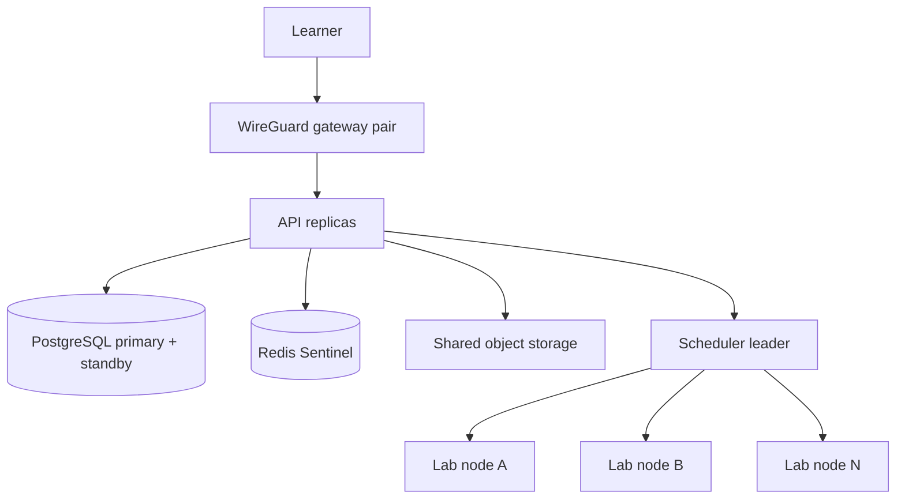

# SWOCTS Cyber Range Enterprise - manual supplement

Enterprise is a **Release 4 profile** and adds HA, SSO, enterprise reporting,
and compliance reporting. Multi-tenant support, LMS/SIS integration, and the
per-student accommodation engine are Release 5. Read the [core manual](../index.md) and the
[Professional supplement](../09_Professional/index.md) first. Enterprise is
cumulative too.

## Delivery status

| Capability | State in Release 4 |
|---|---|
| Professional analytics and reporting | Inherited |
| SSO / OIDC | **Implemented and tested** |
| SSO / LDAP / SAML | **Implemented and tested** |
| Multi-host HA lab pool | Reference implementation in the separate HA repository; not a supported production deployment yet |
| Multi-tenancy | Planned for Release 5 |
| LMS / SIS integration (LTI 1.3 Advantage) | Planned for Release 5 |
| Enterprise and compliance reporting | Partial; the procurement evidence pack is in `docs/COMPLIANCE.md` and `docs/HECVAT.md` |

OIDC, SAML 2.0, and LDAP/Active Directory login are implemented and tested in
Release 4. A formal SSO security review and the full multi-host HA failure
matrix remain. See `docs/EDITIONS.md`, `docs/V3-HA-LAB-POOL.md`, and
`docs/V3-PARKING-LOT.md`.

## HA topology at a glance



The single-host Compose path remains the default and fallback. HA is a separate
deployment shape, not a checkbox in the single-host installer.

## Single sign-on (OIDC, SAML, LDAP)

Release 4 adds OIDC, SAML 2.0, and LDAP/Active Directory sign-in. The login page
shows a button for each enabled OIDC or SAML provider, and an
institution-account form for each LDAP provider.

### OIDC

1. Create an OIDC application at the identity provider. Use the redirect URI
   shown on the provider card:

   ```text
   https://<public-origin>/api/auth/sso/oidc/<provider-id>/callback
   ```

2. In **Admin → Settings → Identity providers**, add an **OpenID Connect**
   provider with the issuer, client ID, client secret, and scopes.
3. Choose whether new users are auto-provisioned, auto-approved, and whether
   verified emails may link existing student or instructor accounts.
4. Select **Test** to check discovery and JWKS reachability.
5. Sign out and use the provider button on the login page.

If the IdP supports RP-initiated logout, also register the platform
`https://<public-origin>/login` URL as the post-logout redirect. Logout revokes
the platform JWT and redirects through the IdP; otherwise it stays local.

### SAML 2.0

1. Create a SAML application at the IdP. Register the SP entity ID and the ACS
   URL shown on the provider card:

   ```text
   https://<public-origin>/api/auth/sso/saml/<provider-id>/acs
   ```

2. Add a **SAML 2.0** provider with the IdP entity ID, SSO URL, IdP signing
   certificate, and attribute mapping.
3. Add an email claim at the IdP. Optionally add name and group claims.
4. Select **Test** to validate the SAML settings, then sign in from the login
   page.

### LDAP / Active Directory

1. Add an **LDAP / Active Directory** provider with `ldaps://` (or StartTLS),
   the base DN, and a service bind account.
2. Set the user search filter, for example `(sAMAccountName={username})` for
   Active Directory or `(uid={username})` for OpenLDAP.
3. Map the email, username, name, and group attributes.
4. Select **Test** to verify the service bind, then sign in with a directory
   username and password on the login page.

All three adapters share the same account policy. SSO-provisioned accounts
cannot use the local password form. Existing local accounts keep their password
unless an administrator changes the flag. Admin accounts are never auto-linked;
keep a local break-glass administrator. Group mapping can grant `instructor`,
but never `admin`. Directory role mapping is refreshed on every SSO login, so a
group change applies without editing the account.

For a local test IdP, see the
[Dex + OpenLDAP test stack](https://github.com/RobChaykoski/opencyberrange/blob/main/deploy/sso/README.md). For setup examples,
claim mapping, and troubleshooting, see
[`docs/SSO-OIDC.md`](https://github.com/RobChaykoski/opencyberrange/blob/main/docs/SSO-OIDC.md),
[`docs/SSO-SAML-LDAP.md`](https://github.com/RobChaykoski/opencyberrange/blob/main/docs/SSO-SAML-LDAP.md), and
[ADR 0004](https://github.com/RobChaykoski/opencyberrange/blob/main/docs/decisions/0004-sso-ha-contract.md).

## Administrator notes

- **Identity providers:** the settings screen stores LDAP, OIDC, and SAML
  configuration and encrypts bind passwords, client secrets, and private keys.
  OIDC, SAML, and LDAP login are active in Release 4.
- **API documentation:** `/docs`, `/redoc`, and `/openapi.json` are not proxied
  on the public origin; nginx returns 404. The backend gate is default-off as
  defense in depth for direct localhost access.
- **Secrets:** protect `WG_ENCRYPTION_KEY` and database backups. The identity
  provider secrets use the same Fernet key as WireGuard keys.
- **Node agents:** never expose the Docker socket or the node-agent port
  publicly. Agent endpoints assume mutual TLS.
- **Failover evidence:** a green dashboard is not proof of failover. Record the
  failure matrix evidence described in the HA test plan (`opencyberrange-ha/docs/10-test-plan.md`).
- **Backups:** re-apply the erasure ledger after any restore so a deleted
  account is not resurrected.

## What to read next

- HA architecture: `opencyberrange-ha/docs/01-architecture.md`
- HA failure and acceptance matrix: `opencyberrange-ha/docs/06-failure-and-acceptance.md`
- HA operations runbook: `opencyberrange-ha/docs/07-operations-runbook.md`
- Supported versions: `docs/SUPPORTED-VERSIONS.md`
- OS support: `docs/OS-SUPPORT.md`
