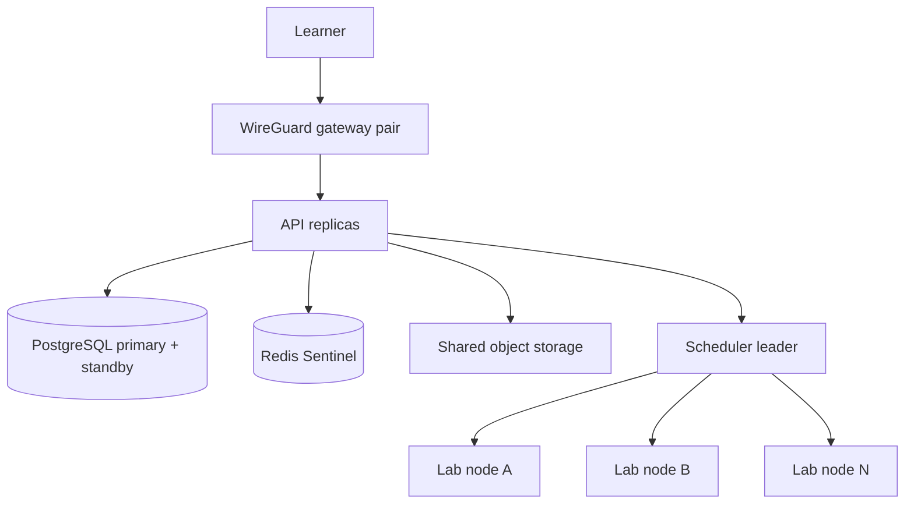

# OpenCyberRange Enterprise 3.0 — manual supplement

Enterprise 3.0 is **Professional 2.1 plus HA, SSO, enterprise reporting,
multi-tenant support, LMS/SIS integration, and compliance reporting**. Read the
[core manual](../index.md) and the
[Professional supplement](../09_Professional/index.md) first. Enterprise is
cumulative too.

## Delivery status

| Capability | State in the 3.0 tree |
|---|---|
| Professional analytics and reporting | Inherited |
| SSO / LDAP / OIDC / SAML settings | Settings-only; login federation is in the HA workstream |
| Multi-host HA lab pool | Reference implementation in the separate HA repository; not a supported production deployment yet |
| Multi-tenancy | Planned |
| LMS / SIS integration | Planned |
| Enterprise and compliance reporting | Planned |

Do not describe Enterprise as fully HA or fully SSO until the failure matrix
and identity-provider login tests pass. See `docs/EDITIONS.md`,
`docs/V3-HA-LAB-POOL.md`, and `docs/V3-PARKING-LOT.md`.

## HA topology at a glance

The single-host Compose path remains the default and fallback. HA is a separate
deployment shape, not a checkbox in the single-host installer.

## Administrator notes

- **Identity providers:** the v3 settings screen stores LDAP, OIDC, and SAML
  configuration and encrypts bind passwords, client secrets, and private keys.
  Creating a provider does not enable login federation by itself.
- **Secrets:** protect `WG_ENCRYPTION_KEY` and database backups. The identity
  provider secrets use the same Fernet key as WireGuard keys.
- **Node agents:** never expose the Docker socket or the node-agent port
  publicly. Agent endpoints assume mutual TLS.
- **Failover evidence:** a green dashboard is not proof of failover. Record the
  failure matrix evidence described in the HA test plan (`opencyberrange-ha/docs/10-test-plan.md`).
- **Backups:** re-apply the erasure ledger after any restore so a deleted
  account is not resurrected.

## What to read next

- HA architecture: `opencyberrange-ha/docs/01-architecture.md`
- HA failure and acceptance matrix: `opencyberrange-ha/docs/06-failure-and-acceptance.md`
- HA operations runbook: `opencyberrange-ha/docs/07-operations-runbook.md`
- Supported versions: `docs/SUPPORTED-VERSIONS.md`
- OS support: `docs/OS-SUPPORT.md`
