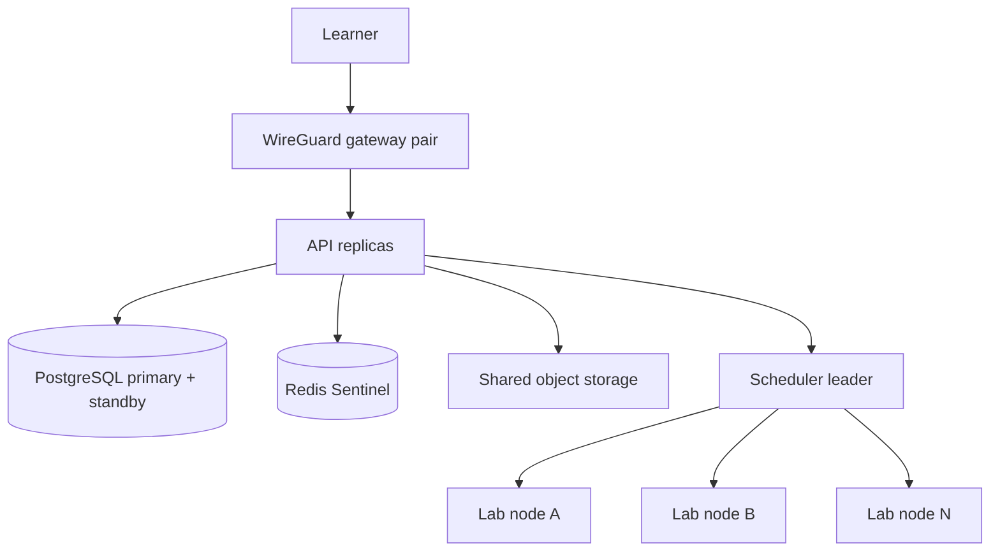

<<<<<<< HEAD
# SWOCTS Cyber Range Enterprise preview - manual supplement

Enterprise is a **preview profile on Release 3** and adds HA, SSO,
enterprise reporting, multi-tenant support, LMS/SIS integration, and compliance
reporting. Read the [core manual](../index.md) and the
=======
# OpenCyberRange Enterprise 3.1 — manual supplement

Enterprise 3.1 is **Professional 2.1 plus HA, SSO, enterprise reporting,
multi-tenant support, LMS/SIS integration, and compliance reporting**. Read the
[core manual](../index.md) and the
>>>>>>> 4c80e58a (feat(sso): add OIDC single sign-on for Enterprise 3.1.0)
[Professional supplement](../09_Professional/index.md) first. Enterprise is
cumulative too.

## Delivery status

| Capability | State in the preview |
|---|---|
| Professional analytics and reporting | Inherited |
| SSO / OIDC | **OIDC login implemented and tested across two API replicas** |
| SSO / LDAP / SAML settings | Stored and encrypted; SAML and LDAP login adapters are next |
| Multi-host HA lab pool | Reference implementation in the separate HA repository; not a supported production deployment yet |
| Multi-tenancy | Planned |
| LMS / SIS integration | Planned |
| Enterprise and compliance reporting | Planned |

OIDC is implemented and HA-tested at the control-plane level. SAML and LDAP
login adapters, a formal SSO security review, and the full multi-host HA failure
matrix remain. See `docs/EDITIONS.md`, `docs/V3-HA-LAB-POOL.md`, and
`docs/V3-PARKING-LOT.md`.

## HA topology at a glance



The single-host Compose path remains the default and fallback. HA is a separate
deployment shape, not a checkbox in the single-host installer.

## OIDC single sign-on

Enterprise 3.1 adds OIDC sign-in on top of the HA control plane. The login page
shows a button for each enabled OIDC provider.

1. Create an OIDC application at the identity provider. Use the redirect URI
   shown on the provider card:

   ```text
   https://<public-origin>/api/auth/sso/oidc/<provider-id>/callback
   ```

2. In **Admin → Settings → Identity providers**, add an **OpenID Connect**
   provider with the issuer, client ID, client secret, and scopes.
3. Choose whether new users are auto-provisioned, auto-approved, and whether
   verified emails may link existing student or instructor accounts.
4. Select **Test** to check discovery and JWKS reachability.
5. Sign out and use the provider button on the login page.

If the IdP supports RP-initiated logout, also register the platform
`https://<public-origin>/login` URL as the post-logout redirect. Logout revokes
the platform JWT and redirects through the IdP; otherwise it stays local.

SSO-provisioned accounts cannot use the local password form. Existing local
accounts keep their password unless an administrator changes the flag. Admin
accounts are never auto-linked; keep a local break-glass administrator.

For setup examples, claim mapping, and troubleshooting, see
[`docs/SSO-OIDC.md`](../../docs/SSO-OIDC.md) and
[ADR 0004](../../docs/decisions/0004-sso-ha-contract.md).

## Administrator notes

- **Identity providers:** the settings screen stores LDAP, OIDC, and SAML
  configuration and encrypts bind passwords, client secrets, and private keys.
  OIDC login is active in 3.1; SAML and LDAP login adapters are next.
- **Secrets:** protect `WG_ENCRYPTION_KEY` and database backups. The identity
  provider secrets use the same Fernet key as WireGuard keys.
- **Node agents:** never expose the Docker socket or the node-agent port
  publicly. Agent endpoints assume mutual TLS.
- **Failover evidence:** a green dashboard is not proof of failover. Record the
  failure matrix evidence described in the HA test plan (`opencyberrange-ha/docs/10-test-plan.md`).
- **Backups:** re-apply the erasure ledger after any restore so a deleted
  account is not resurrected.

## What to read next

- HA architecture: `opencyberrange-ha/docs/01-architecture.md`
- HA failure and acceptance matrix: `opencyberrange-ha/docs/06-failure-and-acceptance.md`
- HA operations runbook: `opencyberrange-ha/docs/07-operations-runbook.md`
- Supported versions: `docs/SUPPORTED-VERSIONS.md`
- OS support: `docs/OS-SUPPORT.md`
