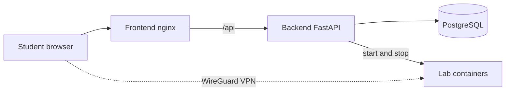

# SWOCTS Cyber Range User Manual

SWOCTS Cyber Range is powered by OpenCyberRange.

SWOCTS Cyber Range is a self-hosted platform for hands-on cybersecurity training. It
serves browser-based lab exercises, gates access to those labs behind a per-user
WireGuard VPN, organizes exercises into tracks and instructor courses, and gives
operators a full administrative console for users, sessions, and infrastructure.

The manual covers the whole platform from a student's first login through course
instruction and server administration. Read it top to bottom the first time, or
jump to the section that matches your role.

!!! note "Build provenance"
    This manual describes an updated build maintained by Robert Chaykoski, based
    on the original OpenCyberRange/OCR-Lite build by Lewis Heuermann. The updated
    build was created with AI assistance and reviewed by a human maintainer. See
    `BUILD_NOTICE.md` in the repository root for attribution, the AI-assistance
    disclosure, and the list of changes. The original copyright and PolyForm
    Noncommercial licence remain in force. Curriculum ownership, review status,
    framework references, and synthetic-content rules are recorded in
    [Educational material provenance](https://github.com/RobChaykoski/opencyberrange/blob/main/docs/EDUCATIONAL-PROVENANCE.md).

## How the platform fits together

A browser talks to an nginx frontend that serves the single-page application and
proxies the API. A FastAPI backend handles authentication, lab orchestration, and
course logic against a PostgreSQL database, and it drives Docker to start and stop
the lab containers each student works in. Students reach those lab containers over
a WireGuard VPN tunnel or from the in-browser RangeBox desktop.

## Manual editions

This is the shared core manual for platform release **2.7.0**. Community /
Academic, Professional, and Enterprise are cumulative edition profiles on that
release; Community / Academic 1.1.3 remains a maintenance line for existing
installs. Edition-specific pages live in the
[Professional supplement](09_Professional/index.md) and the
[Enterprise supplement](10_Enterprise/index.md). See
[Manual editions](VERSIONS.md) for the feature matrix.

## Where to start

- New here? Begin with [Getting Started](01_Getting_Started/01_Platform_Overview.md).
- Working through exercises? See the [Student Guide](02_Student_Guide/01_Student_Dashboard.md)
  and the [VPN Setup Guide](05_VPN_Setup_Guide/01_VPN_Overview.md).
- Tracking completion, certificates, and your PDF transcript? See
  [Viewing Your Profile](02_Student_Guide/16_Viewing_Your_Profile.md).
- Need the exact rules for flags, scoring, and lab timing? See the
  [Lab Workflow Reference](06_Lab_Workflow_Reference/01_Lab_Lifecycle_Overview.md).
- Looking for a term or the MISP-aligned definition? See the
  [Glossary](08_Glossary/01_Glossary.md).
- Something not working? See [Troubleshooting](07_Troubleshooting/01_Login_Issues.md).
- Teaching a course? See the [Instructor Guide](03_Instructor_Guide/01_Instructor_Dashboard.md).
- Running the server? See [Server Deployment](00_Server_Deployment/01_Prerequisites.md)
  and the [Admin Guide](04_Admin_Guide/01_Admin_Panel_Overview.md).
- Prefer direct Docker Compose? See the
  [Docker Compose Deployment Manual](00_Server_Deployment/08_Docker_Deploy_Manual.md).
