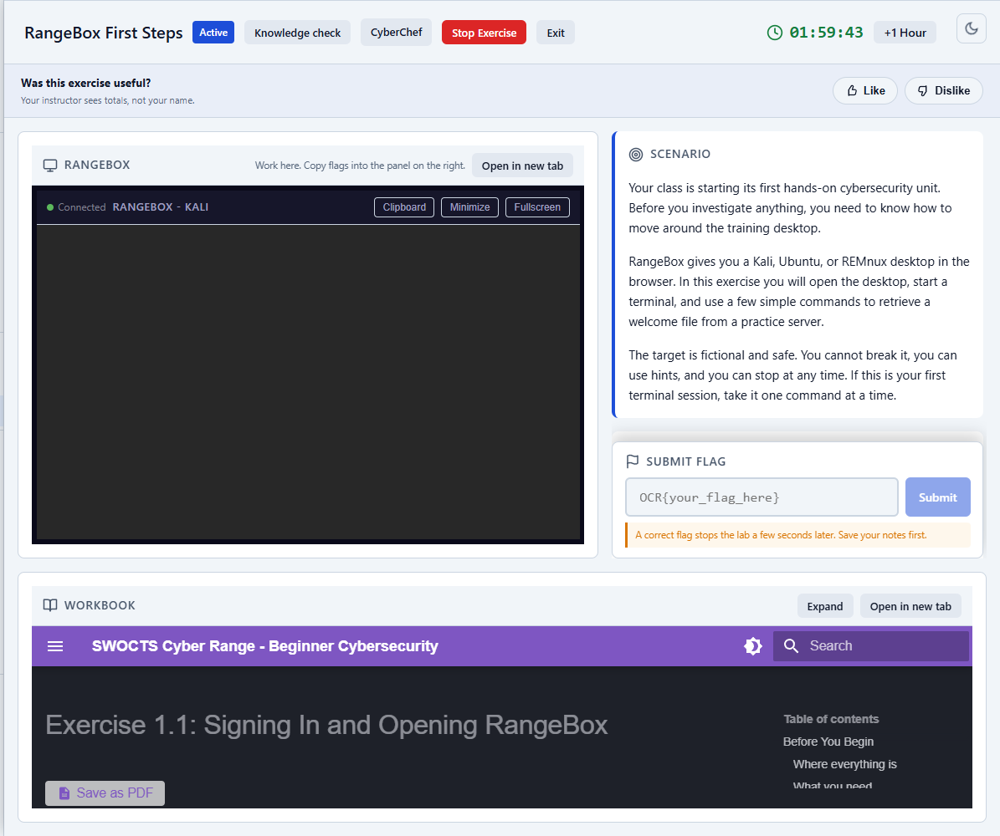

# SWOCTS Cyber Range

**A self-hosted cybersecurity training platform for schools and teams — your own private lab range, powered by [OpenCyberRange](https://github.com/syntaxoverride/opencyberrange).**

Students open a web portal, launch isolated Docker labs (including an in-browser Linux desktop called RangeBox), follow built-in workbooks, and submit flags for automated scoring. Instructors assign tracks, watch progress, and export verifiable transcripts. One Ubuntu server runs the whole platform, with WireGuard-isolated sessions and signed, reproducible releases.

Current release: **5.59.0** · Edition: **Community / Academic**, single host

[](docs/RELEASES.md)
[](platform/labs/)
[](platform/labs/)
[](Manual-Lite/00_Server_Deployment/06_Architecture.md)
[](LICENSE)
[](#ai-assistance-disclosure)



## Who is this for?

- **Teachers and professors** — assign ready-made labs from Grade 9 beginners to advanced penetration testing, track completion, and export PDF transcripts.
- **Students and self-learners** — practise ethical hacking, network forensics, OSINT, and AI security in a browser, with no powerful laptop and no manual VM setup.
- **IT admins and lab operators** — deploy the platform on one Ubuntu server with a single setup script, with WireGuard isolation, SSO (OIDC/SAML/LDAP), and automated backups.

## How it works

1. An instructor creates a course and assigns tracks such as Beginner Cybersecurity or Web Application Security.
2. A learner opens the portal, connects over WireGuard or the browser RangeBox desktop, and reads the workbook.
3. The platform starts a private `/24` Docker network per session, so learners cannot interfere with each other.
4. The learner finds the flag and submits it for instant scoring; completed levels issue verifiable certificates.

## Quick start

| Item | Minimum | Recommended |
|---|---|---|
| Host OS | Ubuntu 24.04 LTS (22.04 is supported for upgrades) | Ubuntu 24.04 LTS |
| CPU | 4 cores | 8 or more |
| RAM | 32 GB | 64 GB |
| Disk | 100 GB for an evaluation install | 500 GB with prebuilt lab images |
| Access | Root or `sudo` on the host | A normal login user with `sudo` |
| Runtime | Docker Engine 24+ with Compose v2 | The installer adds missing packages |
| Network | 80/TCP, 443/TCP, 51820/UDP; 5555/TCP only if WSTunnel is enabled | Keep 8000/TCP and 5000/TCP closed |

```bash
git clone https://github.com/RobChaykoski/opencyberrange.git
cd opencyberrange
gpg --import docs/release-signing-key.asc
TAG=$(git tag --list 'v*' --sort=-v:refname | grep -viE -- '-(rc|beta|alpha|pre|preview|dev)' | head -1)
git verify-tag "$TAG"
git checkout --detach "$TAG"
python3 scripts/supply_chain.py --check \
  --signature supply-chain.lock.json.asc \
  --gpg-public-key docs/release-signing-key.asc \
  --gpg-fingerprint 68A817762C831475F00DB54E775050A4C4921814
sudo bash scripts/setup-range-server.sh --install
```

The verification steps are not optional in a production install: they prove the
tag signature and the reviewed lock before a root script runs. The installer
repeats the supply-chain check before it writes the platform.

Open `https://<server-ip>/`, complete the first-run wizard, then verify:

```bash
bash scripts/post-install-check.sh
```

Do not run the installer from a root shell (`sudo su` or `su -`). For a
platform-only install, use `sudo bash scripts/install-platform.sh --fresh`.
Full instructions: [prerequisites](Manual-Lite/00_Server_Deployment/01_Prerequisites.md),
[local deployment](Manual-Lite/00_Server_Deployment/02_Local_Deployment.md), and
[upgrading](README-UPGRADE.md).

## Editions

One platform release, three cumulative profiles — not three codebases. See
[ADR 0004](docs/decisions/0004-single-platform-release-version.md).

| Edition | State | Purpose |
|---|---|---|
| **Community / Academic** | **Supported** | Single-host teaching platform: labs, workbooks, authoring, maintenance, security |
| **Professional** | **Release profile — analytics preview** | Adds analytics, cohort reporting, competency evidence, accreditation support, and research exports |
| **Enterprise** | **Release profile — SSO** | Adds HA, OIDC/SAML/LDAP federation, enterprise and compliance reporting; multi-tenancy is deferred |

The Community / Academic profile remains the reference behaviour and fallback.
Security fixes also land on the Community / Academic 1.1.3 maintenance line and
merge forward. See [Editions](docs/EDITIONS.md) and
[ADR 0003](docs/decisions/0003-edition-scope-refinement.md).

## Tracks at a glance

The table counts every declared chapter, **including planned tracks**. The
published catalogue is **222 lab definitions**; see [COUNTS.md](docs/COUNTS.md).

<!-- BEGIN GENERATED CURRICULUM INVENTORY -->
The curriculum is generated from `curriculum-manifest.yaml`. The table
below is the learner-facing inventory; the full chapter map, prerequisites,
environments, role alignment, and recommended next steps are in
[`Workbook/CURRICULUM.md`](Workbook/CURRICULUM.md).

Exercise counts are labs that expose a workbook page. The platform also
contains labs without a workbook page; see `Workbook/COVERAGE.md`.

Framework alignment is selective and documented in
[`Workbook/FRAMEWORKS.md`](Workbook/FRAMEWORKS.md).

Regenerate with `python scripts/generate-curriculum-docs.py`; CI can use
`--check` to detect drift.

| Track ID | Display name | Audience | Difficulty | Prerequisites | Exercises | Duration | Status |
|---|---|---|---|---|---:|---|---|
| `high-school` | Beginner Cybersecurity | Grades 9-12 learners with everyday computer experience and no assumed cybersecurity background. | beginner | None | 18 | 7h 00m | published |
| `netfor` | Network Security | Beginner-to-intermediate learners who need network foundations, log analysis, and packet evidence. | beginner | BEG04 | 22 | 19h 45m | published |
| `webpt` | Web Application Security | Intermediate learners who can use a terminal and understand HTTP basics. | intermediate | NET00, NET01 | 27 | 38h 35m | published |
| `software-security` | Software Security | Intermediate learners who can read code and understand web requests. | intermediate | WEB02 | 6 | 2h 55m | published |
| `malware` | Malware Analysis | Intermediate learners with networking and forensic evidence experience. | intermediate | NET02, FOR01 | 10 | 7h 25m | published |
| `forensics` | Digital Forensics | Intermediate learners who want to investigate memory, disk, endpoint, email, browser, and network evidence. | intermediate | NET02 | 5 | 4h 35m | published |
| `osint` | OSINT | Adult learners who want public-source investigation skills; Grades 9-12 are not assigned the live extensions. | beginner | NET00 | 10 | 5h 35m | published |
| `identity` | Identity & Access | Intermediate learners interested in authentication, federation, and account lifecycle. | intermediate | NET00 | 39 | 75h 10m | published |
| `ot` | OT/ICS Security | Intermediate learners interested in industrial control systems and Modbus. | intermediate | NET00 | 4 | 3h 00m | published |
| `ai` | AI Hacking | Intermediate learners exploring prompt injection, policy bypass, and AI-assisted security. | intermediate | WEB02 | 5 | 4h 15m | published |
| `winpt` | Windows Penetration Testing | Intermediate learners who have completed the beginner pathway or have equivalent terminal and networking experience. | intermediate | BEG04, NET00 | 62 | 118h 55m | published |
| `linpt` | Linux Fundamentals | Intermediate learners building Linux enumeration, SSH access, privilege escalation, and detection skills. | intermediate | WIN09 | 30 | 38h 45m | published |
| `msfpt` | Metasploit Operations | Learners who have completed the beginner pathway or have equivalent Linux and network service experience. | intermediate | LIN01, NET00 | 8 | 13h 15m | published |
| `vm` | Vulnerability Management | Learners moving from exploitation into defensive exposure management, asset ownership, and remediation. | intermediate | BEG04, NET00 | 33 | 68h 00m | planned |
| `soc` | Security Operations | Learners who want hands-on detection, triage, hunting, and case management with open-source telemetry. | intermediate | NET02, FOR01 | 34 | 70h 00m | planned |
| `platform` | Platform Engineering | Learners who build and operate the delivery platform: containers, Kubernetes, CI/CD, infrastructure as code, and configuration management. | intermediate | LIN01, NET00 | 40 | 82h 00m | planned |
| `neteng` | Network Engineering and Infrastructure | Learners moving from packet-level analysis into network source of truth, monitoring, configuration control, segmentation, and network access control. | intermediate | NET00 | 35 | 72h 00m | planned |

**Total:** 388 exercises across 17 tracks and 97 chapters.

Recommended pathway:

`BEG01` → `BEG02` → `BEG03` → `BEG04` → `NET00` → `NET01` → `NET01B` → `NET02` → `NET03` → `NET04` → `WEB01` → `WEB01B` → `WEB02` → `WEB02B` → `WEB03` → `WEB11` → `SWSEC01` → `SWSEC02` → `MAL01` → `MAL02` → `MAL03` → `FOR01` → `FOR02` → `FOR03` → `FOR03B` → `OSINT01` → `OSINT02` → `OSINT03` → `IAM01` → `IAM02` → `IAM03` → `IAM04` → `IAM05` → `IAM06` → `IAM07` → `IAM08` → `IAM09` → `OT01` → `OT02` → `AI01` → `AI02` → `WIN01` → `WIN02` → `WIN03` → `WIN04` → `WIN05` → `WIN06` → `WIN07` → `WIN08` → `WIN09` → `WIN10` → `WIN11` → `LIN01` → `LIN01B` → `LIN02` → `LIN02B` → `LIN03` → `LIN03B` → `LIN04` → `LIN05` → `LIN09` → `MSF01` → `MSF02` → `VM01` → `VM02` → `VM03` → `VM04` → `VM05` → `VM06` → `VM07` → `VM08` → `SOC01` → `SOC02` → `SOC03` → `SOC04` → `SOC05` → `SOC06` → `SOC07` → `SOC08` → `PLAT01` → `PLAT02` → `PLAT03` → `PLAT04` → `PLAT05` → `PLAT06` → `PLAT07` → `PLAT08` → `PLAT09` → `NENG01` → `NENG02` → `NENG03` → `NENG04` → `NENG05` → `NENG06` → `NENG07` → `NENG08` → `NENG09`
<!-- END GENERATED CURRICULUM INVENTORY -->

## What is in the box

**222 lab definitions**, **211 workbook-mapped labs**, **13 published tracks**,
and **175 public catalogue exercises** (47 more are course-scoped). Every lab has
a competency contract, defensive takeaways, and automated flag checks. The
exact definitions are in [COUNTS.md](docs/COUNTS.md).

- **Courses and grading** — assignments, completion, attempts, hints, time, private feedback, and LMS gradebook exports.
- **Learner evidence** — profile, achievements, level certificates, and a downloadable PDF transcript.
- **Instructor reporting** — course health, completion matrix, lab friction, and cohort analytics.
- **Career and competency** — Cyber DNA evidence, competency contracts, NICE mapping, and career pathway focus.

## Security and operations

- **Signed releases only.** Runtime and configuration changes ship through a signed tag, the supply-chain lock, and a recorded deployment.
- **One-way passwords.** Argon2id for new and changed passwords; legacy bcrypt hashes upgrade on successful sign-in.
- **Database integrity.** SHA-256 checksums plus an append-only PostgreSQL change ledger with broken-chain detection.
- **Session isolation.** A separate `/24` per session over WireGuard; the backend, PostgreSQL, Valkey, and Docker proxy stay on private interfaces.
- **Privacy by design.** Consent domains, export, erasure, and a suppression ledger that stops a restore from resurrecting deleted data.

Security reporting: [SECURITY.md](SECURITY.md) · privacy: [PRIVACY.md](PRIVACY.md) ·
current test and deployment evidence: [validation report](docs/VALIDATION-REPORT.md) and
[production deployment statement](docs/PRODUCTION-DEPLOYMENT-STATEMENT.md).

## Documentation

| Start here | Use it for |
|---|---|
| [Documentation index](docs/README.md) | The map of the whole set |
| [Server deployment](Manual-Lite/00_Server_Deployment/) | Installing and upgrading a host |
| [Student guide](Manual-Lite/02_Student_Guide/01_Student_Dashboard.md) | Using exercises, courses, profiles, and certificates |
| [Workbook](Workbook/index.md) | Step-by-step lab walkthroughs |
| [Architecture](docs/ARCHITECTURE.md) | Components, trust boundaries, and volumes |
| [Supported versions](docs/SUPPORTED-VERSIONS.md) | Runtime, dependency, and image pins |
| [Learning framework](docs/LEARNING-FRAMEWORK.md) | Tracks, levels, labs, and evidence |
| [Privacy, erasure, and backups](docs/PRIVACY-AND-DATA-DELETION.md) | Data handling for institutions |
| [Release tags](docs/RELEASES.md) and [changelog](CHANGELOG.md) | Release history |
| [Governance](GOVERNANCE.md) and [citation](CITATION.cff) | Decision model, editions, and how to cite |
| [Contributing](CONTRIBUTING.md) | Submitting labs or platform changes |

## Attribution and licensing

**SWOCTS Cyber Range** is the SWOCTS-branded deployment of the OpenCyberRange training platform. The product identity, crest, and title are SWOCTS; the underlying platform, code, and upstream attribution remain OpenCyberRange.

**Original project and attribution**

OpenCyberRange is based on the original
[Open Cyber Range](https://opencyberrange.com/) (OCR-Lite) project, designed
and built by **[Lewis Heuermann](https://github.com/syntaxoverride)** and
published at
[syntaxoverride/opencyberrange](https://github.com/syntaxoverride/opencyberrange).
Lewis is a cybersecurity and data analytics professor and a Capture the Flag
coach. **This project would not exist without his original hard work.**

This repository is an independent updated build maintained by Robert
Chaykoski. It is not an official upstream release and is not endorsed by the
original author. See [BUILD_NOTICE.md](BUILD_NOTICE.md) for the full notice.
The original copyright and PolyForm Noncommercial licence remain in force.

### AI assistance disclosure

**This updated build was created with AI assistance.** AI tools helped draft
code, tests, documentation, workbook content, curriculum material, and design
guidance. A human maintainer reviewed and takes responsibility for the changes,
but AI-assisted output can contain errors or omissions. Verify commands, lab
instructions, security controls, and licence obligations before relying on them
in production.

See [BUILD_NOTICE.md](BUILD_NOTICE.md#ai-assistance-disclosure) and
[THIRD_PARTY_NOTICES.md](THIRD_PARTY_NOTICES.md).

### Licence

The platform source and original content are licensed under the **PolyForm
Noncommercial License 1.0.0** (see [LICENSE](LICENSE) and
[LICENSING.md](LICENSING.md)). It is source-available, not OSI open source.
GitHub's licence detector may show **Other**; the committed [`LICENSE`](LICENSE)
file is authoritative.

Third-party software keeps its own licence. The full inventory, source offers,
and notice-sensitive components are in
[THIRD_PARTY_NOTICES.md](THIRD_PARTY_NOTICES.md), with licence texts in
[THIRD_PARTY_LICENSES/](THIRD_PARTY_LICENSES/). Do not add Redis 7.4+ (RSALv2/SSPLv1)
or PyMuPDF (AGPL-3.0 or commercial) without a licence review.

**Microsoft products referenced by this project are not included.** Users are
responsible for ensuring they possess the necessary Microsoft licenses for all
deployed software. OpenCyberRange does not distribute, resell, sublicense, or
provide Microsoft software, activation keys, or licenses; institutions supply
their own evaluation or licensed media. See the
[Microsoft legal notice](docs/MICROSOFT-LEGAL-NOTICE.md) and
[Windows artifact policy](docs/WINDOWS-ARTIFACT-POLICY.md).
