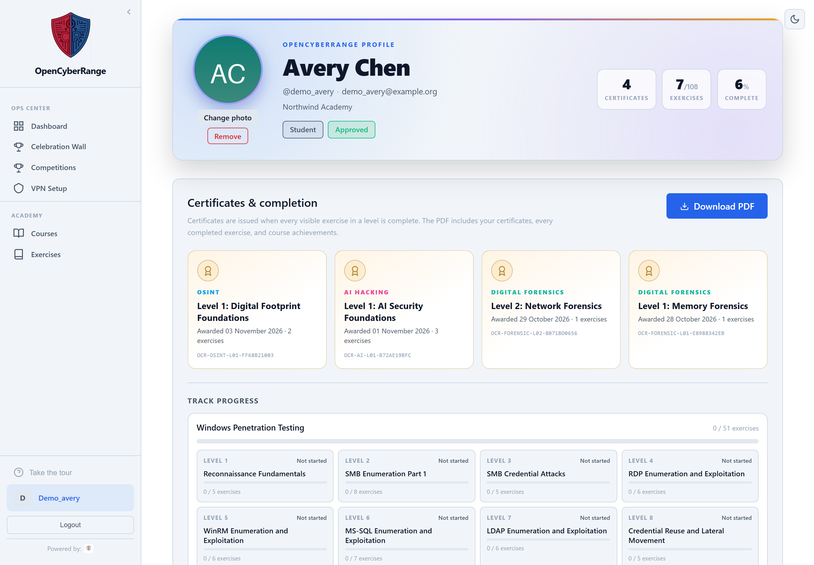
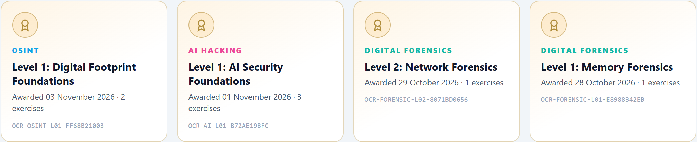
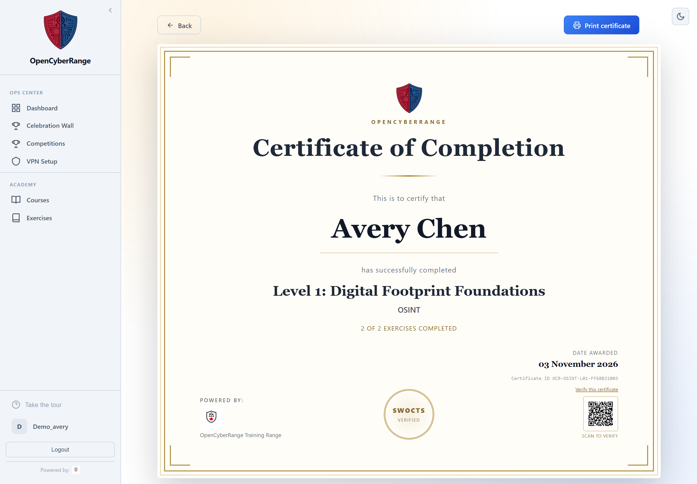
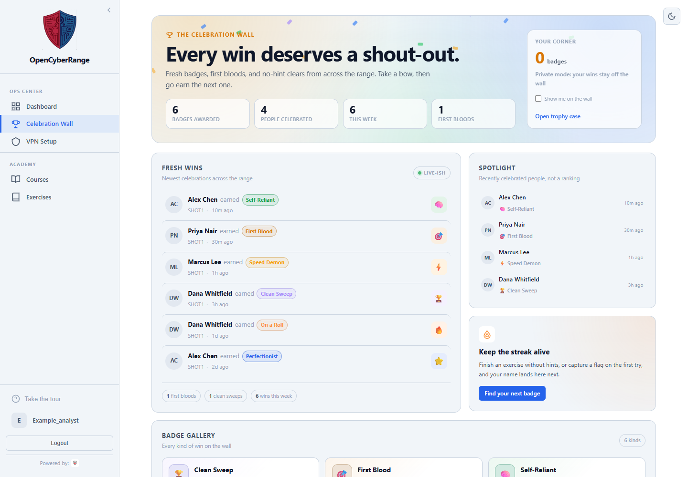
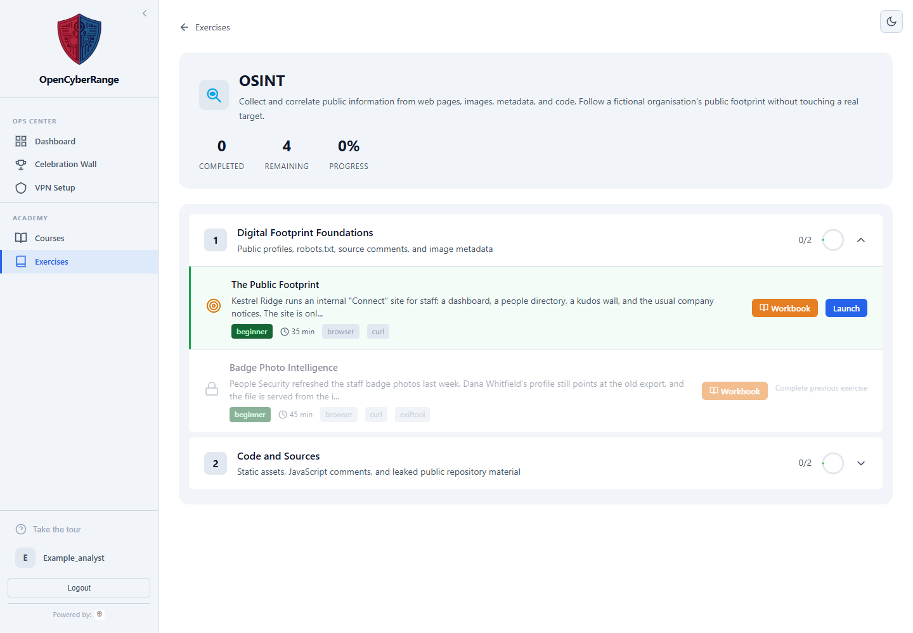
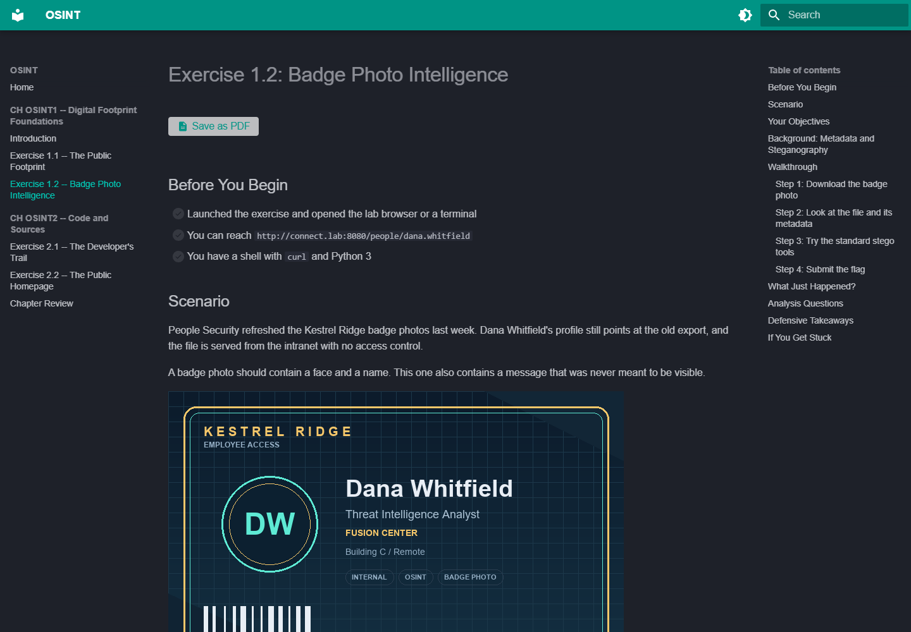

# SWOCTS Cyber Range

> **SWOCTS Cyber Range** is the SWOCTS-branded deployment of the OpenCyberRange training platform. The product identity, crest, and title are SWOCTS; the underlying platform, code, and upstream attribution remain OpenCyberRange.
>
> **Original project and attribution**
>
> OpenCyberRange is based on the original
> [Open Cyber Range](https://opencyberrange.com/) (OCR-Lite) project, designed
> and built by **[Lewis Heuermann](https://github.com/syntaxoverride)** and
> published at
> [syntaxoverride/opencyberrange](https://github.com/syntaxoverride/opencyberrange).
> Lewis is a cybersecurity and data analytics professor and a Capture the Flag
> coach. **This project would not exist without his original hard work.**
>
> This repository is an independent updated build maintained by Robert
> Chaykoski. It is not an official upstream release and is not endorsed by the
> original author. See [BUILD_NOTICE.md](BUILD_NOTICE.md) for the full notice.
> The original copyright and PolyForm Noncommercial licence remain in force.

[](RELEASE_NOTES.md)
[](docs/SUPPORTED-VERSIONS.md)
[](platform/labs/)
[](platform/labs/)
[](Manual-Lite/00_Server_Deployment/06_Architecture.md)
[](LICENSE)
[](#ai-assistance-disclosure)

A self-hosted cybersecurity training platform that deploys hands-on exercises inside isolated Docker containers. Students connect over WireGuard VPN, solve challenges across instructor-defined tracks, and submit flags for automated scoring. The platform ships with foundational exercises spanning penetration testing, network foundations and forensics, web exploitation, malware analysis, OT/ICS security, AI security, and open-source intelligence (OSINT).

Students also get a profile with completion statistics, certificates, achievements, and a downloadable PDF transcript. They can download their account data or permanently delete their account from the privacy panel; the erasure suppression ledger and backup workflow keep a restore from resurrecting a deleted account. Instructors and administrators manage courses, progress, and the platform from the same interface.

## Branding

**SWOCTS Cyber Range** is the product name, title, and visual identity. The
SWOCTS name and crest are owned by **SWOCTS**; the crest was created and designed
by **Avery Chaykoski**. They are brand assets, not software, and are not covered
by the PolyForm software licence. See [BRANDING.md](BRANDING.md).

The OpenCyberRange shield and name are used for the **Powered by OpenCyberRange**
attribution. Brand assets live in `platform/frontend/public/`
(`swocts-cyber-range-mark*.png`, `favicon.*`) and are mirrored into
`Workbook/assets/` and `Manual-Lite/assets/` for the documentation sites. Keep
the upstream OpenCyberRange attribution and licence notices intact.

## Editions

SWOCTS Cyber Range uses one platform release number (`2.5.4`) with three
cumulative edition profiles. The edition names describe scope, entitlement, and
operational shape, not three separate codebases or three separate version lines.
See [ADR 0004](docs/decisions/0004-single-platform-release-version.md).

| Edition profile | Platform release | State | Host OS | Purpose |
|---|---|---|---|---|
| **Community / Academic** | `2.5.4` profile (`1.1.3` maintenance line) | **Supported** | Ubuntu 22.04 / 24.04 LTS | Single-host teaching platform; lab/workbook improvements, authoring, maintenance, and security |
| **Professional** | `2.5.4` | **Release profile — analytics preview** | Ubuntu 24.04 LTS | Community / Academic plus analytics, reporting, cohort analysis, competency evidence, accreditation support, and research exports |
| **Enterprise** | `2.5.4` preview | **Development** | Ubuntu 24.04 LTS | Professional plus HA, SSO, enterprise reporting, multi-tenant support, LMS integration, and compliance reporting |

The Community / Academic profile (1.1.3 maintenance) remains the reference
behaviour and the fallback.
Professional is additive: the Community / Academic curriculum, learner
workflows, privacy controls, and single-host Docker Compose install remain.
Enterprise is additive again: it adds the lab pool, control-plane HA, gateway
failover, identity federation, multi-tenancy, LMS integration, and compliance
reporting without removing the single-host path.

The five Professional priorities — Competency Framework Engine, Student
Feedback Engine, Radar / Spider Web Reporting, Exercise Health Analytics, and
Instructor Intervention Dashboard — are **Professional and Enterprise only**.
They are not Community / Academic work.

**Bug fixes and security updates continue on the Community / Academic 1.1.3
maintenance line and merge forward into the 2.5.4 profiles**, so a fix does not
wait for a feature release. There is no separate fork to maintain. See
[Editions](docs/EDITIONS.md) and
[ADR 0003](docs/decisions/0003-edition-scope-refinement.md).

### Release 2.4.x goals

The 2.4.x feature set covers four workstreams:

| Workstream | What it changes | Status |
|---|---|---|
| Reporting and evidence | A cross-course **Reports** page with red/amber/green course signals, completion and abandonment, learning reported, trending topics, **skill-tree radar coverage**, CSV/PDF export, accreditation support, and research exports. | Development preview in this tree |
| Learning analytics | A private **Learning analytics** view for learners and an **Analytics** tab for courses, plus the Competency Framework Engine, Student Feedback Engine, skill-tree radar, exercise health, and the instructor intervention dashboard. | Skill-tree radar delivered; learner/cohort radar, exercise health, and the intervention dashboard remain planned |
| Mobile student shell | Automatic phone-width detection, an off-canvas navigation drawer, a student bottom tab bar, and explicit fallback behaviour for the embedded RangeBox desktop. | Delivered |
| RangeBox workspace | A dedicated **RangeBox** tab with a live deployed count, VNC readiness checks, capacity enforcement across workers, and a clear split between standalone practice and exercise-attached desktops. | Delivered |

The five priority capabilities are defined in
[Professional and Enterprise priorities](docs/PROFESSIONAL-PRIORITIES.md). The
five programme reports are defined in
[Programme reports](docs/PROGRAMME-REPORTS.md).

**Scope guard:** The Professional profile adds analytics, reporting, competency
evidence, and instructor support only. The mobile student shell and RangeBox
workspace are Community / Academic features. Bug fixes, security updates,
dependency/runtime updates, and small compatibility corrections are still
allowed. New scoring models, enterprise integrations, multi-tenancy, SSO,
compliance reporting, and multi-host HA are Enterprise preview work.

- [Edition model](docs/EDITIONS.md)
- [Professional 2.5.1 program charter](docs/V2-PROGRAM-CHARTER.md)
- [Professional and Enterprise priorities](docs/PROFESSIONAL-PRIORITIES.md)
- [Programme reports](docs/PROGRAMME-REPORTS.md)
- [Community / Academic backlog](docs/COMMUNITY-ACADEMIC-BACKLOG.md)
- [Career and certification resources](docs/CAREER-AND-CERTIFICATION-RESOURCES.md)
- [Skill DNA metric model](docs/SKILL-DNA.md)
- [Celebration Wall](docs/CELEBRATION-WALL.md)
- [Supply-chain verification](docs/SUPPLY-CHAIN.md)
- [Database integrity and change attribution](docs/DATABASE-INTEGRITY.md)
- [Exercise and RangeBox review](docs/EXERCISE-AND-RANGEBOX-REVIEW.md)
- [Enterprise preview parking lot](docs/V3-PARKING-LOT.md)
- [Enterprise HA plan](docs/V3-HA-LAB-POOL.md)
- [Anti-scraping and crawler controls](docs/ANTI-SCRAPING.md)
- [Reverse proxy and Nginx Proxy Manager](docs/REVERSE-PROXY.md)

### Reporting and analytics (development preview)

The first 2.4.x analytics slice is implemented in this tree and documented in
[V2 Learning Analytics and Research Dashboard](docs/V2-LEARNING-ANALYTICS.md):

- **Learner view:** completion and weekly progress, median time against the
  exercise estimate, hint and first-attempt trends, reattempt recovery, and
  plain-language growth cards. Students never see a comparative ranking.
- **Course Analytics tab:** assigned vs started vs completed, time over
  estimate, hint-free and first-attempt rates, abandonment, and per-exercise
  drill-down.
- **Reports & analytics page:** a cross-course teaching view with
  red/amber/green signals and the reason behind each signal, skill-tree coverage,
  trending topics, and CSV/PDF export. Open it from the **Admin** section for
  administrators or the **Instructor** section for instructors; it lives at
  `/reports`.
- **Cyber DNA practice traits and affinities:** six practice traits
  (Explorer, Builder, Tester, Defender, Investigator, Leader) and positive,
  evidence-based role families for offensive security, defensive operations,
  DFIR/investigation, and security leadership. The Tester trait records
  authorised offensive practice in the isolated labs; it is not a licence to
  test real systems. Affinities are conversation aids, not job labels or
  predictions.
- **Pulse and course surveys:** a short optional pulse after completion, custom
  instructor surveys, and consent-gated responses. Survey consent stays separate
  from analytics use and can be withdrawn.
- **Metric dictionary:** one definition per metric, shared by the UI and
  exports, so terms such as "completion rate" or "hint pressure" cannot drift
  between screens.

Phase 2 and Phase 3 add deeper within-person growth detail,
teaching-improvement prompts, cohort bands, and a consent-filtered research
workspace with de-identified exports and small-cell suppression. The
[analytics plan](docs/V2-LEARNING-ANALYTICS.md) records the metric definitions,
privacy rules, and open decisions.

### Deployment goals

The 1.x installer remains a single-host Docker Compose deployment. The 2.4.x line
adds scale-out targets for multiple Docker hosts ("pods") and Kubernetes while
keeping the same platform images, lab definitions, WireGuard access, and student
workflow. See [Deployment topologies](#deployment-topologies) for the supported
and planned states.

## Measurable outcomes

These are current, checkable counts from this repository and metrics the platform records itself. They describe what learners and instructors can measure; they are not claims about learning ability.

| Outcome | How it is measured | Baseline in this repository |
|---|---|---|
| Breadth of hands-on practice | Runnable exercises, tracks, and levels | **148 exercises** across **11 tracks** and **51 levels** |
| Guided lab instruction | Workbook walkthroughs and analysis questions | **164 workbook pages**, **111 analysis sections**, **407 analysis questions** |
| Supported practice | Hints available and hint usage recorded per completion | **500+ hints**; hints used are stored with each completion |
| Automated verification | Per-lab validation checks and flag checks | **650+ validation checks**; flags are stored as hashes |
| Skill progression | Sequential level completion and level certificates | Level gates and **certificates for each completed level** |
| Course delivery | Assignments, completion, course health, and feedback | Per-student completion, attempt, hint, time, and private feedback records |
| Recognition | Achievement and event scoring signals | Completion, no-hint, first-attempt, speed, and first-blood signals |
| Learner evidence | Profile, transcript, and reports | PDF transcript, completion matrix, and per-course reports |
| Session isolation | Network separation per learner | One `/24` per session plus WireGuard access |

### Release and repositories

| Repository | Purpose | State |
|---|---|---|
| [`opencyberrange`](https://github.com/RobChaykoski/opencyberrange) | Production and development (canonical) | `main`, CI green |
| [`opencyberrange-backup`](https://github.com/RobChaykoski/opencyberrange-backup) | Backup mirror of the production tree | `main`, synced with canonical |

This repository is the only development tree. `main` carries platform release
**2.5.4** with Community / Academic, Professional, and Enterprise preview
profiles. The Community / Academic 1.1.3 line remains the supported single-host
teaching maintenance release.
Bug fixes and security updates land on the 1.1 line first and are merged forward
into `main`. The tree contains all history from the pre-cutover tree plus the
upgrade scaffold and dependency waves. See
`docs/MOVE-TO-OPENCYBER-NEXT.md` and `docs/CUTOVER-TO-CANONICAL-REPO.md` for the
migration and cutover trail.

## AI assistance disclosure

**This updated build was created with AI assistance.** AI tools helped draft
code, tests, documentation, workbook content, curriculum material, and design
guidance. A human maintainer reviewed and takes responsibility for the changes,
but AI-assisted output can contain errors or omissions. Verify commands, lab
instructions, security controls, and licence obligations before relying on them
in production.

See [BUILD_NOTICE.md](BUILD_NOTICE.md#ai-assistance-disclosure) for the
build-specific disclosure and [THIRD_PARTY_NOTICES.md](THIRD_PARTY_NOTICES.md)
for the third-party attribution inventory.


## Licensing and third-party notices

The platform source and original content are licensed under the **PolyForm
Noncommercial License 1.0.0** (see [LICENSE](LICENSE) and
[LICENSING.md](LICENSING.md)). It is source-available, not OSI open source.

Third-party software and data keep their own licences. The full inventory,
source offers, and notice-sensitive components are in
[THIRD_PARTY_NOTICES.md](THIRD_PARTY_NOTICES.md), with licence texts in
[THIRD_PARTY_LICENSES/](THIRD_PARTY_LICENSES/). In particular:

- **Redis is pinned to 7.2**, which is BSD-3-Clause. Redis 7.4 and later are
  RSALv2/SSPLv1; do not change the image tag without a licence review.
- The build-time PCAP generators that import Scapy are **GPL-2.0-only**. They
  carry SPDX headers and are listed in the notice inventory.
- The RangeBox image includes separate **AGPL-3.0** tools (Hydra, Masscan) and
  GPL tools. Keep them unmodified and provide source when distributing the
  image.
- Do not add PyMuPDF (`fitz`/`pymupdf`) to the runtime; it is AGPL-3.0 or
  commercially licensed and is not shipped.

This is a compliance inventory, not legal advice.

## What it looks like

**Exercise catalogue.** Tracks group exercises into levels; a level unlocks as
the one before it is completed.


**Working an exercise.** Every exercise opens with its scenario, its
objectives, a link to the workbook, and the box that takes the flag.


**Courses.** Assign exercises to a class, set the weeks, and track who has
finished what.


**Administration.** Users, sessions, VPN peers and platform settings in one
panel. The Users tab includes a portable **Import / Export Users** workflow for
moving accounts between installations, and the System → Backups tab can create,
download, upload, and restore snapshots, including a plain SQL snapshot from
another installation. Every export requires a reason that is written to the
audit log.


**Profile and records.** Every student has a profile with an avatar, completion
stats, earned certificates, track progress, completion details, achievements,
and a downloadable PDF transcript.



**Certificates and transcripts.** Completing every visible exercise in a level
issues a certificate with a deterministic ID, a verification QR code, and a
print/PDF action. Certificates can be rendered in **Classic**, **Executive**,
**Modern**, or **Minimal** designs. Choose one from the certificate page, or set
the platform default in Admin → Settings → General → Certificate Design. The
same profile view generates a PDF transcript containing certificates, every
completed exercise, track progress, and course achievements.





**Celebration Wall.** A shared recognition page for recent wins. It is a
spotlight, not a public leaderboard: individual badge counts and ranks are not
shown. Learners choose whether their wins show their real name, their username,
or "Anonymous participant", and can opt out of the public wall at any time while
still seeing their own private corner. Other signed-in users can celebrate a win
anonymously; only the count is shown, and celebrations never affect progress,
completion, course health, or any learning metric.



**Special events.** Instructors and admins can open opt-in, time-boxed
events using selected exercises. The event uses the existing lab scoring rules
(completion, no-hint, first-attempt, speed, and event first blood).
Only solves during the event window count. Learners choose to join, can leave
at any time, and see a dedicated event leaderboard. The same name preference
applies: real name, username, or "Anonymous participant".

Events are separate from course grades and the learning record; they are
not used for progression, discipline, or public ranking of learning outcomes.
Learners can **practise without joining**, and joining only affects the event
leaderboard. Organizers get a dedicated event dashboard with total
participants, new sign-ups, existing opt-ins, and a copyable sign-up link.

## Included tracks

| Track | Labs | Focus |
|-------|------|-------|
| Windows Penetration Testing | 53 | Enumeration, SMB, RDP, WinRM, MSSQL, LDAP, credential reuse |
| Linux Fundamentals | 37 | Service enumeration, SSH, privilege escalation, pivoting, detection |
| Web Application Security | 16 | Reconnaissance, injection, traversal, API and authentication testing |
| Network Security | 16 | Network foundations (ping, DNS), traffic analysis, protocol attacks, firewalls, exfiltration |
| Malware Analysis | 8 | Static triage, reversing, C2 traffic, document and attachment analysis |
| OT/ICS Security | 1 | Modbus enumeration and register analysis |
| AI Hacking | 3 | Prompt injection, jailbreak policy bypass, indirect prompt injection |
| OSINT | 4 | Public-surface mapping, metadata, image steganography, source-code and public-repository leaks |
| **High School Cybersecurity** | **6** | Browser-first Grades 9–12 pathway; RangeBox basics, defensive logs, and the Grade 12 DevFest community portal |
| Software Security | 2 | Source review, hidden routes, command injection, and remediation |
| Digital Forensics | 2 | Memory analysis and VoIP network evidence reconstruction |
| **Total** | **148** | **11 tracks · 51 levels** |

## Network Foundations stream

The **Network Security** track opens with a beginner **Network Foundations**
level for students who have never used a terminal:

- **Ping Basics** — reachability, latency, packet loss, and why a reply is not a
  service check.
- **DNS Basics** — A, CNAME, MX, and TXT records, queried directly against an
  authoritative lab server.
- **Name or Network?** — a troubleshooting capstone that separates a stale name
  from a dead host and a stopped service.

The matching workbook chapter is **CH N0 -- Network Foundations**.

## AI Hacking stream

The **AI Hacking** track starts with a beginner module, **AI Security
Foundations**, containing three labs:

- **Prompt Injection Basics** — override a mock assistant's hidden instructions.
- **Jailbreak Policy Bypass** — move past a keyword filter with role-play and
  authority framing.
- **Indirect Prompt Injection** — plant instructions in a support ticket that a
  summariser reads.

Each lab uses a deterministic, dependency-free mock assistant inside the lab
network. No external model, API key, or internet access is required. The next
levels — instruction hierarchy, RAG/data exposure, agent tool abuse, model
supply chain, and an AI-assisted capstone — are defined in the curriculum and
will appear as their labs are published.

## OSINT stream

The **OSINT** track teaches students to work from the outside in. The target is
**Kestrel Ridge**, a fictional company with a simulated intranet, a public
employee badge, and a public code trail:

- **The Public Footprint** — map a staff intranet, read `robots.txt`, and find a
  flag in a review page's HTML source.
- **Badge Photo Intelligence** — inspect PNG metadata, then extract a flag from
  the least-significant bits of the blue channel. The exercise ships with a
  dependency-free Python extractor, a browser-based extractor for shared or
  low-tooling devices, and also works with `zsteg`.
- **The Developer's Trail** — fetch a static JavaScript asset and recover a
  staging token left in a developer comment. This exercise also includes a
  bonus flag hidden in the public OpenCyberRange repository.
- **The Public Homepage** — treat a live public site (`www.swocts.com`) as an
  OSINT source, search its document metadata, and find the flag left in the
  page head. A local mirror is available for offline practice.





The live SWOCTS exercise expects the meta tag documented in
[`platform/labs/OSINT/_shared/leaks/swocts-source-snippet.md`](platform/labs/OSINT/_shared/leaks/swocts-source-snippet.md).
The GitHub bonus flag is discoverable by searching the public repository for
`Kestrel Ridge` or `KR-0421`.

The matching workbook chapters are **CH OSINT1 -- Digital Footprint
Foundations** and **CH OSINT2 -- Code and Sources**. The RangeBox, UbuntuBox,
and RemnuxBox images include the supporting tooling: `exiftool`, `binwalk`,
`foremost`, `steghide`, `pngcheck`, `zsteg`, ImageMagick, and Python Pillow.

Completing the track unlocks OSINT-specific achievements, seeded alongside the
existing learning ladder: **Signal in the Noise**, **Digital Footprint**,
**Metadata Miner**, **Open Source Operative**, **Clean Footprint**, and
**First-Pass Analyst**. They are course-scoped, so a student earns them in any
course that assigns the OSINT exercises.

## High School pathway · Grades 9–12

The **High School Cybersecurity** track is a browser-first pathway for students
who are curious but may be new to the field:

| Grade | Focus |
|---|---|
| 9 | RangeBox basics and file discovery |
| 10 | Networks, HTTP responses, and browser source |
| 11 | Defensive security: logs, suspicious requests, and evidence |
| 12 | Applied cybersecurity and community event challenges |

The Grade 11 **RangeBox Log Detective** exercise introduces defensive security:
students read a short web access log, identify repeated probing from one source,
and explain the evidence before submitting a training token. It uses the same
browser-first RangeBox target as the Grade 9 and 10 exercises.

The Grade 12 **DevFest Community Portal** exercise is a gentle OSINT challenge
themed around [DevFest Windsor-Essex 2026](https://wedevfest.com) on
November 21, 2026. SWOCTS is a community partner. Students open a fictional
DevFest speaker profile, download a slide export, and read the PNG metadata in
the browser. No terminal or prior experience is required, hints are expected,
and students can practise without joining the event.

The live DevFest event can be created after discovering the lab:

```bash
docker compose exec backend python /app/app/scripts/seed_devfest_competition.py
```

The script creates an opt-in **Windsor-Essex DevFest 2026** event and prints the
new-participant sign-up link. Existing learners can use the event page's
**Join event** button; new accounts created through the sign-up link are marked
as **New sign-up** on the organizer dashboard.

### Career discovery demo profiles

For demonstrations of Cyber DNA and career conversations, seed three profiles:

```bash
docker compose exec backend python -m app.scripts.seed_career_profiles \
  --output-dir /app/data/career_profiles
```

This creates a well-versed learner, a learner who is just starting, and a
career-changer profile, then exports JSON, Markdown, and printable HTML dossiers.
The dossiers combine Cyber DNA, learning evidence, course participation,
reflection questions, and external career references. They are development-only
and do not alter real learner records. See
[Career and certification resources](docs/CAREER-AND-CERTIFICATION-RESOURCES.md).

## VPN, MFA, and secret handling

- **WireGuard setup** supports downloading the `ocr-vpn.conf` file and an
  on-demand **QR code** for the WireGuard mobile apps. The QR contains the
  private key, so it is only generated after a click, is not cached
  (`Cache-Control: no-store`), and includes an on-screen warning not to share it.
- **TOTP enrollment** returns a scannable QR code plus the manual secret and
  provisioning URI. The QR is generated server-side, so the browser does not
  need a QR library.
- Production installations should set `WG_SERVER_ENDPOINT`,
  `WG_SERVER_PUBLIC_KEY`, `WG_API_URL`, and `WG_API_KEY` through the setup
  script or `.env`. Placeholder values such as `dummy` or a loopback endpoint
  are fine for UI testing but will not produce a working tunnel.

## Free security checks

The repository includes GitHub-native checks that need no third-party account
or repository secret:

- **Dependabot** — weekly dependency and Docker base-image update PRs.
- **CodeQL** — Python and JavaScript/TypeScript static analysis.
- **Trivy** — filesystem vulnerability, secret, and configuration scanning.
- **Dependency audit** — `pip-audit` and `npm audit --omit=dev` on every pull
  request and weekly.

Current status on `main`: `pip-audit` reports **0 packages with advisories**
and `npm audit` reports **0 vulnerabilities**. The remediation trail is in the
`WAVE-A`, `WAVE-B`, and `WAVE-C` documents in `docs/`.

Findings appear in the repository's **Security** tab. Code scanning on a public
repository is free; a private repository needs GitHub Advanced Security for the
same feature.

Snyk Free is also available, but it requires a Snyk account and `SNYK_TOKEN`, so
it is not part of the default workflow. No scanner is a compliance certificate:
retention, access control, backups, incident response, and privacy reviews still
need to be documented separately.

## Security, integrity, and validation

- **One-way passwords.** New and changed passwords use Argon2id; legacy bcrypt
  hashes verify and are upgraded on a successful sign-in. The database stores a
  one-way hash only. There is no plaintext password, reversible password
  encryption, or password recovery.
- **Database integrity.** Critical tables have a SHA-256 checksum manifest and
  an append-only PostgreSQL change ledger. Application writes are attributed to
  a user or a system job; direct SQL writes are recorded as `unattributed` and
  reported. The ledger has an immutable trigger and a broken-chain check. See
  [Database integrity and change attribution](docs/DATABASE-INTEGRITY.md).
- **Deleted-user resilience.** Enrollments, completions, quiz data, feedback,
  surveys, achievements, and celebrations cascade; optional creator/actor
  references are nulled. Courses block deletion until ownership is transferred.
  Dashboards render “Deleted user / learner / participant” instead of breaking,
  and orphaned coaching notes are excluded from course-health counts.
- **Supply-chain lock.** `supply-chain.lock.json` covers dependency, build,
  deployment, workflow, and lab inputs. CI verifies it, and install, update, and
  prebuild stop on drift. See [Supply-chain verification](docs/SUPPLY-CHAIN.md).
- **Celebration privacy.** Celebrations are voluntary and anonymous. The wall
  shows counts only, one celebration per person per win, and celebrations never
  affect progress, completion, course health, Cyber DNA, or any learning metric.

Validation on **8 November 2026**:

| Check | Result |
|---|---|
| Development database quality (2.5.1) | **0 critical, 0 warning, 2 info** |
| Production database quality (2.5.1) | **0 critical, 0 warning, 3 info** |
| Development database fingerprint | `ea4f9acb1cd8fa17f28c66841dba7620abcac76f099862c810bbf60cdc3c4c9c` |
| Development change ledger | Chain OK; a deliberate manual `labs.UPDATE` was detected as `unattributed` |
| Password hash audit | All stored hashes are Argon2id or legacy bcrypt; none invalid or reversible |
| UI validation | Six-trait Cyber DNA, Celebration Wall toggle, theme and 390/1440 px checks with no page errors or overflow |

The two development info findings are a known session-coverage gap and seeded
labs with no creator. Production adds two intentional hint placeholders. None
are data loss or a broken reference.

The 2.5.4 line also uses the [OWASP Top 10 security baseline](docs/V2-SECURITY-OWASP-TOP-10.md)
as a merge and release requirement. It maps each category to interface, data,
and project controls, names the required tests, and defines the exception
process. The current verification pass is recorded in
[V2 security evidence](docs/V2-SECURITY-EVIDENCE.md). New endpoints need allowed/denied authorization tests, new personal
data needs export/erasure coverage, and new rich-text surfaces need XSS
regression tests.

For vulnerability reporting, see [SECURITY.md](SECURITY.md).

## Profile, certificates, and transcripts

The student profile is the record of completed work:

- Upload or remove an avatar; the browser resizes it before saving.
- View every earned certificate and open its printable certificate page.
- Track progress by track and level, with completion counts and certified-level
  markers.
- Expand the completion table to see every solved exercise, date, attempts, and
  hints used.
- See course achievements earned in enrolled courses.
- Download a PDF transcript containing identity details, completion totals,
  certificates, track progress, completed exercises, and achievements.

## Inclusive learning and privacy

The platform is designed for mixed-confidence learners, shared devices, and
classrooms where not every student has the same hardware:

- **Synthetic content only.** The OSINT personas, badges, tokens, and flags are
  fictional. No real employee data, credentials, or live third-party systems are
  required. The public-homepage exercise uses the organisation's own site and a
  local mirror; the workbook tells learners not to probe unrelated sites.
- **More than one access route.** The image-steganography exercise supports
  `zsteg`, a dependency-free Python extractor, and a browser-based extractor for
  Chromebooks, tablets, and shared computers. RangeBox, UbuntuBox, and RemnuxBox
  ship the supporting tools.
- **No public ranking.** The Celebration Wall shows recent wins and the badges
  people are celebrating. It does not publish individual badge counts or ranks.
  Learners choose a real-name, username, or anonymous label, and can opt out via
  “Show me on the wall”; opted-out users still see their own private corner.
  Other signed-in users can celebrate a win anonymously, one per person; only
  the count is shown. Admin diagnostic accounts are excluded.
- **Data minimisation.** The wall exposes only a display name, the latest badge,
  a relative timestamp, and anonymous celebration counts. It does not expose
  email addresses, student IDs, avatars, or the identity of a celebrator.
- **Optional surveys, explicit consent.** Platform and usage surveys are
  off by default. Profile → **Surveys** shows the versioned privacy statement
  before consent is recorded, keeps an append-only consent history, and allows
  withdrawal at any time. Survey consent covers platform feedback only; it does
  not permit collection of passwords, grades, lab flags, or sensitive personal
  data. See [Survey privacy and consent](docs/SURVEY-PRIVACY.md).
- **Email consent and withdrawal.** Profile → **Privacy and data** explains why
  account email is collected, states that it is not marketing, and lets the
  learner withdraw consent to optional account email under PIPEDA. The consent
  version and update time are recorded. Essential security and service messages
  may still be sent where required to operate the account.
- **Learning-impact stance.** Completion, time, and badge counts are activity
  signals, not measures of ability. The platform does not use them for public
  rankings, hiring, promotion, or discipline.
- **Accessibility.** New pages use semantic headings, labelled controls, visible
  focus, reduced-motion handling, and the existing dark/light theme tokens.
  Workbook images carry alt text, and the browser extractor works without a
  local terminal.

The screenshots in this README use a temporary synthetic account and temporary
demo records. No real learner names, emails, or records are shown.

## Building workbooks and labs

The workbook wiki and lab images are build artifacts, not source files.

- `scripts/build-wiki.sh` builds every track wiki, the reference manual, and
  any course wikis into the `wiki_data` volume. The frontend mounts that volume
  read-only; the frontend image no longer bakes HTML.
- `scripts/prebuild-labs.sh --changed` builds only labs whose source hash or
  stable image tag changed. `--all` forces a full rebuild.
- `scripts/verify-lab-builds.sh` validates every lab compose file, checks the
  stable `ocr-lab/<slug>-<service>:latest` images, and verifies workbook links
  against the running frontend.
- `scripts/build-assets.sh all` runs the wiki build, the changed-lab prebuild,
  and the verification pass.

The lab build manifest lives at `scripts/.lab-build-manifest.json` and is
generated, not committed. Set `LAB_ALLOW_ON_DEMAND_BUILD=false` in production
so a missing image fails with a clear "run prebuild-labs.sh" message instead of
building during a student spawn.

## Security and operations

### Authentication

- Username/password login issues a signed JWT with a unique `jti` claim. Tokens
  expire after `JWT_EXPIRATION_HOURS` (24-hour default) and are checked against
  a persistent revocation table on every request, so logout and admin
  revocation take effect across workers.
- Roles are enforced server-side: **student**, **instructor**, and **admin**.
  Admin impersonation is read-only and blocked from mutating data.
- Optional MFA supports TOTP and ten single-use recovery codes. Recovery codes
  are stored as hashes, not plaintext.
- Login is rate-limited to 10 attempts per minute per IP. Five failed attempts
  lock an account for 30 minutes. Registration is limited to 5/minute,
  30/hour, and 100/day per IP, with a documented relaxation during live
  events.
- Registration can require administrator approval and, optionally, a valid
  invite code. Instructor and administrator passwords must meet stricter
  complexity rules.

### Password storage

- New passwords are hashed with **Argon2id** through `pwdlib`.
- Legacy **bcrypt** hashes still verify; a successful login transparently
  rewrites them to Argon2id.
- Plaintext passwords are never stored. The self-service account export excludes
  password hashes, TOTP secrets, recovery codes, trusted-device tokens, and
  WireGuard private keys. The administrative migration export includes password
  hashes so users keep their existing passwords; treat that file as a secret.

### Backup strategy

- A complete backup includes the PostgreSQL dump, `.env`, compose file, TLS
  certificates, and the erasure suppression ledger.
- Backups contain password hashes and personal data. Keep them private, encrypt
  them at rest where possible, and delete them when the retention period ends.
- The default retention is **30 days**. `upgrade-from-backup.sh` copies the
  ledger into each backup and prunes older completed backups; use
  `--backup-retention-days N` to change the window or `0` to disable pruning.
- **Cross-system restore.** Admin → System → Backups → **Restore from another
  system** accepts a plain `.sql` snapshot from another installation. A full
  restore replaces every account and record, including the signed-in
  administrator; take a local snapshot first. Use the portable user import to
  merge accounts without replacing the local administrators.
- **Portable user migration.** Admin → Users → **Import / Export Users** writes
  a JSON export and imports it with a preview. Password hashes travel so users
  keep their passwords; MFA, trusted devices, VPN keys, sessions, and learning
  progress are excluded. Existing administrator accounts are never overwritten
  by an import, and the erasure ledger is consulted before any account is
  created. See [Migrating Users](Manual-Lite/04_Admin_Guide/26_Migrating_Users.md).
- **Export accountability.** User, activity, backup, and report exports require
  a reason of at least five characters. The reason is stored in the audit log;
  the user export JSON also records the reason and the exporting administrator.
- After a restore, re-apply the **live** erasure ledger with
  `scripts/purge_erased_accounts.py`. Otherwise an older dump could resurrect a
  deleted account. `user_transfer.py import` consults the ledger by default.
- Full procedure: [Privacy, Erasure, and Backups](docs/PRIVACY-AND-DATA-DELETION.md)
  and the [Docker Compose Deployment Manual](Manual-Lite/00_Server_Deployment/08_Docker_Deploy_Manual.md).

### VPN isolation

- Each learner receives a WireGuard peer on `10.0.0.x` and reaches only lab
  networks under `10.100.0.0/16`. Each session gets its own `/24`.
- The firewall blocks the lab and RangeBox subnets from external interfaces and
  from the host management LAN. This isolation is re-applied on backend start
  and persisted for reboot.
- Lab traffic cannot route between different learners' session networks. The
  Peer Manager API is internal-only; do not expose port 5000.
- WireGuard private keys are encrypted at rest with `WG_ENCRYPTION_KEY`. VPN
  configs and QR codes are generated on demand and marked `no-store`.
- Open `51820/udp` only when students use the VPN. See the
  [Architecture guide](Manual-Lite/00_Server_Deployment/06_Architecture.md).

### Container isolation

- Every lab session gets its own Docker bridge network and dedicated `/24`;
  services attach only to that session network, which is removed when the lab
  stops.
- The platform applies default per-service CPU and memory caps when a lab does
  not declare its own, with no swap. RangeBox desktops are separately capped and
  run with a PID limit.
- Lab definitions routinely add defence in depth: `cap_drop: ALL`,
  `security_opt: no-new-privileges`, read-only root filesystems with `tmpfs`,
  and non-root users where the image supports it.
- The backend mounts the Docker socket to orchestrate labs. Treat the host and
  the `docker` group as privileged, keep the backend bound to localhost, and
  expose only the frontend ports required by the deployment.

### Data deletion process

- **Self-service:** Profile → **Privacy and data** → **Delete my account**.
  The request requires the current password, a live TOTP or recovery code when
  MFA is enabled, and typing `DELETE`.
- **Administrator:** Admin → Users → Delete requires typing the username and
  uses the same erasure service.
- Deletion removes identity and credential data, the WireGuard peer and keys,
  enrolments, completions, flag and quiz attempts, achievements, event
  entries, lab sessions/containers, and WebSocket tickets. Activity and audit
  records are anonymised; authored labs keep their content but lose the author
  link.
- An instructor who owns courses must transfer them first. The last usable
  administrator cannot delete their own account.
- A keyed suppression ledger stores HMAC hashes of the erased username and
  email on the persistent `/workbook` volume. Restores re-apply it so deleted
  accounts cannot be resurrected.
- Backups taken before deletion may retain the account until they age out of
  the 30-day retention window. Activity/audit retention defaults to 90 days.
  Downloaded certificate and transcript PDFs cannot be revoked by the platform.

## Quick Start

Run the setup script on a fresh Ubuntu 24.04 LTS server (Ubuntu 22.04 LTS is also supported; see [Requirements](#requirements) for sizing):

```bash
git clone https://github.com/RobChaykoski/opencyberrange.git
cd opencyberrange
sudo bash scripts/setup-range-server.sh --install
```

Prefer to run Docker Compose yourself? See the
[Docker Compose Deployment Manual](Manual-Lite/00_Server_Deployment/08_Docker_Deploy_Manual.md)
for a command-by-command deployment.

### Google Cloud (GDG-Deploy)

For a short-lived Google Cloud demo, `scripts/GDG-Deploy.sh` provisions a
Compute Engine VM, opens the required ports, clones the repository, and runs the
normal installer:

```bash
bash scripts/GDG-Deploy.sh --dry-run
bash scripts/GDG-Deploy.sh
```

The VM is billable. Use `bash scripts/GDG-Deploy.sh --delete` to remove it. See
[GDG-Deploy](docs/GCP-GDG-DEPLOY.md) for variables, security notes, and limits.

The first prompt in the setup script asks how students will reach the server:

```
How will students access this server?

  1) Local network only
     Students are on the same network as this server
     (classroom, school lab, school network)
     VPN is installed for user isolation; HTTPS uses a self-signed certificate

  2) Over the internet / cloud
     Students connect remotely from home or other locations
     Includes cloud servers (AWS, Azure, Hetzner, OVH, etc.)
     VPN is installed; optional WSTunnel for Cloudflare deployments
```

Both paths install WireGuard VPN for user isolation. The difference is the VPN endpoint address and TLS configuration.

The scenario is not the only prompt. Later in the run the script pauses to ask whether to discover labs into the database (default yes) and whether to pre-build lab images now (default no, since it can take a long time). The internet path adds a WSTunnel prompt and asks for the public IP if it cannot auto-detect one. Every prompt has a sensible default, so pressing Enter accepts it.

### Local Network (Option 1)

Choose option 1 when the server and all student machines are on the same physical network; a classroom, a school lab, or a home setup. The VPN endpoint uses the server's LAN IP, and a self-signed TLS certificate is generated so students connect over HTTPS.

After installation, students open `https://<server-ip>` in a browser, accept the certificate warning once, create an account, download their VPN config, connect with WireGuard, and start working.

### Internet / Cloud (Option 2)

Choose option 2 when students connect from home or other external networks, or when deploying to a cloud server (AWS, Azure, Hetzner, OVH, DigitalOcean, etc.). The VPN endpoint uses the server's public IP. Students download a VPN config from the platform, connect with WireGuard, and access labs over the encrypted tunnel.

A cloud install has not been verified end to end yet, so expect to adjust firewall rules and the VPN endpoint to suit your provider.

#### Cloud provider requirements

If deploying to a cloud provider, open the following ports in your provider's security group or firewall **before** running the setup script:

| Port | Protocol | Purpose |
|------|----------|---------|
| **443** | TCP | Platform web interface (HTTPS) |
| **51820** | UDP | WireGuard VPN tunnel |
| **5555** | TCP | WSTunnel fallback (only if using Cloudflare Tunnel) |

The setup script configures `iptables` on the server itself, but cloud providers add a separate firewall layer that defaults to blocking all inbound traffic. Both layers must allow these ports.

> **Do not open port 5000.** The Peer Manager API is an internal service used by the backend container. It is not meant to be reachable from the internet, and opening it adds attack surface without enabling any student feature.

> **KVM note:** Labs that use QEMU/KVM virtual machines require hardware virtualization. Most standard cloud VPS instances do not expose `/dev/kvm`. Use a bare-metal server (Hetzner AX-series, AWS `.metal` instances, OVH dedicated) or a VPS with nested virtualization enabled. Docker-only labs work on any VPS.

For public-facing deployments behind a domain, the [Cloud Deployment guide](Manual-Lite/00_Server_Deployment/03_Cloud_Deployment.md) covers optional Cloudflare Tunnel configuration.

## What the Setup Script Does

| Phase | Local Network | Internet / Cloud |
|-------|--------------|-------------------|
| 1. System packages | Docker, Python 3, WireGuard, iptables-persistent | Same |
| 2. IP forwarding | Enabled | Enabled |
| 3. WireGuard VPN | Server keys generated, wg0 interface configured (LAN endpoint) | Same (public IP endpoint) |
| 4. Peer Manager API | Deployed internally on port 5000 (never public) | Same |
| 5. VPN firewall rules | NAT, forwarding, and isolation rules applied | Same |
| 6. Host firewall | Ports 80, 443, 51820/UDP opened | Same |
| 7. Platform | `.env` generated, Docker Compose starts backend + frontend + database | Same |
| 7b. Curriculum | Tracks, levels, and all included exercises seeded | Same |
| 7c. WSTunnel | Skipped | Optional; for Cloudflare Tunnel deployments |
| 7d. HTTPS certificate | Self-signed cert generated, frontend rebuilt with HTTPS | Skipped (Cloudflare handles TLS) |
| 8. Verification | Core + VPN + HTTPS checks | Core + VPN + Peer Manager checks |

## Manual Setup

For production deployments or custom configurations, see the [Server Deployment guides](Manual-Lite/00_Server_Deployment/) which cover each step individually. For a direct, command-by-command path, use the [Docker Compose Deployment Manual](Manual-Lite/00_Server_Deployment/08_Docker_Deploy_Manual.md).

## Platform Components

| Component | Technology | Container |
|-----------|-----------|-----------|
| Frontend | Vue.js 3.5.44 + Vite 8.3.5, served by nginx | `ocr-frontend` (port 80/443) |
| Backend | Python 3.11 + FastAPI 0.162.2 | `ocr-backend` (port 8000, localhost only) |
| Database | PostgreSQL 15 | `ocr-db` (port 5432, internal only) |
| Cache and rate limits | Redis 7.2 | `ocr-redis` (port 6379, internal only) |
| VPN | WireGuard + Peer Manager API | Host systemd services (port 51820/UDP) |

The running version is available from `GET /api/version` and is shown in the
footer of every page. `platform/backend/app/version.py` is the single source of
truth for the platform version; runtime and dependency pins live in
[`versions.yaml`](versions.yaml).

## Deployment topologies

The 1.x installer is a **single-host Docker Compose** deployment. The 2.4.x line
keeps that path as the only supported production topology.

| Topology | State | Notes |
|---|---|---|
| Single host, Docker Compose | **Supported** | The current installer, upgrade path, backup workflow, and WireGuard host services |
| Multiple Docker hosts ("pods") | **Enterprise preview candidate** | A controller and per-host agent place each learner session on a registered lab host, track per-host CPU and memory, drain hosts for maintenance, and keep the per-session `/24` isolated whichever host runs the lab. See [the v3 HA lab pool plan](docs/V3-HA-LAB-POOL.md) |
| Kubernetes | **Enterprise preview candidate** | The same platform and lab images, with the scheduler running as a controller and PostgreSQL, Redis, workbook storage, ingress, and the VPN control plane treated as shared services |

The scale-out design keeps lab definitions and student workflows unchanged:
students still connect through WireGuard and open the same frontend, and
instructors still assign the same exercises. The work is in placement, capacity,
health, and shared state rather than in the curriculum.

Multi-host Docker and Kubernetes are **not supported deployment targets**.
The setup script and Compose files stay single-host. Multi-host HA is an
Enterprise preview workstream and is not part of the 2.5.4 release gate.

## Repository Structure

```
opencyberrange/
├── platform/
│   ├── backend/          # FastAPI app, migrations, curriculum and lab scripts
│   ├── frontend/         # Vue 3 SPA and nginx; wiki served from wiki_data
│   ├── db/               # PostgreSQL init and password bootstrap
│   ├── labs/             # Exercise library (organized by track)
│   ├── rangebox/         # RangeBox container build
│   ├── templates/        # Exercise Studio template catalog
│   ├── tester/           # Exercise tester module
│   ├── wiki-builder/     # MkDocs builder image for the wiki_data volume
│   ├── certs/            # Local TLS certificates (not committed)
│   ├── docker-compose.prod.yml
│   └── .env.example      # Environment variable template
├── docs/                 # Architecture, analytics, privacy, research, release docs
├── Manual-Lite/          # Deployment, student, instructor, and admin guides
├── Workbook/             # Student walkthroughs (MkDocs source)
├── RangeBox/             # Kali in-browser desktop image source
├── UbuntuBox/            # Ubuntu in-browser desktop image source
├── RemnuxBox/            # REMnux in-browser desktop image source
├── scripts/              # Setup, deployment, backup, and lab validation tools
├── tools/                # Wiki generation and maintenance tools
├── wiki-overrides/       # MkDocs theme overrides
├── .github/              # CI, CodeQL, Dependabot, and Trivy workflows
├── .opencode/            # Project-local design and authoring skills
├── mkdocs-*.yml          # Per-track workbook build configuration
├── versions.yaml         # Runtime, dependency, and image pins
├── wikis.yaml            # Workbook wiki registry
├── BUILD_NOTICE.md       # Updated-build provenance, attribution, and AI disclosure
├── BRANDING.md           # SWOCTS/OpenCyberRange marks and ownership
├── THIRD_PARTY_NOTICES.md # Third-party licence inventory and attribution checklist
├── THIRD_PARTY_LICENSES/  # Notice-sensitive licence texts
├── RELEASE_NOTES.md      # Current release notes
├── CHANGELOG.md          # Release and change history
└── CONTRIBUTING.md       # Contributor guidelines
```

## Documentation

| Guide | Audience |
|-------|----------|
| [Server Deployment](Manual-Lite/00_Server_Deployment/) | Server administrators deploying the platform |
| [Supported versions](docs/SUPPORTED-VERSIONS.md) | Operators and contributors checking runtime, dependency, and image pins |
| [Host OS support](docs/OS-SUPPORT.md) | Administrators choosing between Ubuntu 24.04 and 22.04, and the 24.04 validation checklist |
| [2.5.1 program charter](docs/V2-PROGRAM-CHARTER.md) | Maintainers and contributors checking whether work belongs in 2.5.1 |
| [Enterprise preview parking lot](docs/V3-PARKING-LOT.md) | Maintainers recording deferred features without expanding 2.5.1 |
| [2.5.1 Ubuntu 24.04 migration plan](docs/V2-UBUNTU-24.04-MIGRATION.md) | Release engineers moving 2.5.1 to 24.04 while 1.1.3 supports 22.04 and 24.04 |
| [V2 24.04 build-out checklist](docs/V2-24.04-BUILD-OUT.md) | Operators standing up and validating the 24.04 baseline before analytics/reporting deployment |
| [Enterprise preview HA lab pool plan](docs/V3-HA-LAB-POOL.md) | Architects planning the Enterprise preview multi-host Docker pods, routing, storage, and failure recovery |
| [Upgrade and Verify](Manual-Lite/00_Server_Deployment/07_Upgrade_And_Verify.md) | Administrators backing up and upgrading a server, labs, and RangeBox images |
| [Student Guide](Manual-Lite/02_Student_Guide/01_Student_Dashboard.md) | Students using exercises, courses, profiles, and certificates |
| [Migrating Users](Manual-Lite/04_Admin_Guide/26_Migrating_Users.md) | Admins moving accounts from an earlier installation, in the admin UI or CLI |
| [Privacy, Erasure, and Backups](docs/PRIVACY-AND-DATA-DELETION.md) | Privacy officers, DPOs, and administrators reviewing erasure, exports, and retention |
| [Privacy notice](docs/PRIVACY-NOTICE.md) | Learners, instructors, and administrators reviewing the PIPEDA-aligned platform notice |
| [Security policy](SECURITY.md) | Security reporters and reviewers checking scope and export/restore safeguards |
| [Workbook](Workbook/index.md) | Students following step-by-step lab walkthroughs |
| [AI Hacking Workbook](Workbook/CH_AI01_AI_Foundations/00_Introduction.md) | Students starting the AI Hacking stream |
| [Architecture](Manual-Lite/00_Server_Deployment/06_Architecture.md) | Developers and operators extending the platform |
| [System architecture diagram](docs/ARCHITECTURE.md) | Developers and operators reviewing runtime components, trust boundaries, and volumes |
| [Learning framework](docs/LEARNING-FRAMEWORK.md) | Instructors and curriculum designers mapping tracks, levels, labs, and evidence |
| [Release 2.5.1 analytics plan](docs/V2-LEARNING-ANALYTICS.md) | Instructors, developers, and researchers reviewing metrics, reporting, privacy, and the analytics roadmap |
| [NICE mapping matrix](docs/NICE-MAPPING.md) | Programme reviewers mapping tracks to NICE categories and work roles |
| [Survey privacy and consent](docs/SURVEY-PRIVACY.md) | Privacy officers and survey operators |
| [REB-ready survey package](docs/research/REB-SURVEY-PACKAGE.md) | Researchers and REB reviewers preparing a survey protocol |
| [Build Notice](BUILD_NOTICE.md) | Upstream attribution, AI-assistance disclosure, and changes in this updated build |
| [Third-Party Notices](THIRD_PARTY_NOTICES.md) | Third-party dependencies, licence families, and attribution checklist |
| [Branding](BRANDING.md) | SWOCTS mark ownership, design credit, and upstream attribution |
| [About area](docs/ABOUT-AREA.md) | In-app version, component, licence, and SBOM inventory |
| [CONTRIBUTING.md](CONTRIBUTING.md) | Contributors submitting labs or platform changes |

## HTTPS

The frontend auto-detects certificates in `platform/certs/` at container startup. When certificates are present, nginx serves HTTPS on port 443 and redirects HTTP to HTTPS. When no certificates are found, nginx serves HTTP only; suitable for Cloudflare Tunnel deployments where TLS terminates at the edge.

To generate a certificate manually (outside the setup script):

```bash
sudo bash scripts/generate-self-signed-cert.sh
cd platform && docker compose up -d frontend
```

## Verifying Health

After installation, log in as admin and navigate to **Admin Panel > System Health**. The health check verifies Docker, the database, disk space, and the Peer Manager VPN service (if installed). All indicators should show green. The page footer shows the running platform version, and `GET /api/version` returns the same value for support reports.

For a small API-based deployment dashboard, run:

```bash
python scripts/status-dashboard.py
```

This writes `docs/status-dashboard.html`, `docs/status-dashboard.md`, and (with
`--json docs/status-dashboard.json`) a machine-readable snapshot. It checks
`/api/version`, `/api/setup/status`, and the SPA index only; it does not log in
or read learner records. Docker host and container state still need
`docker compose ps` on each host. The latest browser verification is recorded in
[UI verification](docs/UI-VERIFICATION.md).

## Requirements

- **OS:** Ubuntu 24.04 LTS for new 2.1 installs; the 1.1 maintenance line supports Ubuntu 22.04 and 24.04 LTS. See [Host OS support](docs/OS-SUPPORT.md).
- **CPU:** 4+ cores (KVM-capable for shared VM labs)
- **Platform stack:** SWOCTS Cyber Range 2.5.4 (powered by OpenCyberRange); Python 3.11 runtime, Node 22 frontend build, PostgreSQL 15, Redis 7.2, nginx, and Docker Engine 24+ with Compose v2 on a single host. Multi-host Docker and Kubernetes are v3 candidates, not supported deployment targets. Current pins and the upgrade trail are in [`versions.yaml`](versions.yaml) and the `WAVE-*.md` documents in `docs/`.
- **RAM:** 32 GB minimum, 64 GB recommended for 20+ concurrent students. Most RAM goes to RangeBoxes (the in-browser desktops), each hard-capped at 2 GB; the platform auto-sizes how many it will start from free memory, keeping an 8 GB reserve. See [Prerequisites and Sizing](Manual-Lite/00_Server_Deployment/01_Prerequisites.md#memory-and-rangebox-capacity).
- **Disk (production):** 500 GB; pre-building all exercise containers uses ~200 GB of images and cache; exercises then start in seconds for students
- **Disk (evaluation):** 100 GB; skip pre-building and let containers build on first launch; the first student to start each exercise waits 1-3 minutes while Docker builds the image, but disk stays small until exercises are actually used
- **Network (local):** Server reachable on the classroom/school network
- **Network (internet/cloud):** Public IP or Cloudflare Tunnel; ports 443/TCP, 51820/UDP, and 5555/TCP (WSTunnel) open in provider firewall
