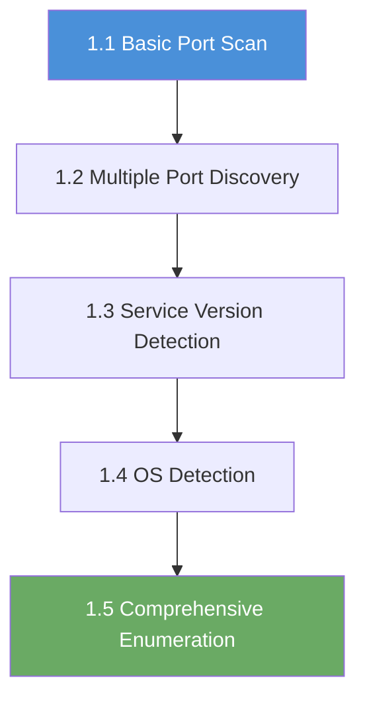

# Chapter 1: Enumeration

!!! note "Example IP addresses"
    The examples in this chapter use `10.100.13.0/24`, the subnet in the
    reference setup. A **subnet** is a block of IP addresses on the same
    network. The platform assigns each student **session** (one running lab
    instance) its own `/24` and displays the real address in the **Active Lab
    View** or **Exercise Network** panel.

    Every command in this chapter uses the placeholder `<target_ip>`. Replace
    it with the target IP shown in your exercise. Do not reuse the example
    subnet unless the platform shows it for your session. These static examples
    are not updated automatically when the range changes.

## Start Here: What Enumeration Means

The terms below are used throughout the chapter. They are defined here once so
that later commands have a clear meaning. Read this table before the first
command.

| Term | Meaning in this chapter |
|---|---|
| **Host** | A device with an IP address (Internet Protocol address, a numeric address on a network), such as a server, workstation, or lab container. |
| **Target** | The specific host assigned to your exercise. It is the only host you are authorized to scan here. |
| **Port** | A numbered logical endpoint on a host, from `0` to `65535`. The operating system uses the port number to decide which program should receive a connection. |
| **Protocol** | The rules two systems use to communicate. This chapter focuses on **TCP** (Transmission Control Protocol), the reliable, connection-based protocol used by most of the services below. **UDP** (User Datagram Protocol) is a different transport protocol and is outside this chapter. |
| **Service** | A program that listens on a port and responds to connections, such as a web server, remote-access server, file-sharing service, or database. |
| **Port scan** | Probing a host's ports to learn which are open, closed, or filtered. |
| **Version detection** | Asking an open service to reveal its software product and version. The `-sV` option in this chapter performs this. |
| **OS fingerprinting** | Inferring the host's operating system (the main platform, such as Linux or Windows) from how it responds to network probes. The `-O` option performs this. |
| **Enumeration** | The systematic discovery of hosts, ports, services, versions, and operating-system details. |
| **Scope** | The set of systems, ports, and actions you are authorized to test. In this chapter, scope is the target IP shown in your exercise, nothing else. |
| **Firewall** | A network control that permits or blocks traffic between hosts or ports. |
| **Open port** | A service is listening and accepting connections. |
| **Closed port** | The host is reachable, but nothing is listening on that port. |
| **Filtered port** | A firewall or network control is silently dropping the probes. You cannot tell from the scan whether a service is behind it. |
| **Nmap** | Network Mapper, the open-source network discovery and security-auditing tool used in this chapter. |
| **NSE** | The Nmap Scripting Engine, the part of Nmap that runs small scripts against discovered services for deeper enumeration. |
| **OS** | Operating system, such as Linux or Windows. |
| **Vulnerability** | A weakness in a system, configuration, or application that can be exploited. |
| **CPE** | Common Platform Enumeration, a standardized identifier for a product and version, used when looking up vulnerabilities. |
| **Packet** | A unit of data sent across a network. |
| **Flag** | A token in `OCR{...}` format that proves you reached the exercise objective. `OCR` is the platform's flag prefix. Submit the flag through the platform's **Submit Flag** form. |
| **Exploitation** | Using a discovered weakness to gain access or control. Enumeration comes first so that exploitation is evidence-led. |
| **Penetration test** | An authorized security assessment that mimics an attacker's discovery and exploitation steps to find weaknesses before a real attacker does. |
| **VPN** | Virtual Private Network: an encrypted tunnel that places your machine on the lab network. |
| **RangeBox** | The browser-based Kali, Ubuntu, or REMnux desktop provided by the platform for lab work. |

In this chapter, **enumeration** means the systematic discovery of what exists
on a network before you try to interact with it: which hosts are present, which
ports accept connections, which services answer on those ports, which software
versions those services run, and which operating system the host is likely
using.

## Who This Chapter Is For

This chapter is for a new cybersecurity learner who is comfortable with
software development or general IT. You may already know how to run a local
application, read a terminal, or connect to a database. You do not need prior
security, penetration-testing, or Nmap experience.

You should be able to:

- open a terminal and run a command;
- read command output and copy text into notes;
- recognize an application, a server, and a database when you see one;
- follow instructions that use placeholders such as `<target_ip>`.

If terminal basics are new to you, ask your instructor for the platform's
introductory terminal exercise before starting this chapter.

## What You Will Be Able to Do

By the end of this chapter, you will be able to:

- define enumeration, host, target, service, port, protocol, and scope;
- state where scanning commands run and how to obtain the assigned target IP;
- explain why enumeration comes before exploitation;
- run a basic scan, a full-range scan, service-version detection, OS detection,
  and a combined enumeration scan;
- distinguish open, closed, and filtered ports;
- read an Nmap port table and explain what each column means;
- record evidence and explain what a scan proves, what it does not prove, and
  one defensive action that would reduce the exposed surface.

## Before You Begin

### Required knowledge

- Basic terminal use: running a command, reading output, and copying text.
- A notes file or text editor for saving commands and results.
- A general understanding of applications, ports, and databases. The bridge
  below covers the security-specific parts.

### Environment

You need one of these two environments:

1. **RangeBox:** launch the exercise with a RangeBox desktop, open its
   terminal, and work there. The RangeBox is already on the exercise network.
2. **Your own Kali Linux VM over VPN:** Kali Linux is a Linux distribution that
   ships with security tools. Connect the VPN first, open a terminal, and
   confirm the platform shows the VPN as connected.

Commands in this chapter run **inside the RangeBox terminal or your own
VPN-connected Kali VM**. They do not run in the OpenCyberRange web page, on the
platform server, or on the target itself. The RangeBox is your workstation; the
target is a separate, disposable lab container.

### Estimated time

Plan for roughly **2–3 hours for the five exercises**, or about 20–40 minutes
per exercise. This is a planning estimate, not a deadline. Reading the output
and recording evidence takes longer than running the command.

### How to find the target

1. Open the exercise in OpenCyberRange.
2. Start the lab and wait until it is running.
3. Open the **Exercise Network** or **Active Lab View** panel.
4. Copy the IP shown under **Your targets**. If a hostname is shown next to it,
   use the IP for Nmap in this chapter.
5. Write the IP in your notes. Use it in place of `<target_ip>` in every
   command.

If the panel does not show a target, do not scan addresses at random. Confirm
that the lab is running, refresh the panel, and ask your instructor if the
target is still missing.

!!! warning "Authorized scope only"
    Scan only the target IPs shown in your OpenCyberRange exercise. Do not scan
    the platform, your own RangeBox, other students, your school or employer
    network, or the internet. The lab network is isolated and fictional. The
    techniques transfer to real work; the permission does not. If you are
    unsure whether a system is in scope, stop and ask before sending traffic.

### Before You Start Checklist

- [ ] I am working in the RangeBox terminal or a VPN-connected Kali VM, not in
      the OpenCyberRange web page or on the platform host.
- [ ] The lab is running and the exercise panel shows a target IP.
- [ ] I have written down the target IP and will use it in place of
      `<target_ip>`.
- [ ] I have a notes file for commands, output, and explanations.
- [ ] I understand that only the assigned target is in scope.

## A Software Developer's Bridge to Ports

If you have run a web application at `http://localhost:3000`, you have already
used the same model this chapter teaches:

- `localhost` is the **host** (your own machine, using the loopback address
  `127.0.0.1`);
- `3000` is the **port**;
- HTTP (Hypertext Transfer Protocol) over TCP is the **protocol**;
- your development server is the **service**.

A local PostgreSQL listener on port `5432`, or a MySQL listener on `3306`, is
the same idea for a database. A browser or database client connects to a host
and port, and the operating system delivers the connection to the program
listening there.

Two details matter when you move from your laptop to a remote target:

- A service bound only to `127.0.0.1` is reachable only from that host. A
  service bound to `0.0.0.0` or a specific network interface may be reachable
  from another machine, subject to firewalls and the network path between the
  two hosts.
- Port numbers are conventions, not guarantees. A web service can run on
  `3000`, `8080`, or an unusual port. That is why the chapter starts with common
  ports and then scans the full range.

Nmap asks the same question from the outside: **which ports on this host accept
connections, and what service answers?**

### Common ports you will meet

These port numbers are conventions. The scan confirms what is actually running;
it does not prove that the conventional service is the one answering.

| Port | Service | What it does |
|---|---|---|
| 22 | SSH (Secure Shell) | Secure remote terminal access |
| 80 | HTTP (Hypertext Transfer Protocol) | Unencrypted web traffic |
| 135 | MSRPC (Microsoft Remote Procedure Call) | Microsoft Remote Procedure Call |
| 139 | NetBIOS (Network Basic Input/Output System) | Legacy Windows networking |
| 443 | HTTPS (HTTP Secure) | Encrypted web traffic |
| 445 | SMB (Server Message Block) | Windows file and printer sharing |
| 1433 | MSSQL (Microsoft SQL Server) | Microsoft SQL Server database |
| 3389 | RDP (Remote Desktop Protocol) | Remote Desktop Protocol |
| 5985 | WinRM (Windows Remote Management) | Windows Remote Management (HTTP) |
| 5986 | WinRM (Windows Remote Management) | Windows Remote Management (HTTPS) |

When you scan a target, Nmap sends network packets to each port and watches for
responses. An open port means a service is listening and ready to accept
connections. A closed port means nothing is listening. A filtered port means a
firewall is silently dropping the packets, so the scan cannot tell whether a
service is present.

## Why Enumeration Comes First

Before you can assess or attack anything, you need to know what is there.
Enumeration is the process of systematically discovering what machines are on a
network, what ports are open on those machines, what software is listening on
those ports, and what operating system is running underneath. Every penetration
test, whether it is a classroom exercise or a real-world engagement, starts
here.

Skipping enumeration is like walking into a building blindfolded. You might
eventually stumble into something interesting, but you will waste time and miss
critical details. A thorough scan in the first few minutes often reveals the
path to the next step. It also prevents you from assuming that a service exists,
or that it does not, without evidence.

## What Is Nmap?

**Nmap** (Network Mapper) is a free, open-source tool for network discovery and
security auditing (checking systems for unintended exposure or configuration).
It has been the industry standard since 1997 and is pre-installed on every copy
of Kali Linux.

At its simplest, Nmap takes a target IP address and tells you which ports are
open. At its most capable, it can detect operating systems, identify software
versions, run automated enumeration scripts through the Nmap Scripting Engine
(NSE), and map large networks.

You will use Nmap in every chapter of this workbook, but this chapter focuses on
learning the tool itself. Later chapters use Nmap as the first step before
moving to service-specific tools such as `smbclient`, `hydra`, or `xfreerdp`.

## The Five-Step Chapter Map

Each exercise adds one capability. The commands below are the ones used in the
chapter. Replace `<target_ip>` with the IP from your exercise. Do not copy an
example IP from this introduction.

| Step | File | Question it answers | Command | Evidence to keep |
|---|---|---|---|---|
| **1.1 Basic Port Scan** | `01_Basic_Port_Scan.md` | Which of the 1,000 most common ports are open? | `nmap <target_ip>` | The port table, plus your notes on open, closed, and filtered results |
| **1.2 Multiple Port Discovery** | `02_Multiple_Port_Discovery.md` | What is listening outside the default set? | `nmap -p 1-65535 <target_ip>` or `nmap -p- <target_ip>` | The full-range result and one unusual port you can explain |
| **1.3 Service Version Detection** | `03_Service_Version_Detection.md` | What software and version answers on each open port? | `nmap -sV <target_ip>` | The service/version table, including anything Nmap marks as unknown |
| **1.4 OS Detection** | `04_OS_Detection.md` | What operating system is likely running? | `sudo nmap -O <target_ip>` | The OS guess, confidence, and CPE string; note if there is no exact match |
| **1.5 Comprehensive Enumeration** | `05_Comprehensive_Enumeration.md` | Can I combine the techniques into one report? | `sudo nmap -A <target_ip>` | One combined report that explains the ports, services, OS, and next step |

The alternatives in the walkthroughs are intentional:

- `-p 1-65535` and `-p-` both mean “scan every TCP port.” The shorter form is
  easier to type; the long form makes the range explicit.
- `sudo` is required for `-O` and `-A` because OS fingerprinting sends raw
  packets (hand-crafted network packets that require privileged access). If
  `sudo` is unavailable in your environment, stop and ask your instructor rather
  than removing the flag silently.
- `--osscan-guess` and `--osscan-limit` are explained in Exercise 1.4. They
  change how aggressively Nmap guesses and which hosts it tries to fingerprint;
  they do not guarantee a precise answer.

Do not memorize every flag now. Each walkthrough explains the command and the
meaningful options before you run it. Focus on what the output proves.

## What Success Looks Like

A successful scan is not “every port is open.” Success means you can explain
the result you obtained.

**Expected success**

- Open ports appear with a service name, and version detection fills in a
  product and version where the service reveals one.
- OS detection produces a guess with a confidence value, plus a CPE identifier
  when Nmap can produce one.
- You can point to the exact lines in your output that support your conclusion.

**Normal uncertainty**

- A port may be **filtered**. That tells you a firewall or network control is in
  the way; it does not prove the service is absent.
- Version detection may report `unknown`, a generic banner, or a version that
  looks incomplete. Record exactly what Nmap reported.
- OS detection may say `no exact match` or give a low confidence value. Treat it
  as a guess. If the walkthrough uses `--osscan-guess`, use it as a more
  aggressive guess, not as proof.
- The lab image or service version may differ from the walkthrough. Your scan
  output is the evidence for your session; do not invent output to match an
  example.

**Likely failure paths**

- Running the command in the wrong place: the platform web page, the host, or a
  terminal that is not in the RangeBox or VPN-connected VM.
- Forgetting to replace `<target_ip>` with the IP from the exercise, or using an
  example IP from this introduction.
- Starting the scan before the lab is running or before the VPN is connected,
  which produces timeouts or unreachable-host results.
- Running `-O` or `-A` without `sudo`, which fails when Nmap tries to send raw
  packets.
- Assuming a filtered port is closed, or assuming a low-confidence OS guess is
  certain.

If a scan fails, confirm the three basics before changing the command: **where
you are running it**, **which target IP you used**, and **whether the lab and
your network path are ready**.

## Completion Evidence

For each exercise, keep:

1. the exact command you ran, with the real target IP;
2. the relevant output, or a faithful summary of it;
3. one or two sentences explaining what the result means.

At the end of the chapter, you should be able to produce a short record like
this:

- **Target:** the IP shown in your exercise.
- **Open ports and services:** the ports that accepted connections and the
  service/version Nmap reported.
- **Uncertain results:** filtered ports, unknown versions, or a low-confidence OS
  guess, with a note on why they are uncertain.
- **OS guess and confidence:** the value Nmap reported, clearly labelled as a
  guess.
- **Defensive takeaway:** one change that would reduce the exposed surface, such
  as restricting a port to an authorized management network or removing an
  unnecessary service.

If your exercise includes a flag in `OCR{...}` format, submit it through the
**Submit Flag** form after you can explain how you found it. A flag is proof of
access; it is not a substitute for the explanation. The chapter review includes
self-assessment questions and a command cheat sheet so you can check your
understanding before moving on.

## Next Step

Open `01_Basic_Port_Scan.md` and complete Exercise 1.1. Replace `<target_ip>`
with the target from your exercise, save the output, and write one sentence
about what the scan found before you move to the next command.
