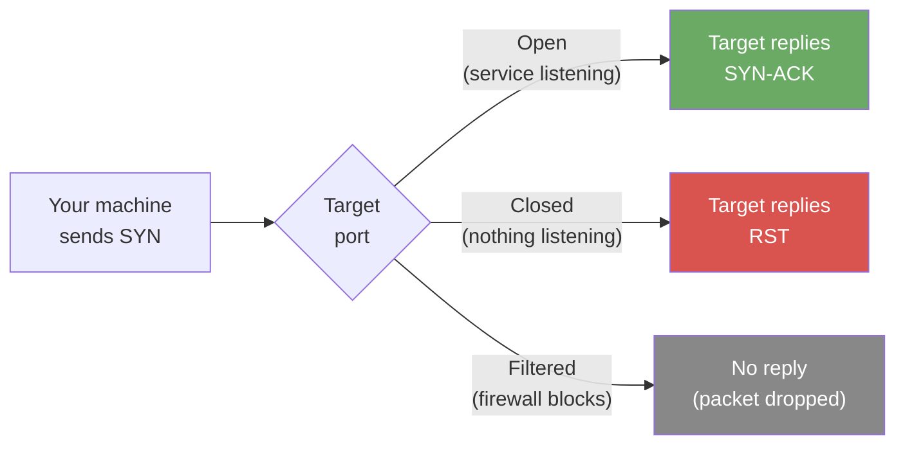

# Exercise 1.1: Basic Port Scan

## Before You Begin

You should have read the **Chapter 1 Introduction**, which defines host, target,
port, service, protocol, and scope, and explains how to find your assigned
target. This exercise starts from zero: no prior Nmap (Network Mapper) or
penetration-testing experience is required.

### Where the commands run

Run every command in this exercise inside the **RangeBox** terminal (the
browser-based lab desktop) or your own **VPN** (Virtual Private Network)-connected
Kali Linux VM. Do not run them in the OpenCyberRange web page, on the platform
server, or on the target itself. The RangeBox is your workstation; the target is
a separate, disposable lab container.

### What you need

- [ ] The Chapter 1 Introduction read.
- [ ] The lab started and its status shown as **Running**.
- [ ] The target IP copied from the **Active Lab View** or **Exercise Network**
      panel.
- [ ] A terminal in the RangeBox or your VPN-connected Kali VM.
- [ ] A notes file for the command and output.

### Estimated time

About **20–30 minutes**. This is a planning estimate, not a deadline. Most of the
time goes into reading the output and recording evidence, not running the scan.

### Scope

!!! warning "Authorized target only"
    Scan only the target IP shown in this exercise. Do not scan the platform,
    your RangeBox, other students, your school or employer network, or the
    internet. If the panel does not show a target, stop and ask your instructor;
    do not scan addresses at random.

### What you will be able to do

By the end of this exercise, you will be able to:

- explain what Nmap does and how a scan differs from exploitation;
- break an Nmap command into its executable, options, and target;
- run a basic scan against the assigned target;
- explain the difference between open, closed, and filtered ports;
- explain why an open port is not automatically a vulnerability;
- read the PORT, STATE, and SERVICE columns;
- retrieve the flag from the exposed SMB share and explain how you found it.

## Scenario

You have been given the IP address of a single Windows machine on the network.
Your task is to perform a basic port scan to discover which services are
running. The organization suspects that file-sharing services may be exposed.
Your job is to confirm what is open.

## Your Objectives

- Perform a basic Nmap scan against the assigned target.
- Identify the open port or ports and the service associated with each one.
- Explain what the scan proves and what it does not prove.
- Find and submit the flag.

## Background: What Does a Port Scan Actually Do?

When Nmap scans a target, it sends a **SYN packet** (the first step of a normal
TCP connection) to each port it wants to check. What happens next depends on
whether anything is listening on that port:



A **SYN-ACK** means the target accepted the connection attempt. An **RST** means
the target refused it. No reply usually means a firewall or network control
dropped the probe.

- **Open:** a service replied. Something is listening on that port and accepting
  connections.
- **Closed:** the machine replied but said “nothing here.” The port exists, but
  no service is using it.
- **Filtered:** no reply at all. A firewall or network device is silently
  dropping the packets, so the scan cannot tell whether a service is behind it.

By default, Nmap scans the **1,000 most common ports** out of 65,535 total.
Those ports cover the vast majority of services you will encounter, including
web servers, file shares, databases, and remote-management tools.

### An open port is not automatically a vulnerability

An open port is an **exposed service**, not proof of a weakness. Whether it is a
risk depends on what the service is, which version is running, how it is
configured, and who can reach it. A web server on port 80 may be intentional; an
SMB file share on port 445 may be unnecessary or over-exposed. Enumeration tells
you what is reachable. It does not prove that the service is exploitable.

### What Nmap does, and what it does not do

Nmap discovers hosts, ports, services, and operating-system details. It does not
exploit them. A scan is an observation step: you send probes and interpret the
responses. Exploitation, if it happens later in an authorized exercise, uses a
separate tool and a separate decision. Keeping those steps separate prevents you
from treating “port open” as “system compromised.”

## Tool Primer: Your First Nmap Command

### The command, piece by piece

The simplest Nmap scan is the tool name followed by the target IP address:

```bash
nmap <target_ip>
```

| Part | Example | Literal or replaceable | Meaning |
|---|---|---|---|
| Executable | `nmap` | Literal | The Nmap program. Type it exactly as shown. |
| Options | none | — | With no options, Nmap runs its default TCP scan against the 1,000 most common ports. |
| Target | `<target_ip>` | Replace | Use the IP shown in the Active Lab View or Exercise Network panel for your session. Do not use an example IP from the introduction. |

No flags are required for this first scan. Nmap sends probes to the default port
set and reports which ports are open.

### What the output means

A basic scan produces a port table with three columns:

- **PORT:** the port number and protocol. Most entries in these exercises are
  TCP.
- **STATE:** `open`, `closed`, or `filtered`.
- **SERVICE:** Nmap's best guess at the service, based on the port number. This
  is not a confirmed identification. Version detection in Exercise 1.3 asks the
  service directly.

!!! note "Representative output, not your output"
    The example below is from the reference setup. Your Nmap version, timing,
    port set, service names, and target IP may differ. Record what your scan
    actually prints; do not paste this example as your own result.

```text
Starting Nmap 7.94 ( https://nmap.org )
Nmap scan report for 10.100.13.10
Host is up (0.0032s latency).
Not shown: 997 closed ports
PORT     STATE SERVICE
80/tcp   open  http
445/tcp  open  microsoft-ds
3389/tcp open  ms-wbt-server

Nmap done: 1 IP address (1 host up) scanned in 3.42 seconds
```

The example shows three open ports. In the reference Windows target, port 445
is the SMB file-sharing service the scenario is concerned with. Your target may
show a different set; that is a result to record and explain, not a failure.

## Walkthrough

### Step 1: Launch the exercise

Open the platform in your browser and start the exercise environment. You need
running containers before your scan will find anything.

1. Navigate to **Exercises** and open the **Windows** track.
2. Open **Level 1**.
3. Click **Launch** on **Basic Port Scan**.
4. Wait for the status to change to **Running**.
5. Copy the **target IP** shown in the **Active Lab View** or **Exercise
   Network** panel into your notes.

If the target IP is missing, wait for the lab to finish starting. If it is still
missing, ask your instructor; do not scan another address.

### Step 2: Verify the path to the target

This step checks whether your workstation can reach the target before you spend
time interpreting scan results.

!!! kali "Check connectivity with ping"
    Run this in the RangeBox terminal or your VPN-connected Kali VM:

    ```bash
    ping -c 3 <target_ip>
    ```

| Part | Example | Literal or replaceable | Meaning |
|---|---|---|---|
| Executable | `ping` | Literal | The connectivity-test program. |
| Option | `-c 3` | Literal | Send **3** probes, then stop. `-c` means “count”; `3` is the number. |
| Target | `<target_ip>` | Replace | The IP from your exercise panel. |

You should see three replies with round-trip times. If the ping times out, that
does **not** prove the VPN is broken: some targets block ICMP (the protocol used
by `ping`) while still accepting TCP connections. Check the platform's VPN
status first, then try the Nmap scan. If Nmap also times out, use the recovery
table below.

### Step 3: Run your first scan

!!! kali "Run the basic port scan"
    In the same terminal, run:

    ```bash
    nmap <target_ip>
    ```

    Replace `<target_ip>` with the IP from your exercise panel. Nmap will take a
    few seconds and then print the results table.

**What success looks like**

- Nmap reports `Host is up`.
- The table contains at least one `open` port, or a clear `closed`/`filtered`
  result you can explain.
- You can point to the PORT, STATE, and SERVICE columns and say what each one
  means.
- You have copied the full output into your notes.

**What is normal uncertainty**

- The SERVICE column may say `unknown` or use a different name than the example.
  It is a guess based on the port number.
- A port may be `filtered`. That means a firewall or network control is in the
  way; it does not prove the service is absent.
- Your target may expose different ports from the reference example. Record what
  you see and explain it.

### Step 4: Interpret the results

Look at the open ports in your output. In the reference setup, port 445 is open
and maps to SMB, the Windows file-sharing protocol. Chapter 2 focuses on
investigating SMB.

For each open port, write down:

- the port number and protocol;
- the state;
- the service label Nmap reported;
- whether the label is a guess or a confirmed version (at this stage, it is a
  guess);
- one sentence about what the service does and whether it is relevant to the
  scenario.

Do not assume that an open port is a vulnerability. The next step is to confirm
what is actually running and how it is configured.

### Step 5: Find and submit the flag

Knowing which services are open tells you how to connect. In this exercise, port
445 is open, SMB file sharing is running, and the target exposes an anonymous
**share** (a folder or resource exposed over SMB) named `public` that holds a
`flag.txt` file.

!!! kali "Read the flag from the SMB public share"
    Use `smbclient` to connect to the `public` share without a password and print
    `flag.txt` to your terminal:

    ```bash
    smbclient //<target_ip>/public -N -c 'get flag.txt -'
    ```

| Part | Example | Literal or replaceable | Meaning |
|---|---|---|---|
| Executable | `smbclient` | Literal | The SMB client program. |
| Target and share | `//<target_ip>/public` | Replace the IP; keep `/public` | Connect to the `public` share on the assigned target. Replace `<target_ip>` with your IP. |
| Option | `-N` | Literal | Connect without a password. |
| Option | `-c` | Literal | Run the command that follows. |
| Command | `'get flag.txt -'` | Literal | Download `flag.txt`. The trailing `-` prints the file to standard output instead of saving it to disk. |

Chapter 2 covers `smbclient` in depth. For now, run the command exactly as
shown. The output contains the flag in `OCR{...}` format (`OCR` is the platform's
flag prefix). Copy the whole value, paste it into the **Submit Flag** form on the
platform, and click **Submit**.

If the share or file is not present, do not guess a flag. Use the recovery table
below and ask your instructor if the lab does not match the scenario.

### Completion evidence

Before you submit the flag, make sure you have:

- the exact command you ran, with the real target IP;
- the full scan output, or a faithful copy of the relevant lines;
- one sentence explaining what each open port means;
- one sentence explaining why an open port is not automatically a vulnerability;
- the command and output that produced the flag, so you can explain how you
  found it.

---

## What Just Happened?

You launched the target, confirmed a path to it, and ran a default Nmap scan.
The scan discovered which ports accepted connections and gave a port-based guess
for each service. In the reference target, port 445 exposed SMB, and the
anonymous `public` share contained the flag. The flag proves you reached the
exercise objective. The scan output and your explanation prove that you
understand how you got there.

The scan did **not** prove that every open port is vulnerable. It identified
exposure. Version detection, configuration review, and exploitation are separate
steps, and each requires its own evidence and authorization.

## Analysis Questions

Take a moment to think through these questions. They do not have single right
answers; the goal is to build analytical thinking.

**1. Why does Nmap only scan 1,000 ports by default instead of all 65,535?**

??? note "Reveal Answer"

    Scanning all ports takes significantly longer. The default 1,000 covers the
    most commonly used services and finds the vast majority of listening
    programs. The tradeoff between speed and completeness is a recurring theme
    in penetration testing. The next exercise explores what happens when you
    scan the full range.

**2. A port shows as “filtered” instead of “open” or “closed.” What does that
tell you about the network between you and the target?**

??? note "Reveal Answer"

    Something between you and the target (a firewall, a router with access
    control lists, or the target's own host firewall) is silently dropping your
    packets. The service behind the filtered port might be running; you cannot
    tell because the firewall is hiding it.

**3. Is an open port automatically a vulnerability? Explain your answer.**

??? note "Reveal Answer"

    No. An open port means a service is reachable. Whether that is a weakness
    depends on the service, its version, its configuration, and who can reach
    it. A web server on port 80 may be intentional; an unnecessary SMB share may
    be an unnecessary risk. Enumeration identifies exposure, not exploitability.

**4. The SERVICE column says `microsoft-ds` for port 445. Why is that not enough
to conclude that the target is running a vulnerable SMB service?**

??? note "Reveal Answer"

    The SERVICE column is a guess based on the conventional port number. Nmap
    has not confirmed the actual software or version. Version detection and
    configuration review are needed before making a vulnerability claim.

**5. You found port 445 open. If you were a system administrator trying to
secure the machine, what would you do?**

??? note "Reveal Answer"

    Consider whether SMB needs to be exposed to the network at all. If file
    sharing is only needed internally, restrict access with firewall rules so
    that only authorized IP ranges can reach port 445. If SMB is not needed,
    disable the service entirely. Unnecessary open ports are unnecessary risk.

## Defensive Takeaways

- Disable services that are not needed. An unused SMB share is an unnecessary
  attack surface.
- Restrict file-sharing ports such as 445 to authorized management networks.
- Monitor for unexpected port scans and repeated connection attempts.
- Patch exposed services and confirm their versions instead of trusting the
  port number.
- Ask whether an anonymous share should exist at all. If it must exist, limit
  what it contains and who can read it.

## If You Get Stuck

| Symptom | Likely cause | What to do |
|---|---|---|
| `Failed to resolve` or `Name or service not known` | The IP or hostname was typed incorrectly. | Re-copy the target from the exercise panel. Do not use an example IP. |
| All ports show `filtered`, or the scan times out | The VPN is not connected, the target is not ready, or a firewall is blocking the path. | Check the platform's VPN status, confirm the lab is **Running**, and try again. If you are using RangeBox, confirm the desktop is connected. |
| `Host seems down` | Nmap's discovery probes were blocked, or the target is not ready. | Verify the target IP and VPN/RangeBox first. Do not assume the host is down. Do not add flags by guessing; follow the course guidance for the target. |
| `nmap: command not found` | The command is running in the wrong environment. | Run it in the RangeBox terminal or your VPN-connected Kali VM, not in the platform page. |
| `smbclient: command not found` | The command is running outside the lab desktop. | Use the RangeBox terminal or your Kali VM. |
| `NT_STATUS_ACCESS_DENIED` or `NT_STATUS_NO_SUCH_FILE` | The share or file is not present, or the target is not the one in the scenario. | Confirm the target IP, the lab status, and the exact share/file names. Ask your instructor if the lab does not match the scenario. |
| The flag is rejected | The value was copied incorrectly, or the wrong case/format was submitted. | Copy the whole `OCR{...}` value exactly, including the prefix and braces. Do not guess or alter the flag. |
| The scan finds no open ports | The IP is wrong, the target is not ready, or the service is filtered. | Re-check the target IP and lab status. Do not scan other hosts. |

## Further Reading

- [Nmap reference guide](https://nmap.org/book/man.html)
- [Nmap port scanning basics](https://nmap.org/book/man-port-scanning-basics.html)
- [Nmap output formats](https://nmap.org/book/output.html)

## Key Takeaways

- A **port scan** is the foundation of enumeration: you cannot assess what you
  have not found.
- Nmap's default scan checks the **1,000 most common ports**. That is a useful
  starting point, not a complete inventory.
- **Open** means a service is listening; **closed** means nothing is there;
  **filtered** means a firewall or network control is blocking your view.
- The SERVICE column is a **guess based on the port number**, not a confirmed
  identification.
- An open port is **not automatically a vulnerability**. It is an exposed
  service that needs context.
- Port 445 (SMB) on a Windows machine is a common service to investigate
  further. The next exercise shows how to find services that the default scan
  misses.
