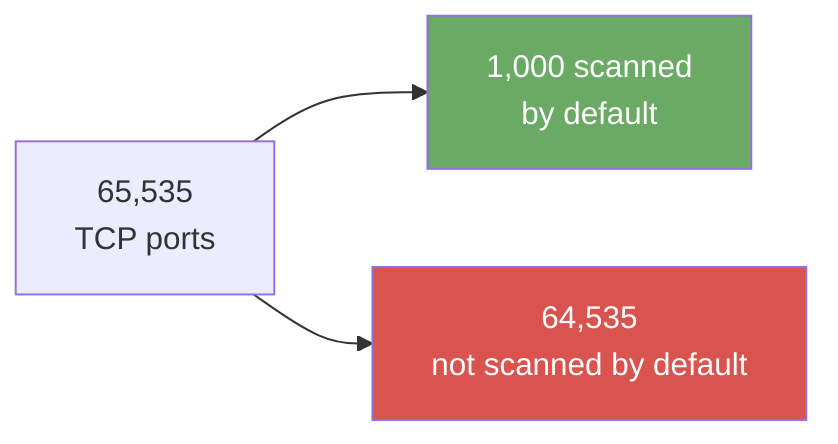

# Exercise 1.2: Multiple Port Discovery

## Before You Begin

In Exercise 1.1, you ran Nmap's default scan against the 1,000 most common
ports. That is a useful baseline, but it is not the whole port space. Services
can run on non-standard ports, either because an administrator moved them or
because an application chose a different number.

This exercise introduces **one new decision**: which ports to scan. You will
compare a single port, a comma-separated list, a range, and a broader scan, then
run the broader scan against the assigned target.

### Where the commands run

Run every command inside the **RangeBox** terminal (the browser-based lab
desktop) or your own **VPN** (Virtual Private Network)-connected Kali Linux VM.
Do not run them in the OpenCyberRange web page, on the platform server, or on
the target itself.

### What you need

- [ ] The Chapter 1 Introduction and Exercise 1.1 completed.
- [ ] The lab started and its status shown as **Running**.
- [ ] The target IP copied from the **Active Lab View** or **Exercise Network**
      panel.
- [ ] A terminal in the RangeBox or your VPN-connected Kali VM.
- [ ] A notes file for predictions, commands, and output.

### Estimated time

About **25–35 minutes**. The broad scan may take longer than the default scan;
the estimate includes reading and interpreting the output.

### Scope

!!! warning "Authorized target only"
    Scan only the target IP shown in this exercise. Do not scan the platform,
    your RangeBox, other students, your school or employer network, or the
    internet. If the panel does not show a target, stop and ask your instructor;
    do not scan addresses at random.

### What you will be able to do

By the end of this exercise, you will be able to:

- explain the difference between a single port, a comma-separated list, a port
  range, and a broader scan;
- choose a scan breadth that matches the question you are asking;
- explain how breadth affects time, network noise, and interpretation;
- predict what a broader scan may find before running it;
- compare a default scan with a broader scan and explain whether the extra
  coverage was worth the extra time;
- retrieve and submit the flag.

## Scenario

The target machine has been reconfigured. Intelligence suggests that additional
services may be running on non-standard ports; ports that a default Nmap scan
would miss entirely. Your job is to perform a full port scan that covers every
possible port and identify all exposed services.

## Your Objectives

- Compare single-port, list, range, and broader scan syntax.
- Predict what the broader scan may find.
- Run a default scan as a baseline, then scan all 65,535 TCP ports.
- Identify any open port outside the default set.
- Compare the results and decide whether the broader scan was justified.
- Find and submit the flag.

## Background: Selecting More Than One Port

Nmap's `-p` option selects which ports to scan. The value after `-p` can take
several forms. This exercise uses only that option; other Nmap options are
introduced in later exercises.

### The four choices

| Selection | Syntax | Example | When it is appropriate | Trade-off |
|---|---|---|---|---|
| **Single port** | `-p <port>` | `-p 80` | You already know the one service you need to check. | Fastest and least noisy, but blind to everything else. |
| **Comma-separated list** | `-p <port>,<port>,...` | `-p 22,80,443` | You have a short list of known services to verify. | Fast, but it cannot find a service you did not list. |
| **Range** | `-p <start>-<end>` | `-p 1-1023` | You want to investigate a known band, such as the well-known ports. | Broader than a list, but still bounded. |
| **Broader scan** | `-p <start>-<end>` or `-p-` | `-p 1-65535` or `-p-` | You need a complete inventory of TCP ports on one authorized target. | Slowest and noisiest; it produces the most results to interpret. |

`-p-` is Nmap shorthand for “scan every TCP port.” `-p 1-65535` is the explicit
form of the same range. Do not put spaces around the comma or the hyphen:
`-p 22,80,443` and `-p 1-65535` are valid; `-p 22, 80, 443` and
`-p 1 - 65535` are not the syntax you want.

### Port ranges

| Range | Name | Typical use |
|---|---|---|
| 0–1023 | Well-known ports | Standard services such as SSH, HTTP, and HTTPS. Often described as the first 1,024 ports. |
| 1024–49151 | Registered ports | Applications and services registered with IANA (Internet Assigned Numbers Authority), plus many custom services. |
| 49152–65535 | Dynamic or ephemeral ports | Temporary client ports, and sometimes services that administrators or applications place there. |

Port numbers are conventions, not guarantees. A service can listen on any port.
A full scan checks the whole TCP space; it does not tell you that every open port
is important or vulnerable.

### More ports is not automatically better

**Scan breadth** is how many ports or hosts a scan covers. **Scan noise** is the
traffic, log entries, and alert volume the scan creates.

A broader scan is not automatically a better scan. It gives you more coverage,
but it also:

- takes longer;
- sends more probes and creates more noise;
- produces more output to interpret;
- may be unnecessary when you already know which service you need to check.

Choose the smallest scan that answers your question. Use a broader scan when
you need discovery, not by default.

### What the default scan leaves out

By default, Nmap scans the **1,000 most common ports** out of 65,535 TCP ports.
That leaves **64,535 ports** unchecked in a default scan.



A service moved to a port outside the default 1,000 would be invisible to a
default scan. A custom application on a high-numbered port could be missed too.
The broader scan exists to answer the question: **what else is listening?**

A full-range scan may take anywhere from tens of seconds to several minutes,
depending on the network, the target, and how it responds. The time is part of
the trade-off, not a reason to skip interpretation.

## Prediction: Before You Scan

Before running the broader scan, write down your prediction in your notes:

1. Which services or ports do you expect the default scan to miss?
2. How much longer do you expect the broader scan to take than the default scan?
3. What result would make the extra time and noise worth it?
4. What result would tell you the broader scan was unnecessary for this target?

You will compare your prediction with the actual result.

## Walkthrough

### Step 1: Launch the exercise

1. Navigate to **Exercises** and open the **Windows** track.
2. Open **Level 1**.
3. Click **Launch** on **Multiple Port Discovery**.
4. Wait for the status to change to **Running**.
5. Copy the **target IP** from the **Active Lab View** or **Exercise Network**
   panel into your notes.

Every command uses the placeholder `<target_ip>`. Replace it with the IP from
your exercise panel. Do not copy an example IP from the introduction or another
student's screen. The active target is the only system in scope.

### Step 2: Run a default scan as a baseline

!!! kali "Run the default scan"
    In the RangeBox terminal or your VPN-connected Kali VM, run:

    ```bash
    nmap <target_ip>
    ```

| Part | Example | Literal or replaceable | Meaning |
|---|---|---|---|
| Executable | `nmap` | Literal | The Nmap program. |
| Options | none | — | The default TCP scan of the 1,000 most common ports. |
| Target | `<target_ip>` | Replace | The IP from your exercise panel. |

Record the open ports in your notes. This is your baseline. You are not trying
to find the flag yet; you are establishing what the default view sees.

**Success indicator for this step:** Nmap reports `Host is up` and prints a
port table. Your baseline may contain several open ports, one, or none that you
recognize.

### Step 3: Run the broader scan

!!! kali "Scan all TCP ports"
    Now scan the complete TCP port space:

    ```bash
    nmap -p- <target_ip>
    ```

    The explicit equivalent is:

    ```bash
    nmap -p 1-65535 <target_ip>
    ```

| Part | Example | Literal or replaceable | Meaning |
|---|---|---|---|
| Executable | `nmap` | Literal | The Nmap program. |
| Option | `-p-` | Literal | Select every TCP port from 1 through 65,535. |
| Option | `-p 1-65535` | Literal | The explicit range form of `-p-`. |
| Target | `<target_ip>` | Replace | The IP from your exercise panel. |

Use one of the two forms. Do not add timing options or other Nmap features in
this exercise; the goal is to understand **which ports** you selected, not how
fast the scan runs.

**Success indicator for this step:** The scan completes, reports `Host is up`,
and prints a port table that includes everything from your baseline plus any
additional open ports the broader range found. A result with no additional ports
is still a valid result; it means the default scan was sufficient for this
target.

**Normal uncertainty:** a port may be `filtered`, a service label may be a guess,
or the scan may take longer than expected. Record what happened instead of
assuming a missing result means the service is absent.

### Interpret your result

After the broader scan, answer these questions in your notes:

- Which open ports appeared in the broader scan that were not in the baseline?
- Which port ranges did those new ports fall into?
- Did the broader scan change your understanding of the target?
- Was the extra time and noise justified for this target? Why or why not?

This comparison is the point of the exercise. A broader scan that finds nothing
new is not a failed scan; it is evidence that the baseline was adequate for this
target.

### Step 4: Find and submit the flag

The exercise serves the flag from its HTTP service. Use this command:

!!! kali "Retrieve the flag from the web server"
    ```bash
    curl http://<target_ip>/flag.txt
    ```

| Part | Example | Literal or replaceable | Meaning |
|---|---|---|---|
| Executable | `curl` | Literal | The HTTP client used to request the file. |
| URL | `http://<target_ip>/flag.txt` | Replace the IP; keep `http://` and `/flag.txt` | Request `flag.txt` from the target's HTTP service. |

The response contains the flag in `OCR{...}` format (`OCR` is the platform's flag
prefix). Copy the whole value, paste it into the **Submit Flag** form on the
platform, and click **Submit**.

If your scan shows the HTTP service on a different port, use the port from your
scan in the URL and note the difference. Do not guess a port or a flag.

### Completion evidence

Before you submit the flag, make sure you have:

- your prediction from before the scan;
- the exact baseline command and its open ports;
- the exact broader command and its open ports;
- one sentence identifying a port the baseline missed, or explaining why no
  additional port was found;
- one sentence on whether the broader scan was worth its extra time and noise;
- the `curl` command and output that produced the flag.

---

## What Just Happened?

You selected a broader port set with `-p-` (or `-p 1-65535`) and compared it with
Nmap's default scan. The broader scan gave you a more complete inventory of TCP
services on one authorized target. It did not prove that every open port is
vulnerable, and it did not make the services safe or unsafe by itself.

The useful result is the comparison: what the default scan saw, what the broader
scan added, and whether the extra coverage answered your question.

## Analysis Questions

**1. When would you use a comma-separated list instead of a range?**

??? note "Reveal Answer"

    A list is best when you know the small set of services you need to verify,
    such as `22,80,443`. A range is better when you want to investigate a band
    of ports, such as the well-known ports, or when you do not know which port a
    service uses.

**2. Why is a full-range scan not automatically better than a default scan?**

??? note "Reveal Answer"

    A full-range scan covers more ports, but it takes longer, creates more
    traffic and log noise, and produces more output to interpret. It is the
    right choice for discovery on an authorized target, not a default for every
    scan. Choose the smallest scan that answers your question.

**3. An administrator moves SSH from port 22 to port 54321 “for security.” Does
that make the machine safer?**

??? note "Reveal Answer"

    Moving a service to a non-standard port is “security through obscurity”
    (relying on a hidden port or detail instead of real access control). It may
    stop scanners that only check default ports, but it does not stop a broader
    scan, and the service itself is no more secure on port 54321 than it was on
    port 22. Real security comes from strong authentication, patching, and access
    controls, not from hiding the port number.

**4. Your broader scan found no additional ports. What did you learn?**

??? note "Reveal Answer"

    You learned that, for this target at this time, the default scan was
    sufficient to inventory the TCP services. That is a valid result, not a
    failure. It also tells you that the extra time and noise did not add
    coverage for this particular target.

**5. What did your broader scan add that the baseline missed, and was the extra
time justified?**

??? note "Reveal Answer"

    Answers will vary with the target. A good answer names the specific port or
    ports, explains why the default scan missed them, and makes a judgment about
    whether the extra coverage was worth the slower, noisier scan. “It depends on
    the question” is acceptable when you explain which question the broader scan
    answered.

## Defensive Takeaways

- Minimise exposed ports. Every listening service is reachable surface, even if
  it is not currently vulnerable.
- Do not treat a non-standard port as a security control. Use authentication,
  patching, and network access rules.
- Restrict management and file-sharing ports to authorized networks.
- Monitor for broad port scans and sudden increases in connection attempts.
- Know which ports are expected on each host; unexpected open ports are worth
  investigating.

## If You Get Stuck

| Symptom | Likely cause | What to do |
|---|---|---|
| `Failed to resolve` or `Name or service not known` | The IP or hostname was typed incorrectly. | Re-copy the target from the exercise panel. Do not use an example IP. |
| The scan times out or all ports are filtered | VPN not connected, target not ready, or a firewall is blocking the path. | Check the platform's VPN status, confirm the lab is **Running**, and try again. If using RangeBox, confirm the desktop is connected. |
| `Host seems down` | Nmap's discovery probes were blocked, or the target is not ready. | Verify the target IP and VPN/RangeBox first. Do not assume the host is down. Do not add flags by guessing; follow the course guidance for the target. |
| `-p 1 - 65535` does not behave as expected | Spaces split the range value. | Use `-p 1-65535` or `-p-` with no spaces. |
| `-p 1,65535` scans only two ports | A comma creates a list, not a range. | Use a hyphen for a range: `-p 1-65535`. |
| `-p-` is mistyped as `-p -` | The option and value are separated incorrectly. | Use `-p-` as a single token. |
| The broad scan finds no new ports | The target may not expose anything outside the default set. | Record it as a valid result and compare with your baseline. Do not scan other hosts. |
| The flag is rejected | The value was copied incorrectly, or the wrong case/format was submitted. | Copy the whole `OCR{...}` value exactly. Do not guess or alter the flag. |

## Further Reading

- [Nmap port scanning basics](https://nmap.org/book/man-port-scanning-basics.html)
- [Nmap port specification](https://nmap.org/book/man-port-specification.html)
- [Nmap reference guide](https://nmap.org/book/man.html)

## Key Takeaways

- `-p` selects ports; the value can be a single port, a comma-separated list, a
  range, or the full range with `-p-`.
- Use a single port or list when you know what you need to check. Use a range or
  broader scan when you need discovery.
- Broader scans cost more time, create more noise, and produce more output. They
  are not automatically better.
- A default scan covers 1,000 common ports; 64,535 TCP ports remain unchecked.
- Compare the baseline and broader result. The comparison is the finding, not
  just the command output.
