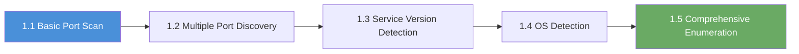

# Chapter 1: Review

## What You Learned

Over five exercises, you built an enumeration workflow: start with a known set of
ports, expand to the full TCP range when the question requires it, collect
service and version evidence, infer the likely operating system, and combine the
techniques into one scan. Most later chapters begin with an Nmap scan, so the
skills here are used repeatedly. The goal is not command recall. The goal is to
choose a safe, appropriate scan and explain what the evidence does and does not
prove.

## The Progression You Followed

| Exercise | Capability | Evidence you should have |
|---|---|---|
| 1.1 Basic Port Scan | Discovered the default port set and read open, closed, and filtered states. | The command, port table, and an explanation of the SERVICE label as a guess. |
| 1.2 Multiple Port Discovery | Selected a list, range, or broader scan and compared it with the default. | A baseline and broader result, plus a judgment about time and noise. |
| 1.3 Service Version Detection | Collected product and version evidence and separated observations from conclusions. | The `-sV` output and a record of product, version, and uncertainty. |
| 1.4 OS Detection | Inferred a likely OS from network behaviour and recorded confidence and ambiguity. | The `-O` output, observation, confidence (or “not shown”), and a tentative conclusion. |
| 1.5 Comprehensive Enumeration | Combined the techniques into one scan and interpreted the result. | One combined report and an explanation of what it supports. |

## How to Use This Review

Answer the questions without looking back at the walkthroughs. Write your
reasoning, not just the command. Then use the answer key to check your thinking.
If you miss something, follow the remediation pointer (the exercise to revisit)
for that topic.

This review is a **readiness gate** (a self-check before moving on), not a
proctored exam. If you cannot answer a question independently, that is useful
information: revisit the linked exercise before Chapter 2.

## Part A: Short Answer and Interpretation

**1. You are assigned one target for an exercise. State the scope and where the
scanning commands run.**

> &nbsp;
>
> &nbsp;

**2. A port is open. Does that mean the service is vulnerable? Explain your
answer.**

> &nbsp;
>
> &nbsp;

**3. What is the difference between an open port and a filtered port? What does
“filtered” not tell you?**

> &nbsp;
>
> &nbsp;

**4. A basic scan shows SERVICE `microsoft-ds` for port 445. A version scan
shows SERVICE `netbios-ssn` and VERSION `Samba smbd 4.15.5`. Identify the service
name, product, and version. Which part is an observation, and which part is a
conclusion?**

> &nbsp;
>
> &nbsp;

**5. A version scan reports `xrdp` for port 3389 but shows no version. What can
you conclude, and what can you not conclude?**

> &nbsp;
>
> &nbsp;

**6. OS detection returns several candidates, or says it has no exact OS match.
What should you record? Is that a failed lab?**

> &nbsp;
>
> &nbsp;

**7. You need to check only ports 22 and 443 on your assigned target. Which
selection syntax would you use, and why would you not start with `-p-`?**

> &nbsp;
>
> &nbsp;

**8. What does `-A` combine, and when would you avoid it?**

> &nbsp;
>
> &nbsp;

**9. Why should enumeration come before exploitation? What can go wrong if you
skip it?**

> &nbsp;
>
> &nbsp;

**10. Name one defensive takeaway from this chapter and the exercise where you
learned it.**

> &nbsp;
>
> &nbsp;

## Part B: Output Interpretation

Use **your own** Exercise 1.3 and 1.4 output. Do not copy the example output from
the chapter.

**1. Choose one line from your version scan that has both a product and a
version.** Record the service name, product, version, and one tentative
conclusion. Label the conclusion as tentative.

> &nbsp;
>
> &nbsp;

**2. Choose one line that has a product but no version, or a version you would
not rely on.** Explain what you can and cannot claim from that line.

> &nbsp;
>
> &nbsp;

**3. From your OS detection output, was the result one candidate, several
candidates, or no exact match?** Record the observation and one sentence of
uncertainty. Do not invent a confidence value if Nmap did not print one.

> &nbsp;
>
> &nbsp;

## Part C: Practical Scenario

Your instructor assigns you one target IP from the **Active Lab View** and asks
you to produce a short enumeration report. You may use RangeBox or your
VPN-connected Kali VM.

Write a plan that answers all five points:

1. **Where** will the commands run, and **which system** is in scope?
2. **Which scan** will you run first, and why is that breadth appropriate?
3. **What success evidence** will you record?
4. **What is one likely failure**, and how will you recover without scanning
   another host?
5. **What claim will you not make** without more evidence?

> &nbsp;
>
> &nbsp;
>
> &nbsp;

## Glossary Check

Write a one-sentence definition or a concrete example for each term. Use the
chapter glossary or the platform glossary if you need a reminder.

| Term | Your definition or example |
|---|---|
| Enumeration | |
| Host | |
| Target | |
| Port | |
| Protocol | |
| Service | |
| Product | |
| Version | |
| Banner | |
| Scope | |
| Open port | |
| Closed port | |
| Filtered port | |
| OS fingerprinting | |
| Confidence | |
| Exploitation | |

## Readiness Gate

Complete this checklist before moving to Chapter 2. If you cannot tick an item,
use the remediation pointer instead of guessing.

- [ ] I can state where the commands run and identify the target from the Active
      Lab View or Exercise Network panel.
- [ ] I can explain the difference between an open port and a vulnerable service.
- [ ] I can distinguish a service name, product, version, and banner.
- [ ] I can explain observation, confidence, and conclusion for OS detection.
- [ ] I can interpret a single OS candidate, multiple candidates, and “no exact
      match.”
- [ ] I can choose a list, range, or broader scan and explain the time and noise
      trade-off.
- [ ] I have saved evidence from Exercises 1.1–1.5.
- [ ] I can name one likely failure and one recovery step.
- [ ] I can state one defensive takeaway from the chapter.
- [ ] I completed the self-rating below.

| If you are unsure about… | Revisit |
|---|---|
| Scope, target selection, or where commands run | Chapter introduction and Exercise 1.1 |
| Open, closed, filtered, or “open is not vulnerable” | Exercise 1.1 |
| Single port, list, range, breadth, or noise | Exercise 1.2 |
| Service name, product, version, banner, or evidence quality | Exercise 1.3 |
| OS inference, confidence, multiple matches, or no exact match | Exercise 1.4 |
| Combining techniques or interpreting the final scan | Exercise 1.5 |

## Self-Rating

Rate yourself honestly. This is for planning, not for a grade.

| Skill | Not yet | With help | Independently | Evidence I can point to |
|---|---|---|---|---|
| State scope and target | [ ] | [ ] | [ ] | |
| Choose scan breadth | [ ] | [ ] | [ ] | |
| Read a port table | [ ] | [ ] | [ ] | |
| Separate service, product, and version | [ ] | [ ] | [ ] | |
| Record observations versus conclusions | [ ] | [ ] | [ ] | |
| Interpret OS confidence and ambiguity | [ ] | [ ] | [ ] | |
| Name a failure path and recovery | [ ] | [ ] | [ ] | |
| Explain one defensive takeaway | [ ] | [ ] | [ ] | |

If any row is **Not yet** or **With help**, revisit the matching exercise before
Chapter 2. That is the purpose of the gate.

---

## Answer Key and Rationales

### Part A

**1. Scope and location.** Scope is the one target IP shown in the exercise; the
commands run in the RangeBox terminal or your VPN-connected Kali VM, not in the
platform page, on the platform host, or on another student's system. *Why:* the
technique is authorized only for the assigned lab target. *Revisit:* Chapter
introduction and Exercise 1.1.

**2. Open is not vulnerable.** An open port means a service is reachable.
Vulnerability depends on the service, version, configuration, exposure, and
whether a weakness is actually exploitable. A scan is evidence, not a
vulnerability finding. *Why:* a version or port match does not prove
exploitability. *Revisit:* Exercise 1.1 and Exercise 1.3.

**3. Open versus filtered.** Open means a service is listening and accepting
connections. Filtered means a firewall or network control is silently dropping
probes; you cannot tell whether a service is behind it. *Why:* “filtered” is an
absence of evidence, not evidence of absence. *Revisit:* Exercise 1.1.

**4. Service, product, version, observation, conclusion.** `netbios-ssn` is the
service name; `Samba` (with `smbd`) is the product; `4.15.5` is the version. The
observation is what Nmap printed. The tentative conclusion is that the SMB
service is probably Samba 4.15.5, which is a research lead, not proof of a
vulnerability. *Why:* the service label, product, and version come from different
layers of evidence. *Revisit:* Exercise 1.3.

**5. Product without a version.** You can record that Nmap identified the RDP
product as xrdp. You cannot make a version-specific vulnerability claim because
no version was reported. Record “product identified, version not shown.” *Why:*
a missing version is a valid uncertainty, not a gap to fill with a guess.
*Revisit:* Exercise 1.3.

**6. OS multiple candidates or no exact match.** Record the exact wording, every
candidate you can see, and any confidence values. State that the result is
ambiguous or that no exact match was produced. It is not a failed lab; OS
detection is probabilistic. *Why:* a guess is not a fact. *Revisit:* Exercise
1.4.

**7. List versus broad scan.** Use a list such as `-p 22,443` on `<target_ip>`.
A list is faster and less noisy when you already know the services you need to
check. `-p-` scans all 65,535 ports and is appropriate for discovery, not for a
known two-port check. *Why:* choose the smallest scan that answers the question.
*Revisit:* Exercise 1.2.

**8. What `-A` combines.** `-A` enables version detection, OS detection, default
NSE scripts, and traceroute. Avoid it when you need a small, fast, quiet check,
when you are scanning a broad range of hosts, or when you do not need all of
those techniques. *Why:* more capability costs time and noise. *Revisit:*
Exercise 1.5.

**9. Enumeration before exploitation.** Enumeration gives you evidence about what
exists before you attempt anything: the target, open ports, services, products,
versions, and likely platform. Exploitation without that evidence is guessing.
It can waste time, miss the actual service, target the wrong host, or cross the
authorized scope. *Why:* enumeration makes the next step evidence-led and
safer. *Revisit:* Chapter introduction and Exercise 1.1.

**10. Defensive takeaway.** Any one of: minimise exposed ports; do not treat a
non-standard port as a security control; restrict file-sharing and management
ports; patch and inventory versions; monitor for scans; treat scanner output as
evidence to verify. Name the exercise where you saw it. *Why:* the chapter is
about understanding exposure, not only finding it. *Revisit:* Exercises 1.1–1.4,
depending on the takeaway you choose.

### Part B

**1–3. Output interpretation.** A strong answer names the exact line, separates
the observation from the conclusion, and states uncertainty. For example:
“Observation: Nmap reported `Samba smbd 4.15.5` for `445/tcp`. Tentative
conclusion: the SMB service is probably Samba 4.15.5; this is a research lead,
not proof of a vulnerability.” A product-only line should be recorded as “product
identified, version not shown.” An OS result with several candidates or no exact
match should be recorded as ambiguous, with the exact candidates or wording and
any confidence values. *Why:* the review is testing evidence handling, not
whether you can copy a command. *Revisit:* Exercises 1.3 and 1.4.

### Part C: Model Scenario Answer

- **Where and what is in scope:** “I will run commands in the RangeBox terminal
  or my VPN-connected Kali VM. The only target is the IP shown in the Active Lab
  View; I will not scan the platform, my RangeBox, other students, or the
  internet.”
- **First scan and breadth:** “I will start with `nmap <target_ip>` to inventory
  the default 1,000 ports. If the task requires discovery, I will follow with
  `nmap -p- <target_ip>` and explain the extra time and noise.”
- **Success evidence:** “I will save the command, the port table, the state
  (open/closed/filtered), the service label, and, if I run `-sV`, the product and
  version or ‘not shown.’ I will write one observation and one tentative
  conclusion.”
- **Likely failure and recovery:** “If the scan times out, I will confirm the
  lab is Running, verify the target IP, and check the VPN or RangeBox connection
  before changing the command. I will not scan a different host.”
- **Claim I will not make:** “I will not claim that an open port or a version
  string proves a vulnerability or exploitability. I will treat it as a research
  lead and state the uncertainty.”

*Why:* this answer demonstrates scope, method, evidence, recovery, and safe
judgment. *Revisit:* the relevant exercise for any part you cannot state.

### Glossary Check

| Term | Model definition |
|---|---|
| Enumeration | The systematic discovery of hosts, ports, services, versions, and OS details. |
| Host | A device on a network with an IP address. |
| Target | The specific host assigned to the exercise and in scope. |
| Port | A numbered logical endpoint on a host, from `0` to `65535`. |
| Protocol | The rules two systems use to communicate; TCP and UDP are transport protocols. |
| Service | A program that listens on a port and responds to connections. |
| Product | The software family or application, such as nginx or Samba. |
| Version | The specific release string, which may be missing or inaccurate. |
| Banner | The text or protocol response a service returns; evidence for product/version inference, not proof. |
| Scope | The systems, ports, and actions authorized for the exercise. |
| Open port | A port where a service is listening and accepting connections. |
| Closed port | A port on a reachable host where nothing is listening. |
| Filtered port | A port where a network control is dropping probes; the scan cannot tell whether a service is behind it. |
| OS fingerprinting | Inferring an OS from network behaviour and comparing it with a fingerprint database. |
| Confidence | A match score or guess strength, not a guarantee or probability that the OS is exact. |
| Exploitation | Using a discovered weakness to gain access or control; it requires evidence and authorization. |

*Revisit:* the exercise that introduced a term you could not define.

## Command Reference

These are the required commands from this chapter. `<target_ip>` is the only
replaceable value in most lines; do not copy an example IP from the
introduction. Options are explained in the exercise that introduces them.

| Command | What it does | Exercise |
|---|---|---|
| `nmap <target_ip>` | Scan the 1,000 most common TCP ports. | 1.1 |
| `nmap -p 22,80,443 <target_ip>` | Scan a comma-separated list of ports. | 1.2 |
| `nmap -p 1-65535 <target_ip>` | Scan a range covering every TCP port. | 1.2 |
| `nmap -p- <target_ip>` | Shorthand for `-p 1-65535`. | 1.2 |
| `nmap -sV <target_ip>` | Collect service, product, and version evidence. | 1.3 |
| `sudo nmap -O <target_ip>` | Infer an operating system from fingerprint evidence. | 1.4 |
| `sudo nmap -A <target_ip>` | Combine version detection, OS detection, NSE scripts, and traceroute. | 1.5 |

**Flag retrieval used in this chapter:**

| Command | What it does | Exercise |
|---|---|---|
| `smbclient //<target_ip>/public -N -c 'get flag.txt -'` | Read `flag.txt` from the `public` SMB share. | 1.1, 1.3 |
| `curl http://<target_ip>/flag.txt` | Read `flag.txt` from the HTTP service. | 1.2 |
| `smbclient -L //<target_ip> -N` | List SMB shares and server information. | 1.4 |
| `nmap -sV -p 445 <target_ip>` | Collect the SMB version banner. | 1.4 |

Do not add options from other chapters or from internet examples during this
review. If a walkthrough or your instructor has not introduced an option, you do
not need it here.

## Connect the Dots: What Comes Next

You now have evidence about open ports, services, products, versions, and the
likely operating system. The next step is to choose one service to investigate in
more depth within the isolated lab.

**Chapter 2 (SMB Reconnaissance)** focuses on port 445, the SMB file-sharing
service you encountered in your scans. You will inspect shares and read data in
the authorized lab environment. The enumeration skills from Chapter 1 established
that the service is reachable; Chapter 2 shows how to investigate it safely and
explain what you find.

## Free Practice and Certification Next Steps

These optional free resources match this chapter. They do not replace the lab or
this workbook.

- **TryHackMe** — beginner-friendly rooms for Windows and Active Directory
  practice: <https://tryhackme.com/>
- **KC7 Cyber** — free threat-hunting cases using KQL and log analysis:
  <https://kc7cyber.com/>
- **ISC2 Certified in Cybersecurity** — free entry-level training and exam
  pathway: <https://www.isc2.org/landing/1mcc>

See [Free training and certifications](../FREE-TRAINING-AND-CERTIFICATIONS.md)
for the full map and the privacy note.
