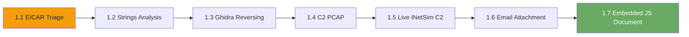

# MAL01: Malware Fundamentals

<!-- BEGIN GENERATED CHAPTER POSITION -->
!!! note "Curriculum position"
    **Chapter:** `MAL01` — Malware Fundamentals
    **Prerequisites:** `NET02` — PCAP Forensics
    **Recommended next:** `MAL02` — Executable Analysis
<!-- END GENERATED CHAPTER POSITION -->

## Why Malware Analysis Matters

Every intrusion eventually leaves a file behind. A phishing attachment, a
dropped loader, a memory-resident beacon, or a binary pulled from a backup:
before you can contain an incident, you have to answer a deceptively simple
question. What is this thing, and what does it do?

Malware analysis is the discipline of answering that question safely. You do
not need a fully equipped reverse-engineering lab to start. You need a
quarantine process, a handful of command-line tools, and the discipline to look
before you run. This chapter builds those habits from the ground up.

---

## What You Will Learn

Seven labs take you from safe sample handling to live command-and-control
detection. You will:

- Triage a quarantined email attachment without executing it
- Recover an implant's configuration from a memory image with `strings`
- Reverse a small Linux agent in Ghidra and read its tasking key off the
  decompiler
- Follow HTTP command-and-control streams in a packet capture with Wireshark
- Detect a live beacon talking to a simulated internet service on INetSim
- Analyse a phishing email end to end, from authentication headers to the
  script inside its Word attachment
- Inspect an OOXML document package, extract an embedded JavaScript beacon, and
  capture its live C2 traffic

---

## How the Labs Work

All seven labs are analyst-side exercises. You work from a REMnux desktop and
pull evidence from a dedicated evidence server. The pattern is deliberate:

1. Launch the exercise and open the REMnux desktop from the panel.
2. Read the scenario to learn what the SOC already knows.
3. Pull the evidence from the evidence server with `curl`.
4. Analyse the copy. Never execute a recovered sample.
5. Record indicators and recover the analyst flag.

> **Safety first.** The samples in this chapter are synthetic or harmless by
> design. The habits are real: work from a copy, hash the original, and never
> double-click an unknown file. Treat every sample as hostile even when the
> scenario says it is safe.

---

## Connection Details

The evidence server is listed under **Target Hostnames** on the launch page.
Use the IP shown there, or add the hosts entry the panel offers.

| Exercise | Evidence | What you pull |
|----------|----------|---------------|
| 1.1 | Evidence server (offset 40) | `samples.zip` (password `infected`) |
| 1.2 | Evidence server (offset 41) | `svchost.dmp` (64 KiB memory image) |
| 1.3 | Evidence server (offset 42) | `halcyon-agent` (Linux ELF) |
| 1.4 | Evidence server (offset 43) | `c2-capture.pcap` |
| 1.5 | INetSim (offset 50), network tap (offset 253) | Live PCAP stream on TCP 9999 |
| 1.6 | Evidence server (offset 44) | `case-email.eml` |
| 1.7 | Evidence server (offset 44), INetSim (offset 50), network tap (offset 253) | `malicious-invoice.docx` and the live PCAP stream |

Labs 1.1 through 1.4 use a REMnux desktop and the evidence server only. Labs
1.5 and 1.7 add a synthetic victim and an INetSim service; you capture their
traffic from the network tap.

---

## Lab Progression

---

## Lab Overview

| Exercise | Title | Evidence | Primary tool |
|----------|-------|----------|--------------|
| 1.1 | Suspicious Attachment Triage | `samples.zip` | `file`, `strings`, `sha256sum`, `clamscan` |
| 1.2 | Beacon Configuration Recovery | `svchost.dmp` | `strings`, `grep` |
| 1.3 | Agent Reversing in Ghidra | `halcyon-agent` | Ghidra |
| 1.4 | C2 Traffic in Wireshark | `c2-capture.pcap` | Wireshark, `tshark` |
| 1.5 | Detecting C2 to INetSim | Live traffic | Wireshark, `tcpdump`, `nc` |
| 1.6 | Email Attachment Analysis | `case-email.eml` | `grep`, Python `email`, `base64` |
| 1.7 | Embedded JavaScript C2 in Documents | `malicious-invoice.docx`, live traffic | `unzip`, `strings`, Wireshark, `nc` |

---

## The Case Files

The chapter follows two organisations.

**Northwind Health** opens the chapter. An Accounts Payable employee forwards a
suspicious invoice attachment, and the SOC quarantines it before anyone opens
it. Your job is to confirm what the attachment is and document it for the
ticket.

**Halcyon Retail Group** takes over from Exercise 1.2. An EDR alert on a
point-of-sale workstation leads to a memory image, a dropped Linux agent, a
packet capture of the beacon, and a live C2 service standing in for the
internet. Exercise 1.6 opens a second delivery path, and Exercise 1.7 returns
to the same C2 infrastructure through an embedded document script. Each lab adds
one more piece of the same intrusion.

---

## Before You Start

Confirm the following before beginning any lab in this chapter:

- [ ] You can launch an exercise and open the REMnux desktop from the panel
- [ ] You have a terminal open inside REMnux
- [ ] `curl`, `file`, `strings`, `sha256sum`, and `unzip` are available
- [ ] Wireshark or `tshark` is available for Exercises 1.4, 1.5, and 1.7
- [ ] You have read the safe-handling note above

---

*Proceed to Exercise 1.1: Suspicious Attachment Triage when you are ready.*
