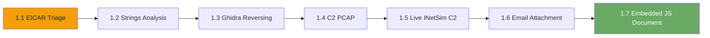

# Chapter M1: Review

## What You Learned

Over seven labs you followed one intrusion from a quarantined email attachment
to a live command-and-control beacon, then closed the loop with an email that
started another and a document whose embedded script pointed back at the same
kind of infrastructure. The samples changed, the tools changed, and the evidence
changed, but the analytical method stayed the same:

1. Acquire the evidence without executing it.
2. Identify what you have before you analyse it.
3. Start with the cheapest technique that can answer the question.
4. Escalate to code analysis or live capture only when the cheap technique
   cannot.
5. Record indicators in a form another analyst can act on.

By the final lab you were extracting a payload from an Office package,
identifying its beacon configuration, and proving from a live capture that the
traffic was command-and-control rather than a legitimate update check.

## The Progression You Followed

| Exercise | Evidence | Technique | What You Recovered |
|----------|----------|-----------|--------------------|
| 1.1 | `samples.zip` | Quarantine handling, `file`, `sha256sum`, `clamscan` | Sample identity and analyst note |
| 1.2 | `svchost.dmp` | `strings`, `grep` | C2 host, user agent, mutex, campaign tag |
| 1.3 | `halcyon-agent` | Ghidra decompiler, XOR | Runtime tasking key |
| 1.4 | `c2-capture.pcap` | Wireshark, `tshark` | Beacon URI, C2 IP, task key |
| 1.5 | Live tap stream | `nc`, `tcpdump`, Wireshark | Live beacon and task key |
| 1.6 | `case-email.eml` | Header analysis, MIME parsing, JavaScript review | Header token plus attachment marker |
| 1.7 | `malicious-invoice.docx` | OOXML package inspection, `unzip`, live capture | Embedded script configuration and task key |

Each lab built on the last:

- **Exercise 1.1** established the handling discipline. You never executed the
  sample, and you recorded a hash before analysis.
- **Exercise 1.2** showed how much configuration survives in memory and how far
  `strings` can take you.
- **Exercise 1.3** showed the limit of `strings` and introduced static code
  analysis as the next step.
- **Exercise 1.4** moved from the host to the wire and taught you to read a
  beacon from a capture.
- **Exercise 1.5** made the capture live and added containment through INetSim
  and observation through a network tap.
- **Exercise 1.6** returned to the delivery path and showed how headers and an
  attachment can each hold half of the answer. It also reinforced the rule
  that an attachment's extension is not its type.
- **Exercise 1.7** opened the document package itself and showed that a DOCX
  can carry script without a VBA macro. It combined static configuration
  recovery with the live-capture skills from Exercise 1.5.

## Self-Assessment

Answer these questions without looking at the answer key below. If you can
answer all nine confidently, you have internalised the core skills of this
chapter. If any question gives you trouble, revisit the corresponding lab.

1. Why do malware samples travel in password-protected ZIP files, and what is
   the standard password? *(Exercise 1.1)*

2. What does `file` tell you that a filename does not? *(Exercise 1.1)*

3. What is the difference between a network indicator and a host-based
   indicator? Give one example of each from Exercise 1.2. *(Exercise 1.2)*

4. Why does `strings` fail to recover a runtime-built key? *(Exercise 1.3)*

5. What are the four things an analyst records about a beacon? *(Exercise 1.4)*

6. Why does INetSim answer DNS for domains it does not own? *(Exercise 1.5)*

7. What does the network tap give you that `tcpdump` on the victim does not?
   *(Exercise 1.5)*

8. Why should you read the authentication headers before opening an attachment,
   and what did the attachment's true file type reveal? *(Exercise 1.6)*

9. Why can a DOCX carry executable script without containing a VBA macro, and
   which package part tells you where the script is? *(Exercise 1.7)*

## Answer Key

**1.** The password prevents mail gateways and endpoint scanners from opening
the archive automatically and forces a deliberate extraction decision. The
standard password is `infected`.

**2.** `file` reads the magic bytes and reports the actual format. A filename is
attacker-controlled and can claim to be a PDF or an image when the content is
an executable.

**3.** A network indicator is observable on the wire, such as the C2 host
`cdn-sync-update.com` or the beacon URI. A host-based indicator lives on the
endpoint, such as the mutex name or the file path the process ran from. Both
belong in the case notes because they support different hunts.

**4.** The plaintext never exists on disk. The bytes are stored XORed with a key
and rebuilt only when the decode routine runs, so `strings` sees ciphertext.

**5.** Destination, cadence, URI shape, and response content.

**6.** INetSim is a simulator, not a resolver. Answering every query with its
own address keeps the sample inside the lab instead of letting it reach the real
internet.

**7.** The tap mirrors all traffic on the lab bridge, so it sees every
container's conversation without installing tools on the victim. `tcpdump` on
the victim only sees that host's traffic and requires access to the host.

**8.** The headers show whether the message legitimately came from the domain it
claims. Here SPF failed, DKIM was absent, DMARC failed, and `Reply-To` used a
lookalike domain. The `.doc` attachment was actually HTML with a JScript block,
so the extension concealed the real format and the script was the payload.

**9.** A DOCX is a ZIP-based OOXML package, and embedded objects are ordinary
parts inside that package. A relationship in
`word/_rels/document.xml.rels` points at the object, which in this case is
`word/embeddings/beacon.js`. Macro scanning alone will not find it because the
payload is an embedded script, not VBA. Listing the package parts and reading
the relationship targets reveals it.

## Command Cheat Sheet

These are the commands and filters you used most often across the seven labs.

### Evidence handling

| Command | What It Does |
|---------|--------------|
| `curl -O http://<evidence>/<file>` | Download evidence |
| `file <file>` | Identify by magic bytes |
| `sha256sum <file>` | Record a stable fingerprint |
| `unzip -l archive.zip` | List archive contents safely |
| `unzip -P infected archive.zip` | Extract with the standard password |
| `clamscan <file>` | Scan with ClamAV |

### Static analysis

| Command | What It Does |
|---------|--------------|
| `strings <file>` | Print printable runs |
| `strings -n 8 <file>` | Print runs of at least 8 characters |
| `strings <file> \| grep -E 'pattern'` | Filter strings |
| `strings <file> \| grep -o 'OCR{[^}]*}'` | Extract the flag |
| `unzip -l package.docx` | List OOXML package parts |
| `unzip -p package.docx word/embeddings/beacon.js` | Print an embedded object |
| `olevba package.docx` | Check for VBA macros |
| `ghidra` | Start Ghidra |
| `python3 -c "bytes(b ^ 0x6b for b in data)"` | Apply a single-byte XOR |

### Packet analysis

| Command | What It Does |
|---------|--------------|
| `capinfos file.pcap` | Capture summary |
| `tshark -r file.pcap -q -z io,phs` | Protocol hierarchy |
| `tshark -r file.pcap -Y http.request` | Filter HTTP requests |
| `tshark -r file.pcap -Y 'http.host contains "..."'` | Filter by Host |
| `tshark -r file.pcap -Y dns -T fields -e dns.qry.name` | Extract DNS names |
| `tshark -r file.pcap -T fields -e http.request.uri` | Extract request URIs |
| `tshark -r file.pcap -T fields -e http.file_data` | Extract response bodies |
| `wireshark file.pcap` | Open the GUI |

### Live capture

| Command | What It Does |
|---------|--------------|
| `nc <tap> 9999 > live.pcap` | Stream the tap to a file |
| `nc <tap> 9999 \| tcpdump -r - -nn` | Read the stream live |
| `tcpdump -r live.pcap -nn -A 'port 80'` | Print HTTP payloads |
| `tcpdump -i eth0 -w out.pcap` | Capture on an interface |

### Useful Wireshark filters

| Filter | What It Shows |
|--------|---------------|
| `http` | HTTP requests and responses |
| `http.request` | Requests only |
| `http.host contains "cdn-sync-update.com"` | One C2 host |
| `dns.qry.name contains "cdn-sync-update.com"` | DNS lookups for a name |
| `tcp.stream eq 0` | One TCP conversation |
| `tcp.flags.syn == 1 && tcp.flags.ack == 0` | Connection attempts |

## Indicator Summary

The Halcyon Retail Group case produced the following indicators across the
chapter. A real case file would carry all of them into detection and hunting.

| Type | Value | Source |
|------|-------|--------|
| Domain | `cdn-sync-update.com` | 1.2, 1.4, 1.5, 1.7 |
| URI | `/api/v2/task.json` | 1.2, 1.4, 1.5, 1.7 |
| User agent | Halcyon updater string | 1.2, 1.4 |
| User agent | Microsoft Office/Word string | 1.7 |
| Mutex | Halcyon mutex name | 1.2 |
| Campaign tag | `HALCYON-2026-Q4` | 1.2 |
| File path | `C:\Users\Public` | 1.1, 1.2 |
| Document | `malicious-invoice.docx` (OOXML with embedded JS) | 1.7 |
| Beacon cadence | Short fixed interval | 1.5, 1.7 |

## Safe-Handling Checklist

Before you move on to another malware chapter, confirm you can do all of the
following without looking them up:

- [ ] Explain why samples are stored in password-protected archives
- [ ] Hash a sample before analysis and record the value
- [ ] Identify a file with `file` rather than trusting its extension
- [ ] Extract configuration from a memory image with `strings` and `grep`
- [ ] Explain when `strings` is not enough and code analysis is required
- [ ] Recover a single-byte XOR value with a short script
- [ ] Read a beacon from a PCAP and record its four indicators
- [ ] Capture live traffic from a network tap
- [ ] Inspect an OOXML package without opening it in Word
- [ ] Explain why a DOCX can carry script without a VBA macro
- [ ] Explain what INetSim is for and why ranges use it

---

*End of Chapter M1. Continue to the next chapter when you are ready.*

## Free practice and certification next steps

These optional free resources match this chapter. They do not replace the
lab or this workbook.

- **TryHackMe** — guided malware-analysis rooms: <https://tryhackme.com/>
- **KC7 Cyber** — free investigation cases for suspicious activity: <https://kc7cyber.com/>
- **ISC2 Certified in Cybersecurity** — free entry-level training and exam pathway: <https://www.isc2.org/landing/1mcc>

See [Free training and certifications](../FREE-TRAINING-AND-CERTIFICATIONS.md)
for the full map and the privacy note.
