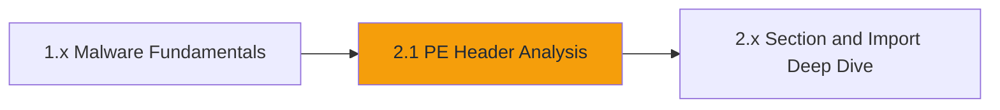

# Chapter M2: Executable Analysis

## From Documents to Binaries

Chapter M1 ended with an email attachment that pretended to be a Word
document. This chapter moves to the other common delivery: a Windows
executable. The file may arrive in a ZIP, a download, a scheduled task, or a
backup. Before you run it, the file format itself answers a lot of questions.

Portable Executable (PE) is the container Windows uses for `.exe`, `.dll`,
`.sys`, and many other files. It is a structured format: a DOS header points at
a PE header, the PE header describes the machine and optional metadata, a
section table maps code and data, and data directories point at imports,
resources, and signatures.

An analyst who can read those structures can tell architecture, build time,
entry point, section layout, and imported behaviour without executing a single
instruction.

---

## What You Will Learn

Chapter M2 begins with one lab and builds outward from the format:

- Confirm a file is a PE and identify its target architecture
- Read the COFF timestamp and entry point
- Map the section table and explain `.text`, `.rdata`, and `.data`
- Walk the import directory and identify file and network APIs
- Locate an encoded marker in a section and decode it

---

## How the Labs Work

The pattern is the same as Chapter M1:

1. Launch the exercise and open the REMnux desktop.
2. Read the scenario.
3. Pull the sample from the evidence server with `curl`.
4. Analyse the copy. Never execute it.
5. Record indicators and recover the analyst flag.

> **Safety first.** The sample is synthetic. The habit is real: hash the
> original, work from a copy, and treat every executable as hostile.

---

## Connection Details

| Exercise | Evidence | What you pull |
|----------|----------|---------------|
| 2.1 | Evidence server (offset 45) | `halcyon_agent.exe` (PE32) |

The evidence server is listed under **Target Hostnames** on the launch page.

---

## Lab Progression

Chapter M2 starts with the container. Later exercises will build on the same
sample and move into code, behaviour, and detection.
