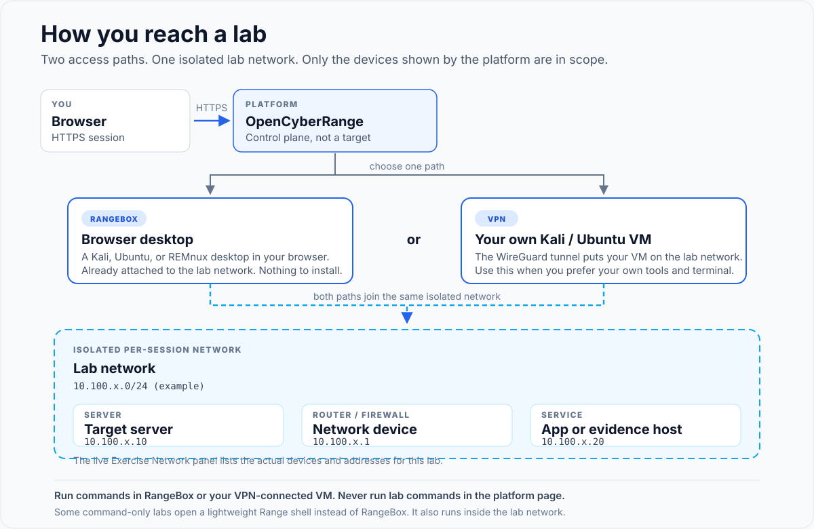

# Exercise 0.1 -- Ping Basics

!!! note "Lab"
    Launch **Can You Reach It? Ping Fundamentals** in the platform before
    starting. Use the target address shown in the exercise.

## Quick Start (5 Minutes)

1. Launch the lab and wait for **Running**.
2. Open the lightweight **Range shell** at `http://shell.lab:7681` (login
   `learner` / `trailguard`), or use your VPN-connected terminal. This shell has
   `ping`, `curl`, and `nmap`; it does not start a full desktop.
3. Copy the target address from **Active Lab View**. It is also shown as
   `intranet-portal`.
4. In the shell or terminal, replace `<target>` with that address:

   ```bash
   ping -c 4 <target>
   curl -s http://<target>/ | grep -o 'OCR{[^}]*}'
   ```

5. Submit the flag.

If ping replies but `curl` fails, check that you used `http://` and the target
from the panel, not the example address. If ping fails, read the next section
before assuming the host is down.



**This lab uses the Range shell** shown in step 2. The shell is a small
container inside the lab network, so `ping` and `curl` reach the target exactly
as they would from RangeBox. If you prefer your own tools, use the VPN path
instead. The platform page is not a target.

!!! note "Example IP addresses"
    The output examples use `10.100.13.10` from the reference lab subnet. The
    platform assigns each student session its own `/24` and shows it in the
    **Active Lab View**. If your session uses a different subnet, substitute
    your address. Static examples are not updated when the range changes.

## Background

`ping` sends an **ICMP echo request** and waits for an **echo reply**. It is the
simplest reachability test on an IP network.

ICMP is a helper protocol, not a transport protocol like TCP or UDP. It carries
diagnostic messages. A reply tells you the host's network stack is alive; it does
not tell you that a web server, database, or application is healthy.

## Tool Primer

### Linux and macOS

```bash
ping -c 4 <host>
```

- `-c 4` sends four requests and stops.
- Without `-c`, ping runs until you press `Ctrl+C`.

### Windows

```cmd
ping -n 4 <host>
```

- `-n 4` sends four requests.

### Reading the output

```text
64 bytes from 10.100.13.10: icmp_seq=1 ttl=64 time=0.42 ms
```

| Field | Meaning |
|---|---|
| `icmp_seq` | Sequence number of the request |
| `ttl` | Remaining Time To Live |
| `time` | Round-trip time in milliseconds |

The summary line is the most useful part:

```text
4 packets transmitted, 4 received, 0% packet loss
rtt min/avg/max/mdev = 0.380/0.402/0.420/0.015 ms
```

## Walkthrough

### Warm-up: predict before you run

Write one sentence in your notes: if `ping -c 4 <target>` returns `0% packet
loss`, what does that prove? What does it not prove? You will compare your
answer after Step 3.

### Step 1: Ping the portal

```bash
ping -c 4 <target>
```

**Record:**

| Measurement | Your value |
|---|---|
| Packets transmitted | |
| Packets received | |
| Packet loss | |
| Round-trip time (avg) | |

**Checkpoint.** You should see four replies and a summary with `0% packet loss`.
If you see `100% packet loss`, stop and check that the lab is **Running**, the
target is copied exactly, and you are in the RangeBox or VPN terminal. Do not
guess the flag.

### Step 2: Interpret the result

- Did every request receive a reply?
- Was the round-trip time stable or variable?
- What would 25% packet loss look like in the summary?

### Step 3: Check the service

Ping tests the host, not the service. Open the maintenance page:

```bash
curl http://<target>/
```

or open `http://<target>/` in a browser.

**Record:** what does the page say about host reachability versus service
availability?

### Step 4: Capture the flag

```bash
curl -s http://<target>/ | grep -o 'OCR{[^}]*}'
```

Submit the flag in the platform.

## Analysis Questions

Answer at least two; the rest are practice.

**1. What did the ping reply prove?**

**2. What did the ping reply not prove?**

**3. If ping succeeded but the page failed, what would you check next?**

**4. If ping failed but the page loaded, what could explain that?**

**5. Why might a firewall block ping while allowing HTTP?**

## If You Get Stuck

| Symptom | What to check |
|---|---|
| `ping: cannot resolve <target>` | You copied the placeholder. Use the IP from Active Lab View. |
| `100% packet loss` | Lab not **Running**, wrong target, or not on the lab network. Re-copy and retry. |
| `curl: (7) Failed to connect` | Try `http://`, not `https://`; confirm the target is **Running**. |
| The flag is rejected | Copy the whole `OCR{...}` value; it is case-sensitive. |

## Key Takeaways

- `ping` uses ICMP echo requests and replies.
- A reply proves the host is reachable, not that a service is running.
- Packet loss and latency are separate signals from "up" or "down."
- Good troubleshooting separates the network path, the host, and the service.

## Next Step

Continue to **Exercise 0.2 -- DNS Basics** to learn how names become addresses.
