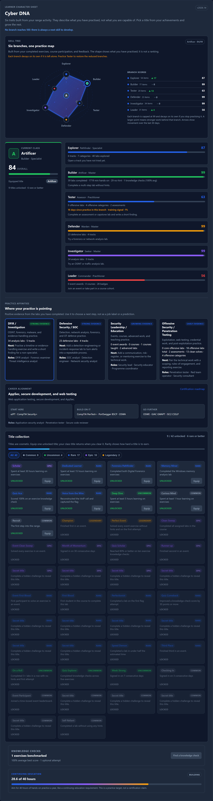
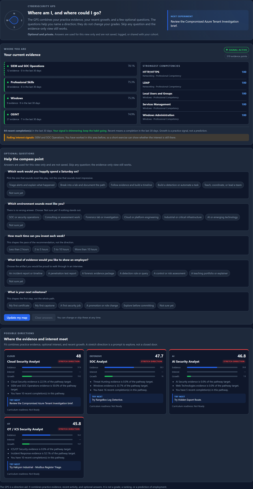

# SWOCTS Cyber Range Workbook

SWOCTS Cyber Range is powered by OpenCyberRange.

Welcome to the SWOCTS Cyber Range student workbook. Each exercise walkthrough guides you step by step, explains the underlying concepts, and prompts you to record and interpret your findings.

!!! note "AI-assisted content"
    Parts of this workbook were drafted with AI assistance and reviewed by a
    human maintainer. Verify every command, target, and flag against the running
    lab before relying on it. See `BUILD_NOTICE.md` in the repository root for
    attribution and the full AI-assistance disclosure.

!!! note "Example IP addresses"
    The walkthrough examples use `10.100.13.0/24`, the subnet in the reference
    setup. The platform assigns each student session its own `/24` and shows it
    in the **Active Lab View**. If your session uses a different subnet,
    substitute your address in every command. Workbook examples are static and
    may not reflect later changes to the address range.

## Your learning evidence

The workbook is the guided practice; the platform records what you did with it.
Your evidence is descriptive, not a grade:

- **Progress:** completed exercises, the next exercise, and course progress.
- **Cyber DNA:** six practice traits (Explorer, Builder, Tester, Defender,
  Investigator, Leader) and positive practice affinities. The Tester trait
  records authorised offensive practice in the isolated labs; it is not a
  licence to test real systems.
- **Knowledge checks:** optional benchmark practice with explanations and
  references. Never an exam or a gate.
- **Achievements:** badges for clean solves, persistence, and learning
  milestones.
- **Celebration Wall:** voluntary, anonymous appreciation from other signed-in
  users. It is not a leaderboard and does not affect any metric.
- **Privacy:** your profile and survey participation are controlled by you. See
  the student manual's privacy page.

<figure markdown>

<figcaption>Cyber DNA is the learner character sheet. Branches grow with strong practice, decay slowly when a branch goes quiet, and recover when you return.</figcaption>
</figure>

The **Cyber GPS** on the profile's Careers tab shows whether your practice
signal is active or fading and names domains you have worked in before as
fading interest signals. It is a prompt to revisit, not a ranking.

<figure markdown>

<figcaption>The Cyber GPS signal is based on completions in the last 30 days. A fading domain is a subject you have already invested in, not a failure.</figcaption>
</figure>

Use the workbook to build the habit; use the platform evidence to see the
practice accumulate.

## Available Tracks

<!-- BEGIN GENERATED WORKBOOK CURRICULUM -->
The workbook curriculum is generated from `curriculum-manifest.yaml`.
Every published chapter has a stable display ID, a physical directory, a
prerequisite chain, an exercise count, an estimated duration, and a
recommended next step.

Exercise counts are labs that expose a workbook page. The platform also
contains labs without a workbook page; see [Workbook coverage](COVERAGE.md).

See the [framework alignment](FRAMEWORKS.md) for the selective mapping.

| Track ID | Display name | Audience | Difficulty | Prerequisites | Exercises | Duration | Status |
|---|---|---|---|---|---:|---|---|
| `high-school` | Beginner Cybersecurity | New learners with everyday computer experience and no assumed cybersecurity background. | beginner | None | 18 | 7h 00m | published |
| `netfor` | Network Security | Beginner-to-intermediate learners who need network foundations, log analysis, and packet evidence. | beginner | BEG04 | 17 | 15h 00m | published |
| `webpt` | Web Application Security | Intermediate learners who can use a terminal and understand HTTP basics. | intermediate | NET00, NET01 | 16 | 21h 35m | published |
| `software-security` | Software Security | Intermediate learners who can read code and understand web requests. | intermediate | WEB02 | 2 | 30m | published |
| `malware` | Malware Analysis | Intermediate learners with networking and forensic evidence experience. | intermediate | NET02, FOR01 | 8 | 6h 15m | published |
| `forensics` | Digital Forensics | Intermediate learners who want to investigate memory and network evidence. | intermediate | NET02 | 2 | 1h 35m | published |
| `osint` | OSINT | Beginner-to-intermediate learners who want public-source investigation skills. | beginner | NET00 | 8 | 4h 05m | published |
| `identity` | Identity & Access | Intermediate learners interested in authentication, federation, and account lifecycle. | intermediate | NET00 | 3 | 2h 15m | published |
| `ot` | OT/ICS Security | Intermediate learners interested in industrial control systems and Modbus. | intermediate | NET00 | 2 | 1h 25m | published |
| `ai` | AI Hacking | Intermediate learners exploring prompt injection, policy bypass, and AI-assisted security. | intermediate | WEB02 | 3 | 1h 50m | published |
| `winpt` | Windows Penetration Testing | Intermediate learners who have completed the beginner pathway or have equivalent terminal and networking experience. | intermediate | BEG04, NET00 | 51 | 102h 00m | published |
| `linpt` | Linux Fundamentals | Intermediate learners building Linux enumeration, SSH access, privilege escalation, and detection skills. | intermediate | WIN09 | 30 | 38h 45m | published |

**Total:** 160 exercises across 12 tracks and 43 chapters.

See the [full curriculum map](CURRICULUM.md) and the [cross-curriculum terminology](TERMINOLOGY.md).

Recommended pathway:

`BEG01` → `BEG02` → `BEG03` → `BEG04` → `NET00` → `NET01` → `NET01B` → `NET02` → `NET03` → `WEB01` → `WEB01B` → `WEB02` → `WEB02B` → `WEB03` → `SWSEC01` → `MAL01` → `MAL02` → `FOR01` → `FOR02` → `OSINT01` → `OSINT02` → `IAM01` → `OT01` → `OT02` → `AI01` → `WIN01` → `WIN02` → `WIN03` → `WIN04` → `WIN05` → `WIN06` → `WIN07` → `WIN08` → `WIN09` → `LIN01` → `LIN01B` → `LIN02` → `LIN02B` → `LIN03` → `LIN03B` → `LIN04` → `LIN05` → `LIN09`
<!-- END GENERATED WORKBOOK CURRICULUM -->

## How to Use This Workbook

See [Workbook coverage](COVERAGE.md) for the generated list of labs that expose
a workbook and the current count per track.

1. **Launch an exercise** in the SWOCTS Cyber Range platform
2. **Click the Workbook button** to open the walkthrough for that exercise
3. **Follow the steps** in the walkthrough while working in your terminal or the
   in-browser RangeBox desktop
4. **Record your findings** in the spaces provided
5. **Answer the analysis questions** to deepen your understanding

Each walkthrough includes background concepts, tool primers, guided steps, and analysis questions. The chapter reviews provide self-assessment quizzes and command cheat sheets.

### Reading the workbook in the RangeBox workspace

On a desktop, the exercise page keeps the RangeBox, the briefing, the flag
panel, and the workbook in one workspace. The workbook is the full-width pane
under the desktop. It hides the wiki header and sidebars, uses the full width for
the article, and scrolls on its own, so you can read a step and keep the desktop
open at the same time.

<figure markdown>

<figcaption>The workbook pane in the workspace. Use the pane's own scrollbar to move through the walkthrough while the RangeBox stays open.</figcaption>
</figure>

Use **Expand** to make the workbook pane taller. Use **Open in new tab** if you
prefer a separate reading tab. Use **Pop out** on the RangeBox to move the
desktop into its own window; the main tab then keeps the briefing, notes, and
workbook in view.

### Copying a flag from the desktop

When you find a flag inside the RangeBox, copy it as text. The in-window flag
field captures an `OCR{...}` value from the desktop clipboard automatically. If
the guest clipboard does not propagate, use **Paste** in the flag panel or press
Ctrl+V in the field. The field keeps only the flag value when you paste a whole
log line or shell prompt.

!!! warning "Text only"
    Files cannot leave or enter the RangeBox. The clipboard is text-only, and
    file drops and file pastes are rejected. Record your evidence as text and
    screenshots outside the desktop, or use the workbook's recording prompts.
